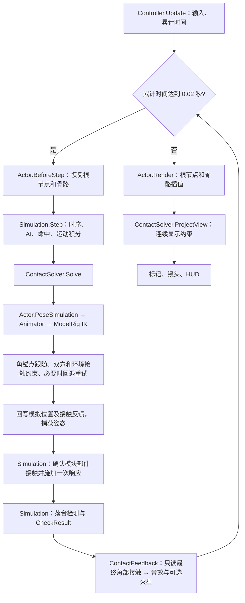

# BugDuel 项目地图

> 根据当前代码核对：2026-10-14。本文描述现有实现；修改模块职责、调用顺序或状态写入者时，同步更新本文。
> 下文目录均相对于 BugDuel 项目根目录，核心游戏代码位于 `Assets/BeetleArena/`。

游戏设计：[Design Intro.md](Design%20Intro.md)，说明玩家体验、玩法循环、激励、交锋节奏、六档撬飞、擂台与视听方向；不涉及技术实现。

扩展框架：[Framework.md](Framework.md)，说明养殖领域、物种与环境定义、参赛快照、名册事务、存档、内容 JSON 更新及新模型接入边界。

单机经营：[Campaign.md](Campaign.md)，GDD v2 的完整入口与主流程。打开 `Assets/Scenes/Campaign/CampaignMainMenu.unity` 运行，包含四存档槽、温室、独立捕虫队与市场、联赛和冠军拍卖；现有战斗演示场景保留。

配套阅读：[TechnicalGuide.md：关键技术说明](TechnicalGuide.md)，详细介绍真实模型绑定、六足 IK、程序步态、接触求解、托举挣扎与运动连续性。

动作扩展：[MotionModules.md](MotionModules.md)，包括模块增删、接口、状态归属与研究依据；虚晃垫步/顶角冲击调参见技术说明第 17.7 节。

动画制作目标：[Aim.md](Aim.md)，维护特别推荐的关键帧动作、制作优先级、接入边界与验收进度；计划内容不等于已实现。

改动历史：[CHANGELOG.md](CHANGELOG.md)，按带时区时间戳追加记录。

## 1. 项目入口与结构

这是一个使用真实甲虫模型的自动格斗游戏。玩家只能鼓励选手，双方自主选择动作；落台或台内倒地连续 5 秒未能翻正判负，时限到达时双方平局。单局含开场与击败展示最多三分钟（暂停除外），平均约90秒为调参目标。

| 项目项 | 位置 / 当前实现 |
| --- | --- |
| Unity 版本 | `ProjectSettings/ProjectVersion.txt`：6000.3.16f1 |
| 渲染与输入 | URP 17.3.0、Input System 1.19.0；版本声明在 `Packages/manifest.json` |
| 游戏场景 | `Assets/Scenes/BeetleArena.unity` |
| 运行入口 | 场景中的 `BeetleMatchController.Start()` 和 `Update()` |
| 比赛参数资产 | `Assets/BeetleArena/Generated/MatchSettings.asset` |
| 源模型 | `Assets/bug.fbx`，贴图位于 `Assets/bug.fbm/` |
| 生成的甲虫预制体 | `Assets/BeetleArena/Generated/ArticulatedBeetle.prefab` |
| 生成的模型资源 | `Assets/BeetleArena/Generated/ImportedModel/` |
| 原有使用说明 | `Assets/BeetleArena/README.md` |
| 验证报告与截图 | 项目根目录的 `Artifacts/` |

当前 `Start()` 调用 `SelectArena(0)`，默认平地木桩；T 键或换场按钮切换擂台，并用当前种子重新开局。
当前共四张擂台：平地木桩、起伏岩台、半圆槽、起伏圆槽。C 在全景与两只虫各自上方的跟随视角间循环，V 开关击败近景慢放。

2026-10-14 增量：`BeetleCombatUpgrade` 安装双骨颈膜、头部/下颚地形采样、镜头按钮与 `HornSurgeMotion`。`BeetleTraits` 生成四项整数评分和正态总分；`BeetleMotionRuntime` 统一后足所有权，动画器协调步态交替。接触求解器回写实际接受朝向，并检测有运动意图却无位移的卡角；脱困仍经过碰撞与位移预算。`BeetleMatchController` 持有击败慢放时钟，`ArenaCamera` 只管理取景，不改变胜负状态。
后续独立行为修复：每只 `BeetleState` 拥有独立决策随机流、交锋阶段、决策节奏和脱困冷却；总览 `Exchange` 只用于展示。稳定行为偏好调整推顶/侧顶/撬举权重和幅度，反击也进入个体模块选择。`ContactSolver` 保留本步最终接受提案的真实角碰记录，普通命中在该次求解之后计算；详见技术说明末尾与 `BeetleIndividualityValidation`。

```text
Assets/BeetleArena/
├── Runtime/
│   ├── Actors/          场景入口、更新调度、状态与模型的适配
│   ├── Simulation/      战斗规则、状态机、动态状态、托举反馈
│   ├── Configuration/   参数定义与合法范围
│   ├── Animation/       程序动作、步态、姿态快照与插值
│   ├── Motion/          Core：动作契约/实例宿主；Modules：独立动作资产
│   ├── Rig/             真实模型的骨骼绑定与 IK
│   ├── Physics/         碰撞查询、接触约束、托举锚点、连续性限制
│   ├── Environment/     擂台支撑查询、贴地标记
│   ├── Presentation/
│   │   ├── Display/    画面效果、分场景配置
│   │   ├── Cameras/    镜头、取景快照
│   │   ├── UI/         HUD、设置、滑块、导航
│   │   ├── Audio/      战斗声音、按钮与滑块点击声
│   │   ├── Husbandry/  养殖姿态、游走、足部与容器空间
│   │   └── CombatFeedback/ 接触反馈、火星
│   └── Diagnostics/     独立运行检查
├── Editor/
│   ├── Model/           按当前 FBX 生成骨架、蒙皮和碰撞代理
│   ├── Setup/           生成场景、安装擂台、配置卡通材质
│   ├── Validation/      规则、模型、地形、接触和连续性验证
│   └── Automation/      编辑器命令与批处理入口
├── Shaders/             BeetleToon.shader
└── Generated/           生成的预制体、配置、网格和材质
```

### 场景 Hierarchy 分组

```text
00 Systems                 Match Director、Contact Audio
10 Fighters                两只真实模型甲虫（骨骼内部结构保留）
20 Arenas                  Flat stump arena、Uneven rock arena
  Flat stump arena
    00 Surface and Collision
    10 Growth Rings
    20 Bark Ridges
    30 Rim Marks
30 Environment             Forest ground、Forest Stones
40 Camera and Lighting     Spectator Camera、两盏环境灯
50 UI                      Spectator HUD、Event System
```

`Editor/Setup/BeetleSceneHierarchy.cs` 提供 `Tools > 甲壳虫斗 > 场景与安装 > 整理场景层级`，在非 Play 的正式场景中增量整理、支持撤销并保存。根分组使用单位变换，换父节点保留世界姿态。甲虫骨骼、碰撞体组件及 HUD 内部布局不拆动。

`Build Game Scene` 和 `Install Switchable Arenas` 保存前调用同一整理方法，避免重新生成后散乱。验证工具用场景限定的子层级查找获取控制器，不能假定 Match Director 仍在根目录。未知自定义对象不会按猜测归类。

## 2. 核心模块各自负责什么

以下文件名均在上面对应目录中。

| 模块 | 主要文件 | 职责与边界 |
| --- | --- | --- |
| 场景协调 | `Actors/BeetleMatchController.cs` | 检查引用、开局、切换擂台、转发输入；在 `Update()` 中累计时间并运行固定步；通过 `AdvanceFixedStep()` 和 `Present()` 统一正式游戏与自动化顺序；安排 HUD 刷新。 |
| 选手适配 | `Actors/BeetleActor.cs` | 将一份 `BeetleState` 绑定到一只模型；恢复固定步根节点和骨骼、调用程序动画、捕获结果、插值显示。自身不决定攻击或胜负。 |
| 战斗模拟 | `Simulation/BeetleSimulation.cs` | 保存两位选手和本局随机源；负责 AI、动作转换、体力、鼓励、命中、速度积分、托举时序、掉台标记与结果。通过接口调用场景接触求解。 |
| 能量与局势 | `Simulation/BeetleEnergyPolicy.cs`、`BeetleTactics.cs` | 耐力/爆发余量、恢复抑制与接触压力；只读局势快照产生施压/反击/防守/换位/恢复建议，模拟保留切换和写状态权。 |
| 招募动画曲线 | `Motion/Core/InsectMuscleAnimation.cs` | 提供加载、短促启动、摆腿与行进启停曲线；无随机源和状态写入，不求解真实肌肉力。 |
| 状态定义 | `Simulation/BeetleState.cs`、`BeetleLiftResponse.cs` | 定义个体属性、动态状态、三层状态枚举、托举数据和比赛事件。数据对象本身不运行更新循环。 |
| 杠杆撬投 | `Simulation/BeetleThrowMechanics.cs` | 根据有效接触与实际抬头运动累计功、冲量，按质量和切向方向计算连续出手速度与仰角，再划分六档反馈；只提供计算，由模拟决定何时释放。 |
| 参数 | `Configuration/BeetleMatchSettings.cs` | `ScriptableObject` 参数定义及 `Validate()`；包括体型、节奏、移动、地形支撑足位、托举、挣扎、挑飞和接触位移预算。 |
| 程序动画 | `Animation/BeetleProceduralAnimator.cs` | 把动作状态转换为身体/头角姿态和六足目标；管理世界空间落脚点、迈步、落地衔接、逐渐加快的挣扎；调用真实模型 IK。接触求解器可要求头角/腿局部退让。 |
| 动作扩展 | `Motion/Core/BeetleMotionModule.cs`、`BeetleMotionRuntime.cs`、`Motion/Modules/` | 只读上下文输入，输出身体/脚端/移动/接触意图。每只甲虫保存自己的活动模块、计时、冷却与命中锁；具体动作仅由配置列表注册。 |
| 姿态插值 | `Animation/BeetlePoseBuffer.cs` | 保存前后两个固定步的模型局部姿态，供显示帧插值；开始下一固定步前恢复最新模拟姿态。 |
| 模型 IK | `Rig/BeetleModelRig.cs` | 使用模型标定的骨长、静止旋转、弯曲方向和足底偏移求解髋/膝/踝旋转；处理可达范围、足节朝向与触角避地。 |
| 接触求解 | `Physics/BeetleContactSolver.cs` | 组织双方姿态、角下托举跟随、甲虫互碰和环境碰撞；限制整步位移；中心轴分离失败时，沿接触法线的水平分量重试完整及缩小的姿态提案；写回模拟位置与接触反馈。另有独立的显示约束入口。 |
| 碰撞代理 | `Physics/BeetleContactRig.cs` | 保存部件 Collider、角色分类及 AABB 缓存，提供整体平移；不负责战斗决策。 |
| 托举几何 | `Physics/BeetleHornSupport.cs` | 捕获并跟随真实角部局部锚点；在最终接受姿态上测量抬头、力臂与切向运动，交给撬投计算层。托举是否继续由模拟状态决定。 |
| 姿态试算 | `Physics/BeetleContactMotion.cs` | 保存安全起点和候选姿态，按比例恢复/推进；求解器分别持有模拟用和显示用实例。与用于固定步插值的 `BeetlePoseBuffer` 分工不同。 |
| 擂台支撑 | `Environment/BeetleArenaSurface.cs` | 实现地表高度、法线、抓地系数查询；区分可站立的 `supportColliders` 与完整环境 `contactColliders`。 |
| 展示 | `Presentation/UI/BeetleArenaHud.cs`、`Presentation/Cameras/ArenaCamera.cs`、`Presentation/Audio/ArenaAudio.cs`；`Environment/BeetleGroundMarker.cs` | 读取结果并展示；HUD 将按钮请求转交控制器；镜头、声音和贴地标记不参与胜负计算。 |
| 接触表现 | `Presentation/CombatFeedback/BeetleContactFeedback.cs`、同目录的 `HornClashSparks.cs`、`Presentation/Audio/ArenaAudio.cs`、`Presentation/UI/BeetleFeedbackSettings.cs` | 固定步后只读角部接触；分别输出高阻尼木质合成敲击/刮擦、可关闭的兵器火星；设置开关保存到 PlayerPrefs，不修改比赛参数。 |
| 卡通渲染 | `Shaders/BeetleToon.shader`、`Editor/Setup/BeetleArenaToonSetup.cs` | 描边、高光、颜色和阴影的渲染及材质配置，不参与碰撞。 |
| 资源构建 | `Editor/Model/BeetleImportedModelBuilder.cs`、`Editor/Setup/` | 从模型生成关节、蒙皮副本、碰撞代理和材质，装配游戏场景及擂台。仅在编辑器执行。 |
| 验证与自动化 | `Editor/Validation/`、`Editor/Automation/`、`Runtime/Diagnostics/ArenaStandaloneSmoke.cs` | 驱动受控场景/对局，检查规则、接触、动作连续性和资源；输出报告，不承担正常对局逻辑。 |

### 两个容易误解的实现点

- **真实模型不是直接播放 FBX 动画。** 当前 FBX 有 22 个静态网格部件，构建器按部件显式标定并生成关节/蒙皮；运行时程序动画和 IK 驱动它。更换 FBX 必须检查 `BeetleImportedModelBuilder` 的部件编号、坐标转换、关节与代理，不能只替换文件。
- **物理不是动态刚体自由格斗。** 每只甲虫使用运动学 Rigidbody 与不可见查询代理。`Physics.ComputePenetration` 提供重叠方向/深度，自定义模拟和求解器负责位移、速度及接触响应；没有逐足摩擦力或肌肉动力学求解。

## 3. 一次操作从入口到结果经过哪些模块

### 3.1 开局

```text
BeetleMatchController.Start()
  → settings.Validate()、SelectArena(0)、hud.Bind(this)
  → 选择种子 → StartMatch(seed)
      → 解绑旧模拟事件，创建 BeetleSimulation 与两份 BeetleState
      → SetGround(ActiveSurface)，绑定本局事件
      → 两个 BeetleActor.Bind(state, settings, surface)
          → 初始化程序动画 / 模型 Rig / 姿态缓存
      → 创建 BeetleContactSolver，赋给 Simulation.ContactSolver
      → Contacts.Solve(simulation, 0)：处理初始接触并捕获姿态
      → 重置镜头，发出 MatchChanged，刷新 HUD
```

换局会新建模拟和接触求解器，重建本局状态、锚点及接触姿态缓存；Actor 场景对象被重新绑定。

### 3.2 每个固定模拟步与显示帧

固定步长为 **0.02 秒**。调度发生在控制器的 `Update()` 累积时间循环中，并非 Unity 的 `FixedUpdate()` 自动驱动本模拟。

**唯一业务调度入口：** `AdvanceFixedStep()` 执行 `Actor.BeforeStep → Simulation.Step → ContactFeedback.Tick`；`Present(alpha, time, dt)` 执行 `Actor.Render → Contacts.ProjectView → Camera.Tick`。Editor 快进和独立运行检查也调用这两个方法。暂停或零显示 dt 时保留最后接受姿态；HUD 独立刷新。低层验证仍可拆开调用，以检查模拟与表现是否隔离。




`Step()` 正常战斗分支内的顺序是：MotionTime 与模块计时更新 → 个体交锋阶段更新 → 托举时序更新 → 冷却/动作计时与 AI → 积分移动 → 当前姿态接触求解 → 缓存双方命中并应用 → 模块真实接触响应 → 掉台标记 → 胜负结算。新命中冲量进入下一固定步积分。

所有固定步先推进 `MotionTime` 和模块宿主；倒计时分支随后推进倒计时；结束后仍积分已落台甲虫并执行接触求解；`BeetleFallResponse` 用独立固定步时钟继续寻触、跌落、地面缓冲和撑起，`HasFallen` 不代表死亡或停止动画。

**关键时序约束：** `BeforeStep()` 必须同时恢复根节点与骨骼，避免上一个显示帧的插值位置参与固定步求解。普通攻击在本步 `PoseSimulation()` 与碰撞接受之后检查命中；求解器保留该次被接受提案的真实角部碰撞记录，避免分离间隙使攻击漏判。显示投影和被拒绝重试不能产生命中记录，也不得把显示修正回写 `BeetleState`。

### 3.3 玩家按 Q / E 鼓励

1. 键盘由 `BeetleMatchController.Update()` 读取；按钮由 `BeetleArenaHud.Bind()` 注册回调，两者都进入 `Cheer(index)`。
2. 控制器拒绝暂停状态下的请求，再调用 `Simulation.Encourage(index)`。
3. 模拟检查比赛阶段、索引、冷却、落台和腾空状态。接受后修改鼓励持续时间、冷却和体力，返回 `true`。
4. 模拟同步发出 `EventRaised(ContestEvent)`；控制器更新 `LatestEvent`，更新展示文案。碰撞音效改由固定步后的实际角部接触驱动。
5. 控制器刷新 HUD；后续固定步的战斗规则读取鼓励效果。鼓励不会直接指定移动方向或招式。

### 3.4 自动顶举 → 承重 / 挣扎 → 加速扬角撬投 → 结果

1. `Simulation.Think/Decide` 选择 `PryWindup → Pry`。命中检测结合动作窗口、朝向、距离、高度差及接触信息。
2. `ApplySupportedPry()` 经 `IBeetleLiftContacts.TryBeginLift()` 请求真实角下接触；`BeetleHornSupport.TryCapture()` 保存攻守双方的局部锚点。捕获失败不能退化成隔空向上冲量。
3. 满足托举条件后，模拟写入受击者的 `Lift.Supporter`、时长和方向等数据，设置攻击者 `Lifting`、受击者 `Lifted`；本次额外爆发意图保存在 `BurstEffort`，同时生成抬头幅度、承重时间与末段加速时长。普通成功顶举也会抛出。
4. 固定步中，程序动画扬角并逐步改变受击者身体/六足姿态；锚点跟随和接触约束决定根节点的实际移动。位移过大或残余穿透不合格时，缩小姿态推进量并重试。
5. 求解器用真实脚尖判断失去支撑，维护 `GripReleased`、`UnsupportedTime`；动画读取这些状态。默认离地满 0.7 秒后，挣扎频率在 1.1 秒内由 0.65 Hz 平滑升到 3.2 Hz，相位使用频率曲线的积分。
6. 接触层在最终接受姿态上调用 `HornSupport.Measure()`，测量真实抬头角增量、接触力臂、切向方向和贴合程度；`BeetleThrowMechanics.Accumulate()` 累计有效接触时长、冲量和做功，显示帧及被拒绝的试算不会累计。
7. 模拟按慢抬—短暂承重—加速扬角的节奏推进，满足出手、滑脱、受阻或中断条件时释放。已有效离地并有足够做功者调用 `ThrowOpponent()`：根据功、冲量、质量及接触切线计算连续出手速度；达到转角/能量/角速度门槛才允许身后反抛。未建立有效托举的失败入角会退出，不能隔空发射。
8. 成功出手使用 `Toss` 跟随姿态，失败撤角使用 `ReleaseLift`；二者均从实际头角/身体姿态接续，求解器继续防穿透。释放只写速度，不直接改根坐标。
9. 接触修正完成后，模拟按台面支撑和相对落差设置 `HasFallen`。`CheckResult()` 进入双落台等待，再设置胜者或平局；HUD 消费结果；落台文案不触发角部碰撞声。

`Airborne` 也用于托举阶段，不等于六足已经全部离地；挣扎计时不能直接使用进入 `Lifted` 的动作时间。普通空中挣扎不向战斗模拟施加推进力。

### 3.5 切换擂台 / 重赛 / 暂停

| 请求 | 调用链与结果 |
| --- | --- |
| T / 换场按钮 | `SwitchArena()` → `SelectArena()` 启停擂台并替换环境 Collider → `StartMatch(当前种子)`。会重开，不是保留原坐标继续打。 |
| 重赛按钮 | `Rematch()` 仅在结束后调用 `StartMatch(当前种子)`，重新生成同种子阵容。 |
| R / 下一场按钮 | `NextMatch()` 仅在结束后计算下一种子，再开新局。 |
| 空格 / 暂停按钮 | `TogglePause()` 修改控制器的 `IsPaused`；其 `Update()` 使用零增量停止模拟时间推进，不修改全局 `Time.timeScale`。 |

## 4. 关键状态由谁保存、谁能修改

**以下“写入者”是当前正常运行路径的职责划分，并非全部由 C# 访问修饰符强制保证。** `BeetleState` 大多是公开字段；`readonly Fighters` 也不使数组元素或选手数据不可变。验证代码可以直接布置状态，业务代码应遵守下面的写入边界。

| 状态 | 保存位置 | 正常写入者 | 读取者 / 约束 |
| --- | --- | --- | --- |
| 比赛阶段、时间、胜者、交锋阶段、随机源 | `BeetleSimulation` | 模拟构造函数与 `Step()` 内部逻辑 | 控制器、HUD、镜头、验证工具；`Phase/Winner/Exchange` 对外只有公开 getter。 |
| 动作时钟 | `Simulation.MotionTime` | `Step()`，包括倒计时和比赛结束后 | 动画/模块读取；暂停不调用固定步，时钟不前进。 |
| 模块实例状态 | 每份 `BeetleState.Motion` | `BeetleMotionRuntime`；模拟请求启动/取消/确认命中 | 共享 ScriptableObject 只保存配置与无状态曲线，不能保存双方共用的动作计时。 |
| 种子、选手身份与个体属性 | `Simulation.Seed`、`BeetleState.Index/Traits` | 创建本局时由模拟生成 | 本局按不变数据使用；`Traits` 的字段实际上仍公开可写。 |
| 动作、动作计时、体力、疲劳、平衡、鼓励/挑飞冷却、统计 | `BeetleState` | `BeetleSimulation` | 动画与展示读取；动作转换统一经模拟的 `SetAction()` 重置时间和命中标记。 |
| 爆发余量、恢复延迟、收招暴露、接触记忆、优势和意图 | `BeetleState.BurstReserve/ExertionCooldown/ExposureRemaining/ContactConfidence/TacticalAdvantage/Intent/IntentTime/PryRetryRemaining` | Simulation 调用 EnergyPolicy / Tactics；只在固定步结算 | 动作模块通过只读快照取值，Animator 只能读取。优势改变选择，不直接增加伤害。 |
| 平面位置、高度、平面速度 | `BeetleState.Position/Height/Velocity` | 模拟先积分；`ContactSolver.Solve()` 修正位置/高度及闭合平面速度 | 两者按固定先后顺序协作；显示路径不得回写。 |
| 朝向、竖直速度、腾空、落台标记、地表采样与名义支撑 | `Heading/VerticalVelocity/Airborne/HasFallen/Surface*/Footing` 等 | `BeetleSimulation` | Actor、动画、接触、HUD 读取；`Footing` 是名义足位支撑估算，不是六足接触力测量。 |
| 持续受阻时长 | `BeetleState.ContactBlockedSeconds` | ContactSolver.Solve 按本步接受比例累积/衰减 | Tactics/Simulation 读取并选择撤步换位；不直接修改位置或跳过碰撞。 |
| 双方接触标记 | `BeetleState.TouchingOpponent` 与求解器当前步角碰记录 | 正常场景由 `ContactSolver.Solve()` 写入 | AI读取接触状态；本步攻击读取接受姿态及真实角碰记录。纯数据模式使用备用接触逻辑。 |
| 托举支撑者、时长、俯仰/侧倾目标、方向、额外爆发意图 | `BeetleState.Lift` | `BeetleSimulation` | 动画与 `BeetleHornSupport` 读取。 |
| 实际离地计时、抓地释放、受阻累计 | `Lift.UnsupportedTime/GripReleased/BlockedTime` | 场景求解器根据接受的姿态和实际脚尖更新；模拟在开始/落地等转换时重置 | 模拟用来决定撤角，动画用来决定挣扎；无场景模式的离地时间由模拟近似维护。 |
| 角与受击部位的 Transform、局部接触点 | `BeetleHornSupport` | 求解器通过 `TryCapture()` 建立；`Follow()` 使用 | 只在对应支撑状态有效时执行跟随，不把受击者设为攻击者子对象。 |
| 根节点旋转缓存、前后固定步骨骼姿态 | `BeetleActor`、`BeetlePoseBuffer` | `BeforeStep()`、`CaptureSimulationPose()` 等固定步流程 | `Render()` 消费快照，不推进 ContactDriven 模式的动画时钟。 |
| 落脚点、步态相位、头/身体平滑角、挣扎相位与权重 | `BeetleProceduralAnimator` / `BeetleLegRig` | 动画初始化和 `Pose()`；求解器通过 `YieldHead/YieldLeg/AcceptSolvedPose` 请求退让或接收最终姿态 | 表现/接触缓存，不作为胜负数据；已落脚的目标保存在世界空间。 |
| IK 弯曲方向、足节绑定、触角避让 | `BeetleModelRig` | 编辑器建立静态绑定；运行时 `ResetRig/Solve/AvoidFeelerGround` 更新缓存和姿态 | 更换模型需重标定，不在运行时拉伸骨长来补偿错误绑定。 |
| 模拟姿态提案、显示姿态提案 | 求解器中的 `motion`、`viewMotion` | `BeetleContactSolver` 调用 `BeetleContactMotion` | 两套缓存独立；显示连续性不能反过来改变模拟轨迹。 |
| 暂停、当前擂台、本局对象引用、累积器、最近事件文案 | `BeetleMatchController` | 控制器入口与事件回调 | HUD 提交请求并读取；换局重置对应缓存。 |
| 配置参数和模型名义足位 | `MatchSettings.asset` / `BeetleMatchSettings` | Inspector、编辑器生成器、`Validate()` | 运行时共享同一配置对象，并非每局不可变快照；中途改值会影响后续读取。 |

### 撬投新增模块与状态边界

| 模块 / 状态 | 职责与写入者 |
| --- | --- |
| `Runtime/Simulation/BeetleThrowMechanics.cs` | 纯计算的杠杆功、冲量与出手速度；由场景测量或纯数据备用路径传入样本，最终由模拟触发释放。 |
| `Lift.Effort / SnapSeconds / SweepTarget / StrokeProgress / BurstEffort` | 模拟拥有的本次顶举发力及动作节奏。 |
| `BeetleState.LiftStrokeProgress / LiftSweepTarget` | 模拟给攻击者动画的抬头指令，不能代替实际转角测量。 |
| `Lift.ContactSeconds / LostContactSeconds / HeadSweep / AngularSpeed / PeakAngularSpeed / LeverArm / OutputForce / Work / Impulse / ReleaseTangent` | 场景中由 `BeetleHornSupport.Measure()` 在求解结束后经 `Accumulate()` 写入；未注入接触层时由模拟用理想杆近似。 |
| `Lift.LaunchVelocity / LaunchElevation / ThrowKind` | `BeetleThrowMechanics.Release()` 在模拟出手时产生的诊断结果。 |
| `BeetleState.Throws / Tosses` | 模拟统计：全部撬投 / 额外爆发猛挑。 |
| `Editor/Validation/BeetleThrowValidation.cs` | `Tools > 甲壳虫斗 > 验证 > 战斗 > 杠杆投掷`；检查力度/质量/接触时长、静止不蓄力、六档边界与真实模型覆盖/第六档实际身后反抛、碰撞与显示隔离。 |

撬投现分六档：近身短撬、快速前抛、中弧抛、高弧强抛、后扬抛、强力越顶反抛。`Classify()` 按不等距速度阈值和实际方向分档，`TierNumber()` 映射显示档位；出手速度仍由有效接触连续计算。

`tossChance` 现在只控制额外爆发。旧固定 `tossHorizontalImpulse / tossVerticalSpeed` 已移除，改用杠杆参数；详细公式及调参见 [关键技术说明第 9 节](TechnicalGuide.md#9-托举接触点如何带动对手)。

### 三层状态机

- `MatchPhase`：`Countdown → Fighting → Resolving → Finished`，管理整场结果流程。
- `ExchangePhase`：`Probing / Clash / Recovery`，管理一轮交锋的动作选择节奏。
- `BeetleAction`：每只甲虫的具体动作，如试探、冲顶、角力、托举、被举、撤角、失衡、落台。

三层都由模拟维护。显示层不能通过“动画播完了”自行决定比赛结束。新增动作枚举值宜追加，保持已有序列化数值含义。

## 5. 模块之间通过什么接口交互

项目使用 **C# 接口 + 明确对象引用 + 直接方法调用 + C# 事件**，没有统一消息总线或外部状态管理框架。

| 接口 / 方法 | 定义或提供者 | 调用方与契约 |
| --- | --- | --- |
| `IBeetleGround.Sample(Vector2, out BeetleGroundSample)` | 定义在 `Environment/BeetleArenaSurface.cs`；该组件实现它 | 模拟、动画、Rig、标记查询可支撑台面的高度/法线/抓地系数。失败表示该位置没有符合条件的台面支撑；台外地板不能算可站立擂台。 |
| `IBeetleContactSolver.Solve(BeetleSimulation, float)` | 定义在 `Physics/BeetleContactSolver.cs`；`BeetleContactSolver` 实现 | 模拟在积分后调用；接口明确允许读取并修正状态，同时求解实际模型姿态。 |
| `IBeetleLiftContacts.TryBeginLift(sim, attacker, defender)` | 定义在 `Simulation/BeetleLiftResponse.cs`；同一接触求解器实现 | 模拟请求建立真实托举几何。返回成功表示捕获到可用接触，不替代体力/平衡等战斗条件。 |
| `BeetleMotionModule.CanStart / CanContinue / Sample / SampleLeg` | `Motion/Core` 定义，独立模块实现 | 宿主传值快照并消费意图；脚端最终仍经过原有 IK 和碰撞，不准模块直接移动 Transform。 |
| `IBeetleMotionContacts.HasMotionContact` | `Motion/Core` 定义；接触求解器实现 | 模拟在接受本步姿态后确认角/指定前足接触；没有接口则模块不产生攻击响应。 |
| `IBeetlePairContacts.HasOpponentContact` | `Motion/Core` 定义；接触求解器实现 | 当前双方几何接触检查；前足抵推必须先接触，再抬身伸爪，陈旧接触标记不能授权起手。 |
| `BeetleActor.Bind / BeforeStep / PoseSimulation / CaptureSimulationPose / Render` | Actor | 控制器负责绑定、步前恢复和显示；接触求解器负责调用模拟姿态生成与最终捕获。调用顺序决定模拟与显示能否隔离。 |
| `BeetleProceduralAnimator.Pose / YieldHead / YieldLeg / AcceptSolvedPose` | 程序动画 | Actor 请求动作姿态；接触求解器请求局部退让，并让动画缓存与实际接受的姿态对齐。 |
| `BeetleModelRig.PlanSupport / SupportReach` | 真实模型 Rig | 动画规划名义/新一步足点，保留可达余量并提前补步；已经锁定的支撑脚不会逐帧滑向新目标。 |
| `BeetleModelRig.Solve(leg, target, state, ground)` | 真实模型 Rig | 动画把脚端目标交给模型专用 IK；Rig 输出骨骼旋转。 |
| `BeetleContactSolver.ProjectView(sim, dt)` | 场景求解器的具体类型 | 控制器在 `Render()` 后调用，只处理显示姿态及其缓存；不属于纯数据模拟接口。 |
| `BeetleContactMotion.Begin / Propose / Apply` | 姿态试算缓存 | 求解器保存安全起点、捕获候选姿态、按接受比例恢复模型；不推进 AI 或计时。 |
| `Simulation.EventRaised : Action<ContestEvent>` | 模拟 | 控制器订阅，更新最近事件文案。声音改由真实接触采样驱动。事件是消息/选手索引/强度快照，不是命令；当前鼓励事件强度为默认 0。 |
| `Controller.MatchChanged : Action` | 控制器 | 新局完成绑定、初始求解后通知观察者；它不表示获胜或攻击命中。 |
| `Controller.Cheer / SwitchArena / Rematch / NextMatch / TogglePause` | 控制器 | HUD 和键盘入口的统一操作边界；UI 不直接写选手动态字段。 |

### 场景模式与纯数据模式

`BeetleSimulation` 是普通 C# 类，不直接操作 GameObject，但使用 Unity 数学类型，也不是可脱离 Unity 编译的独立库。正常游戏注入真实地表与接触求解器；测试可以不注入，使用默认平地、简化身体分离与托举高度近似。

因此，**纯数据规则测试通过，不等于真实模型 IK、碰撞和显示连续性通过**。种子也只控制局内随机源；复现还要求相同配置、输入时序、调用顺序和物理环境，当前没有完整的输入录像回放系统或跨平台逐帧确定性保证。

## 6. 修改时从哪里入手

| 修改目标 | 主要入口 | 对应验证入口 |
| --- | --- | --- |
| 战斗节奏、动作选择、鼓励或胜负 | `Simulation/BeetleSimulation.cs`、`BeetleState.cs`、配置 | `BeetleArenaValidation`；涉及真实命中时加 `BeetleArenaCollisionValidation` |
| 新增、禁用或移除扩展动作 | `Motion/Modules/`、`MatchSettings.motionModules` | `BeetleModuleValidation`；说明见 [MotionModules.md](MotionModules.md) |
| 步态、落脚、身体/头角姿态、挣扎 | `Animation/BeetleProceduralAnimator.cs`；必要时 `Rig/BeetleModelRig.cs` | `BeetleMotionValidation`、`BeetleLiftValidation` |
| 突跳、穿模、托举接触或脱角 | `Physics/BeetleContactSolver.cs`、`BeetleHornSupport.cs`、`BeetleContactMotion.cs`，以及 Actor/姿态缓冲时序 | `BeetleLiftContinuityValidation`、`BeetleArenaCollisionValidation`、`BeetleContactEscapeValidation` |
| 更换模型、调整骨架与碰撞代理 | `Editor/Model/BeetleImportedModelBuilder.cs`、`Runtime/Rig/` | `BeetleImportedValidation`、实际托举及地形验证 |
| 起伏地图或支撑规则 | `Environment/BeetleArenaSurface.cs`、`Editor/Setup/BeetleArenaTerrainSetup.cs` | `BeetleArenaTerrainValidation`，并检查 IK 与接触 |
| 卡通外观 | `Shaders/BeetleToon.shader`、`Editor/Setup/BeetleArenaToonSetup.cs` | `BeetleArenaToonSetup.Validate()` |

常用编辑器菜单位于 `Tools > 甲壳虫斗 > 验证`，包括 `Validate Simulation`、`Validate Clash Actions`、`Validate Horn Supported Lift`、`Validate Lift Continuity`、`Validate Motion Continuity` 、`Validate Contact Escape` 和 `Validate Switchable Arenas`。`BeetleImportedValidation.Run()` 是代码入口。

`Build Game Scene` 会重建生成场景/预制体，并设置构建场景列表与 Play 启动场景；它不是只读检查。模型结构变更应改构建器，再生成和验证，避免只改生成结果后被下次构建覆盖。

### 本地图的维护规则

1. 新增/迁移核心文件：更新模块表和目录树。
2. 新增公共接口、事件或跨模块调用：更新接口表与操作链路。
3. 新增动态字段或改变写入者：更新状态归属表，标明模拟、接触、动画还是显示缓存。
4. 改变固定步或显示顺序：同步更新流程图，并验证不同显示频率不会改变模拟轨迹。
5. 配置默认值、场景入口、模型管线或 Unity 版本变化：更新对应入口说明与核对日期。
6. 验证结果放入 `Artifacts/`；本文记录架构和验证入口，不把某次有限样本结果写成永久质量保证。

## 落败反馈模块与调用链（2026-10-12 更新）

- `Simulation/BeetleFallResponse.cs`：保存落台反馈时钟、接地状态、冲击速度和进入方向；独立于胜负。
- `Simulation.Integrate()` → `Fall.Begin()/Tick()` → `Actor.PoseSimulation()` → `Animator.Pose()` 生成从当前姿态接续的寻触/挣扎。
- `ContactSolver.Solve()` 接受完整碰撞姿态 → `HasForestFloorContact()` → `Fall.SetFloorContact()`，之后的固定步生成缓冲和重新撑起。
- `Actor.GroundRotation()` 平滑释放旧坡面倾角；`PoseBuffer` 仍只为显示做插值。
- 状态写入者：模拟拥有 `Time/UnsupportedSeconds`；最终接触拥有 `OnFloor/ImpactSpeed`，模拟据此推进 `GroundSeconds`；动画读这些值，不修改胜负。纯数据测试由模拟补充平地落地判定。
- `Editor/Validation/BeetleFallValidation.cs`：受控落败姿态、碰撞、接地恢复、双落台及显示隔离；详见技术说明第 12 节和 `Artifacts/FallRecovery/Validation.txt`。

## 碰撞声音、火星和设置（2026-10-13）

- 游戏右侧「设置」→「角斗碰撞火星」；默认开启，关闭立即清除，偏好跨重赛/重启保存。声音继续保持甲壳/木质干敲设计，不随火星开关静音。
- `Controller.Update`：每个 `Simulation.Step` 之后、显示插值之前调用 `contactFeedback.Tick`；仅查询最终代理，不能由任意强度文案事件触发。
- `Contact Audio` 对象继续归 `00 Systems`，其上新增反馈采样器和火星组件；运行时声音池与粒子对象归该对象的子层级。设置组件位于现有 HUD，未新建 Canvas/EventSystem。
- `Editor/Setup/BeetleFeedbackSetup.cs`：显式增量安装，场景重新构建时也装配；`Editor/Validation/BeetleFeedbackValidation.cs`：开关、持久化、真实交锋、粒子与声音验证。
- 资料依据、合成边界与参数见技术说明第 19 节；测试图、报告及试听 WAV 位于 `Artifacts/ContactFeedback/`。


## 昆虫活动与受力表现通道（2026-10-13）

- `Runtime/Motion/Core/InsectMotionTiming.cs`：纯函数的短动作包络与蓄力/发力曲线；不保存状态、不调用比赛随机源。
- `Runtime/Motion/Modules/AntennalSamplingMotion.cs`：上下文驱动的触角扫探，独立可删覆盖模块；通过新增可选接口 `SampleAntenna` 交付局部旋转意图。
- `Runtime/Motion/Modules/ImpactRecoveryMotion.cs`：读取 Context.Impact，交付受力退让与补足目标；不写根位置或攻击结算。
- `MotionRuntime` 仲裁主动作/覆盖模块；`ProceduralAnimator` 独占每虫触角平滑缓存，固定步消费目标，之后继续模型避地、IK 和接触限制。资产只保存配置，不存动态缓存。
- 前足、推顶、侧顶、虚晃文件仍独立。模块在 MatchSettings 引用数组注册，移除时自然交还动画；更新参数、依据与适用边界见技术说明第 20 节。

## 架构优化后的维护约定（2026-10-13）

| 所属模块 | 新的归属 / 接口约束 |
| --- | --- |
| `Animation/BeetleLocalPose` | 共用局部 TRS 数值与插值公式；不持有时钟。PoseBuffer、ContactMotion 的快照数组分别拥有，不能合并缓存。 |
| `BeetleActor.PoseBones` | 内部只读使用的 Transform 列表，由 Bind 初始化；接触缓存复用该列表中的引用。更换骨架后需重新 Bind 并重建求解器。 |
| `Physics/BeetleContactRig` | 缓存 Role、LegIndex、IsHorn。更换数组自动失效；原地替换元素/改部件名后调用 InvalidateShapeMetadata，再 CacheBounds。热路径不读 name。 |
| `Motion/BeetleMotionRuntime` | 每固定步建立去空/去重的有序注册表，逐虫保存活动状态，采样仍无副作用。 |
| `ArenaAudio / HornClashSparks` | 拥有动态音源、AudioClip、ParticleSystem；OnDisable 停止/清空，OnDestroy 调 ReleaseResources。Editor 手动初始化后必须显式释放。 |
| `Editor/Validation/BeetleValidationScene` | IDisposable 作用域拥有唯一临时场景资产与 MatchSettings 副本；关闭前释放表现资源、恢复活动场景；异常也清理。Imported/Motion/Module/Throw/Fall/Feedback/Architecture 验证已使用。 |

性能数据、检查范围、已知边界及验证方法见 [TechnicalGuide.md 第 21 节](TechnicalGuide.md#21-全局代码审查与架构优化2026-10-13)。共享动作资产依然只读；验证若要改模块字段，需单独克隆。

## 个体短恢复与再交锋（2026-10-13）

- `BeetleRecoveryPolicy` 是无状态规则模块；输入个体状态、比赛配置及压力条件，返回恢复资格、单段预算和退出判断。
- `BeetleSimulation.Step/Think/SetAction` 是 RecoveryTime / RecoveryCooldown 的唯一正常写入者；计时跨 Recover↔Retreat 续接保持，退出时启用冷却。
- 外层 Exchange.Recovery 是短重整机会，个体可分别休息或寻触；不再按外层状态同步锁住双方。
- `SupportAdjustmentMotion` 只输出重心/足端意图；不负责体力恢复，不控制比赛阶段。先重心转移再低提足、最后回正。
- 恢复改造依据见 TechnicalGuide 第 22 节，当前能量/恢复参数以第 23 节为准；验证入口为 `Tools > 甲壳虫斗 > 验证 > 战斗 > 恢复节奏`。

## 体力策略与中足校准补充（2026-10-13）

固定步新增顺序：双方能量/暴露时钟 → 同时捕获双方局势 → 平滑优势和更新意图 → 原状态机合法决策 → 接触结算与资源消耗。一般在已有承诺动作完成后采用新意图，持续几何受阻时可卸力退出；动作模块不能绕过疲劳、防守和反击优先级。具体参数、研究依据和验证见 TechnicalGuide 第 23 节。

中足源站位落地后使用约 98.8% 的可达上限；模型构建器、既有场景、预制体和 settings.supportFootOffsets 同步向前收足 .18 模型单位。运行时按每腿髋踝距离规划支撑点，超过可达比例 .96 提前补步；新落点以 .94 保留余量。两段 IK 继续保持骨长，细节见第 24 节。

胸部动作高度由 Animator.bodyHeightOffset 独立缓存；ModelRig 的坡面姿势抬升在后面叠加，下一步不能把叠加后的 Transform 高度作为动画缓存读回。初始化清零，避免累积抬胸和拖脚。

## 接触互锁的备用求解与回归现场（2026-10-13）

- `ContactSolver.Solve` 首先使用原分离方式；整步位移或残余重叠不合格时，从同一提案与原速度开始，尝试水平接触法线分离，再依次缩小推进比例。普通接触按质量分配位移；原托举、脱角与入角分支保持各自语义。
- `ProjectView` 使用独立姿态缓存执行相同的方向备用策略，仅修改可见 Transform。它不调用动画退让/缓存提交，也不回写模拟位置、速度或 AI。
- `ProceduralAnimator.YieldHead` 从本次候选 Transform 读取头角和偏航；失败试算不能让相同姿态的头部退让越积越大。
- `Editor/Validation/BeetleContactEscapeValidation.cs` 拥有现场恢复及测试流程；`Validation/Fixtures/FlatHornDeadlock.json` 保存已知互锁姿态、模型局部变换、动态状态与步态缓存，仅供编辑器验证。骨架或字段变更时必须明确更新夹具，不能静默跳过缺失字段。
- `Tools > 甲壳虫斗 > 验证 > 战斗 > 接触脱困` 覆盖恢复移动、穿透/位移上限、0/1/4 显示次数隔离和头角重试；报告在 `Artifacts/DeadlockFix`。原因与复现边界见 TechnicalGuide 第 25 节。

## 触角与口器的独立网格（2026-10-13）

`Editor/Model/BeetleHeadMeshSplit.cs` 对源Part2/14做三角形裁切；`BeetleAntennaBindingUpgrade.cs` 负责四个独立Mesh资产、Renderer安装、切口权重与避地采样，生成器调用同一规则。左右触角分别使用Part2_Antenna/Part14_Antenna；两个刚性口器对象挂在头节点下，使用Part2_Mouth/Part14_Mouth。生成资源位于 Generated/ImportedModel，原FBX仍是输入资源。

运行时状态归属不变：Animator驱动头和触角，ModelRig负责避地。新增的两个口器Renderer登记至ContactRig.surfaces，未新增碰撞代理或模拟循环。菜单 Split Antenna And Mouth Meshes 增量同步正式场景/预制体，重复运行复用资源。

`BeetleHeadSplitValidation.cs` / `Validate Split Head Meshes` 检查真正拆分的资源、表面守恒、UV和动画切口连续性；原Feeler验证菜单兼容转发。报告与分色特写在Artifacts/HeadSplit，详细技术见TechnicalGuide第27节。


## 独立下颚与未来进食接入（2026-10-13）

当前状态以本节和 TechnicalGuide 第28节为准：上一节的 Mouth 网格进一步拆为固定基部与左右可动颚片。

- Editor/Model/BeetleHeadMeshSplit：执行三角面裁切，保留完整表面、UV和法线。
- Editor/Model/BeetleJawBinding：针对当前 FBX 标定区域，建立两个颚枢轴和三个独立 Mesh 资源。源 Part2 同时包含左右口器，因此不能按原零件编号判断左右。
- Runtime/Rig/BeetleJawRig：只写左右颚枢轴，SetPose(opening, sweep) 提供开合和扫动接口，不自行启动进食或增加行为状态。
- Runtime/Rig/BeetleModelRig.jaws：保存绑定引用；ResetRig 时统一复位。
- Editor/Model/BeetleJawPreview：在 BeetleJawRig 组件右键菜单用 Preview Open Jaw / Restore Closed Jaw 验收，支持 Undo。预览后请还原再保存。
- Editor/Validation/BeetleJawValidation：验证切口和UV、独立运动、复位、异常输入与Renderer登记；HeadSplitValidation 检查拆分总表面积。

数据流：FBX → 模型坐标转换 → 触角/口器裁切 → 固定基部/左右颚片裁切 → 蒙皮资产与枢轴 → 场景及预制体。将来的进食模块应在固定步姿态捕获前调用 SetPose；BeetlePoseBuffer 已自动收录模型树中的新枢轴，显示插值继续读取快照。

可动资源：Generated/ImportedModel/Part2_LeftJaw.asset、Part2_RightJaw.asset、Part14_RightJaw.asset；右侧两块共同跟随 Right jaw pivot，左侧跟随 Left jaw pivot。剩余 Part2_Mouth / Part14_Mouth 为固定口器。原 FBX 未修改。


## 调试工作台（2026-10-13）

入口：Tools → Beetle Arena → Debug Workbench。使用方法与AI命令见 [DebugWorkbench.md](DebugWorkbench.md)。

| 模块 | 职责与状态所有权 |
| --- | --- |
| Editor/Debugging/BeetleDebugWorkbenchWindow + UXML/USS | 人的操作入口；按钮调用Service，不独立修改模拟 |
| BeetleDebugWorkbenchService | 管理目标对局、隔离预览、记录开关、300帧姿态缓存与1200条诊断；统一人/AI操作 |
| BeetleDebugSnapshot / BeetleDebugGraph | 保存并恢复同版本现场；包含随机源及模拟/动画/接触私有缓存；引用映射与类型/版本校验 |
| BeetleDebugSceneOverlay | Scene中只读显示IK、脚目标/实际点、弯曲方向和候选根修正；拖脚只允许暂停的隔离预览 |
| BeetleDebugCapture | 实际相机PNG导出；临时隔离渲染对象，finally恢复 |
| BeetleDebugCommandBridge | Temp/BugDuelDebug.request.json → Service.ExecuteJson → 匹配id的response.json |
| Runtime/Diagnostics/BeetleDebugHooks | UNITY_EDITOR下提供状态、决策、接触及固定步观察事件；不拥有或改写玩法状态 |
| Editor/Validation/BeetleDebugWorkbenchValidation | 续算一致性、观察隔离、跨场景引用恢复、UI和生命周期验证 |

操作链：窗口按钮/AI命令 → Service → 正式固定步或快照服务 → 模拟/IK/接触 → 观察钩子 → 有界记录/曲线/JSON。
现场恢复后由模拟继续拥有战斗状态；窗口不能在录像拖动时写回模拟。音频、粒子和相机时钟不属于现场恢复范围。
