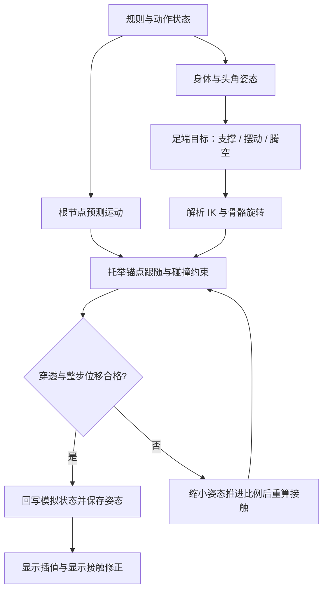

# BugDuel 关键技术说明

> 根据当前代码核对：2026-10-12。本文说明已经实现的算法、数据流、参数和限制；算法改动后应同步维护。
> 模块职责、入口、状态归属与接口总览见 [Intro.md：项目地图](Intro.md)。本文重点是 IK、程序动画、接触物理、托举反馈和运动连续性。
> 文件路径均相对于 BugDuel 项目根目录。以下简写 `Runtime/` 和 `Editor/` 分别指 `Assets/BeetleArena/Runtime/`、`Assets/BeetleArena/Editor/`。

## 阅读导航

1. [整体技术路线与坐标约定](#1-整体技术路线与坐标约定)
2. [真实模型的骨架与蒙皮生成](#2-真实模型的骨架与蒙皮生成)
3. [固定步模拟与显示帧](#3-固定步模拟与显示帧)
4. [六足步态：先决定脚去哪里](#4-六足步态先决定脚去哪里)
5. [两段式解析 IK：再求关节怎么转](#5-两段式解析-ik再求关节怎么转)
6. [非平地支持与身体姿态](#6-非平地支持与身体姿态)
7. [状态转换与攻击结算](#7-状态转换与攻击结算)
8. [碰撞代理与穿透修正](#8-碰撞代理与穿透修正)
9. [托举：接触点如何带动对手](#9-托举接触点如何带动对手)
10. [腾空计时与从慢到快的挣扎](#10-腾空计时与从慢到快的挣扎)
11. [防止顶举结束后瞬移](#11-防止顶举结束后瞬移)
12. [自由运动、落地和落台](#12-自由运动落地和落台)
13. [随机性、复现与性能](#13-随机性复现与性能)
14. [卡通渲染](#14-卡通渲染)
15. [调参、排障和验证](#15-调参排障和验证)
16. [扩展约束与维护规则](#16-扩展约束与维护规则)
17. [可插拔动作、接触响应与活体时钟](#17-可插拔动作接触响应与活体时钟)
18. [场景分组与引用安全](#18-场景分组与引用安全)
19. [木质接触声与可关闭的兵器火星](#19-木质接触声与可关闭的兵器火星)
20. [打斗节奏与昆虫式活动](#20-打斗节奏与昆虫式活动2026-10-13)
21. [全局代码审查与架构优化](#21-全局代码审查与架构优化2026-10-13)
22. [短恢复与情境响应](#22-短恢复与情境响应2026-10-13)

## 1. 整体技术路线与坐标约定

### 1.1 运行时由谁计算什么

当前项目组合了三类算法：

- **规则模拟**：`BeetleSimulation` 保存双方位置、速度、体力、平衡、动作、托举时序和比赛结果。
- **程序姿态**：`BeetleProceduralAnimator` 生成身体、头角和六足目标；`BeetleModelRig` 把足端目标转换为真实骨骼旋转。
- **几何接触约束**：`BeetleContactSolver` 使用 Unity 的碰撞查询检测重叠，修正根节点及必要的局部姿态；合格结果再保存为本步姿态。

根节点上的 Rigidbody 为运动学刚体，关闭内置重力。比赛中的重力、推顶、托举和位置修正由代码计算。模型上的碰撞体主要作为查询形状使用，不能把 `AddForce()` 接到当前流程中就期待它接管运动。

这套实现是面向游戏表现的运动学与动力学近似：有重力、质量相关速度变化、抓地指标、接触锚点和防穿透，但没有完整求解每个关节的刚体动力学、肌肉力矩、接触摩擦锥或六足力分配。



重试有次数上限；所有尝试都失败时保留此前姿态，持续受阻的托举会提前释放，流程不会无限循环。

### 1.2 坐标与单位

| 数据 | 所处空间 / 含义 |
| --- | --- |
| `BeetleState.Position`、`Velocity` | `Vector2`，分别对应世界 X、Z 平面 |
| `Height`、`VerticalVelocity` | 世界 Y 方向位置与速度 |
| `Heading` | 水平朝向，角度制；与地面倾斜分开保存 |
| `SurfaceNormal` | 世界空间地表法线 |
| `leg.planted`、`stepFrom`、`stepTo`、IK 输入 `target` | 世界空间足端点 |
| `leg.restAnkle` | 模型空间名义足端位置；当前真实模型中实际表示爪端接触点，并非踝骨原点 |
| `footOffsetInModel` | 绑定姿态下踝到爪端的模型空间偏移 |
| `bendInBody` | 身体局部空间中的膝弯曲提示方向 |
| 骨骼快照 | 局部位置、局部旋转、局部缩放；根节点另外处理 |

世界采用 Y 向上、甲虫模型 Z 向前。模型缩放为 `settings.visualScale * traits.size`，默认基础值为 `0.70`。IK 使用 `Abs(model.lossyScale.x)` 换算长度，因此当前绑定要求均匀缩放。

展示用毫米、克来自个体属性；运动采用归一化游戏单位。重力数值为 `9.81`，不意味着整个模型已经按现实米、千克完成标定。

## 2. 真实模型的骨架与蒙皮生成

**实现文件：** `Editor/Model/BeetleImportedModelBuilder.cs`、`Runtime/Rig/BeetleModelRig.cs`。

### 2.1 当前 FBX 的实际情况

`Assets/bug.fbx` 是由 22 个静态网格部分组成的模型，没有可直接驱动的原生骨架和动画。编辑器构建器依据当前模型的部件编号、实测关节点及方向约定，生成 `Generated/ArticulatedBeetle.prefab`。

这不是任意 FBX 的自动识别器。当前算法包含部件名称末尾编号和指定关节坐标的绑定知识，换模型时必须重新建立这些对应关系。

源模型到运行时模型的点转换为：

```text
Point(p)     = (-p.z * 5, (0.17 - p.x) * 5, (p.y - 0.43) * 5)
Direction(p) = (-p.z, -p.x, p.y)
```

点带有平移和缩放，方向不带平移。源模型的头向、背向和侧向经过该转换，成为运行时的 Z 前、Y 上、X 侧。

### 2.2 骨架层级

```text
甲虫根节点（模拟拥有世界位置）
└── FBX Model（统一模型缩放）
    └── Body（身体俯仰、侧倾和小幅姿态抬升）
        ├── Head（头角俯仰 / 偏转）
        ├── 左前腿 Hip → Knee → Ankle → Tip
        ├── 左中腿 Hip → Knee → Ankle → Tip
        ├── 左后腿 Hip → Knee → Ankle → Tip
        ├── 右前腿 Hip → Knee → Ankle → Tip
        ├── 右中腿 Hip → Knee → Ankle → Tip
        └── 右后腿 Hip → Knee → Ankle → Tip
```

六腿数组顺序固定为左前、左中、左后、右前、右中、右后。`side` 为左 `-1`、右 `+1`，`pair` 为前 `0`、中 `1`、后 `2`；索引为 `(side < 0 ? 0 : 3) + pair`。

每条腿的 `LegBinding` 至少包含：

- `hip / knee / ankle / tip`：骨骼和实际末端引用。
- `hipRest / kneeRest`：绑定旋转，求解前恢复，避免累计旋转误差。
- `upperLength / lowerLength`：由关节点位置计算的固定段长。
- `footOffsetInModel`：保留原始足节形状所需的踝到爪端偏移。
- `bendInBody / lastBend`：初始弯曲方向和上次有效弯曲方向。
- `targetError`：实际足端到经过限制后的目标的距离，供诊断使用。

腿节长度在运行时保持不变。步态通过旋转关节完成，不通过拉长腿网格追赶目标。

### 2.3 蒙皮如何得到

构建器为 11 个腿部网格生成蒙皮，另外 11 个部件保持刚性绑定。原始顶点、三角形、UV 和纹理关系通过生成的网格副本保留。

权重生成大致过程：

1. 找出顶点离 `hip→knee`、`knee→ankle`、`ankle→tip` 哪一段最近。
2. 远离关节的顶点赋给对应骨骼。
3. 接近相邻关节的顶点，根据关节附近的方向与距离，在相邻两骨骼之间平滑混合。
4. 设置 `bindposes = bone.worldToLocalMatrix * model.localToWorldMatrix`。

当前每顶点最多使用两根骨骼权重；渲染器设置 `SkinQuality.Bone2`。关节附近的权重混合控制弯折外观，IK 本身不修复错误权重。

足底补偿 `soleOffset` 来自足部网格的最低位置估算，用于弥补“骨骼端点到真实网格底面”之间的差距。缺少该补偿时，即使目标点落在地表，足部网格仍可能插入地面。

运行时不需要每帧 `BakeMesh()` 来生成碰撞网格。碰撞使用随骨骼运动的简化代理；蒙皮网格只负责显示。验证工具可以烘焙网格进行检查。

## 3. 固定步模拟与显示帧

**实现文件：** `Actors/BeetleMatchController.cs`、`Actors/BeetleActor.cs`、`Animation/BeetlePoseBuffer.cs`。

### 3.1 两个更新频率

模拟固定步长为 `BeetleSimulation.FixedStep = 0.02s`，即每秒 50 步。控制器通过 `Update()` 内的累积时间循环调用模拟，并非依赖 Unity 的 `FixedUpdate()`。

```text
dt = 暂停 ? 0 : min(unscaledDeltaTime, 0.1)
accumulator += dt

while accumulator >= 0.02:
    每只甲虫 BeforeStep()
    simulation.Step(0.02)
    accumulator -= 0.02

alpha = accumulator / 0.02
每只甲虫 Render(alpha, ...)
contacts.ProjectView(simulation, dt)
```

帧时间被限制为最多 `0.1s`。严重卡顿时不会无限追赶丢失时间；因此长时间低帧率下，模拟时间与现实经过时间可能不一致。

### 3.2 必须区分三种姿态

| 姿态 | 保存位置 | 用途 |
| --- | --- | --- |
| 模拟状态 | `BeetleState` | 规则、命中、运动、胜负 |
| 固定步已接受姿态 | `BeetleActor` + `BeetlePoseBuffer` | 下一步起点、显示插值端点 |
| 当前显示姿态 | 场景 Transform + `viewMotion` | 屏幕显示及该显示帧的防穿透 |

`BeetlePoseBuffer` 保存模型子节点的局部 TRS。根位置和根旋转由 `BeetleActor` 独立保存；根朝向同时包含水平 Heading 与地表倾斜。

`BeforeStep()` 会恢复上一固定步的完整模型姿态和根姿态，再开始本次计算。它不能只恢复骨骼而保留上一次显示帧修正过的根位置，否则显示结果就会污染下一次模拟的起点。

`Render()` 对根位置做 Lerp，对旋转做 Slerp，并插值骨骼快照。正常接触驱动路径不会在显示帧再次推进步态、动作计时或随机数。

### 3.3 一次模拟步的顺序

正式战斗阶段的主要顺序是：

1. 更新交锋阶段和已有托举反馈。
2. 更新计时、冷却、体力与 AI 动作。
3. 先计算双方的命中结果，再按选手索引应用结果。
4. 积分双方平面及竖直运动。
5. 生成程序姿态、求 IK、跟随托举锚点、求解接触。
6. 回写根位置、高度、接触等状态，保存本步骨骼姿态。
7. 检查落台并更新比赛结果。

双方命中先计算后应用，可以减少“先执行的一方改变动作，导致另一方本步无法计算命中”的顺序偏差；结果应用仍按索引执行，不能视为完整的同时刚体冲量求解。

## 4. 六足步态：先决定脚去哪里

**实现文件：** `Animation/BeetleProceduralAnimator.cs`，重点为 `Pose()`、`NominalFoot()`、`FootHeight()`、`AcceptSolvedPose()`。

IK 只回答“如何到达给定目标”。什么时候抬腿、脚放哪里、空中摆动、落地混合，都由 IK 前面的步态层决定。

### 4.1 每条腿的运行状态

| 字段 | 含义 |
| --- | --- |
| `planted` | 当前世界足端目标；支撑期保持固定，摆动期沿轨迹更新 |
| `stepFrom / stepTo` | 本次摆动的起点和终点 |
| `stepping` | 是否正在迈步 |
| `stepTime / stepDuration` | 摆动归一化进度与持续时间 |
| `lastFoot` | 上次已接受姿态中的实际足端，可能与理想目标不同 |
| `landingFrom / landingBlend` | 空中转落地时的实际起点与混合进度 |

支撑期的目标点放在世界空间。身体向前移动时，脚仍停留在原来的世界位置，IK 调整髋和膝补偿身体运动，从而形成落脚感。

如果每帧都将支撑脚目标重新绑定在身体局部位置，脚会跟着身体平移，即使 IK 数学完全正确也会明显滑步。

### 4.2 名义落脚点与迈步触发

名义点由模型空间的 `restAnkle` 转到世界空间，再通过地表采样设定足底高度。它代表当前身体位置和朝向下，这条腿适合回到的支撑位置。

正常迈步需同时满足：

- 当前没有迈步。
- `planted` 与名义点的误差超过 `0.16 * size`。
- 当前腿进入允许的步态相位窗口。
- 同时摆动的腿数尚未超过预算。

当脚过分靠近身体中线，或误差超过 `0.40 * size`，会触发紧急调整，允许跳过正常相位窗口。

起步时的目标加入 `Velocity * 0.17` 的平面预测偏移。终点在该步开始时确定，不会每帧跟随身体重新漂移。

### 4.3 慢走、快走与发力时的支撑预算

速度超过 `0.55` 且不处于承诺动作时，进入较快步态：

- 第一组三足：左前、左后、右中，相位偏移为 0。
- 第二组三足：左中、右前、右后，相位偏移为 0.5。
- 慢速使用按前中后错开的波浪相位。

普通同时迈步预算：快走最多 3 条，慢走最多 2 条；承诺动作或撑地时最多 1 条。紧急调整预算可到 3 条。

该预算约束的是“是否开启新的一步”。已经开始的摆动不会在动作切换时立刻取消，因此瞬时摆动数不一定马上降到新预算。

### 4.4 摆动轨迹

设归一化摆动进度为 `t`，平滑函数为：

```text
S(t) = 3t² - 2t³，t 限制在 [0, 1]
foot = Lerp(stepFrom, stepTo, S(t))
foot.y += sin(πt) * 0.13 * size
```

持续时间分别为：紧急 `0.12s`、快步 `0.17s`、慢步 `0.25s`。每个模拟步还对当前摆动点做地形高度检查，保证不低于足底高度加上当前抬脚弧线所要求的余量。

这里采样的是离散模拟步中的当前位置，并没有对整条曲线进行连续扫掠。很窄的障碍仍可能需要更密集采样或额外的摆动路径规划。

### 4.5 落地与异常恢复

从腾空转为落地时，记录上一已接受姿态中的实际足端 `lastFoot`，再用约 `0.18s` 过渡回支撑目标，避免直接跳回名义站姿。

接触求解结束后，`AcceptSolvedPose()` 记录实际脚位；当姿态推进被缩小时，也同步内部头、身体角度缓存。支撑点不会随根节点碰撞修正一起平移，否则会人为造成滑步。

代码还有应急重置：根位移超过 2 个世界单位，或足点严重越过身体中线、偏差超过 `1.5 * size` 时，重新建立落脚点。这些是处理瞬移和异常初始状态的兜底，不属于正常连续步态。

## 5. 两段式解析 IK：再求关节怎么转

**主实现：** `Runtime/Rig/BeetleModelRig.cs` 的 `Solve()`。

`BeetleProceduralAnimator.SolveLeg()` 检测到 `importedRig` 后，会直接调用上述实现。该方法后面的旧几何体腿算法是备用分支，修改真实模型腿部时应先确认修改的是正在使用的分支。

### 5.1 问题定义

一条腿有髋 H、膝 K、踝 A、爪端 T。两个主要可弯折长度为：

```text
L1 = |K - H|   // 上腿段
L2 = |A - K|   // 下腿段
```

程序给出爪端目标和足节朝向，先反推出踝目标，再求髋、膝旋转。第三段足节的原始形状作为固定偏移保留；这不是任意三段链的全自由度 IK。

### 5.2 第一步：限制目标活动区域

把世界目标转回模型局部空间，保证目标仍位于本腿一侧：

```text
local.x = side * max(abs(restAnkle.x) * 0.55, local.x * side)
local.z = clamp(local.z, restAnkle.z - 0.55, restAnkle.z + 0.55)
```

随后转回世界空间。这样可以减少左右腿跨过中线、前后腿互相穿越的情况，但它只是足端活动区域限制，不是完整的生物关节角限位。

接地时采样足端下方地表，将目标 Y 限制为至少：

```text
地表高度 + (soleClearance + soleOffset) * 模型缩放
```

### 5.3 第二步：足端目标转换成踝目标

足节旋转由地面法线和 Heading 构成：

```text
footFrame = FromToRotation(up, surfaceNormal) * Euler(0, Heading, 0)
ankleTarget = tipTarget - footFrame * (footOffsetInModel * scale)
```

腾空或已经落台时使用 `model.rotation` 作为足节方向参考。

必须先减去足节偏移。如果把爪端目标直接当作踝目标求解，整段足节还会从踝继续伸出去，实际脚尖就会偏离地面目标。

### 5.4 第三步：限制可达距离

令 `offset = ankleTarget - H`，方向为其单位向量 `e`，长度为 `d`。当前代码限制：

```text
dMin = abs(L1 - L2) + 0.001 * scale
dMax = (L1 + L2) * (1 - reachMargin)
d = clamp(length(offset), dMin, dMax)
ankleTarget = H + e * d
```

`reachMargin` 默认 `0.015`。不允许腿完全伸直，有助于避免膝弯曲方向在接近奇异姿态时跳变；最短距离也保留小余量。输入方向接近零时使用向下方向兜底。

超出可达范围的目标会被收回可达区域，骨骼长度不会被拉长。因此 `targetError` 大于零不一定意味着求解公式错误，也可能是目标受距离或活动区域限制。

### 5.5 第四步：确定膝盖朝哪边弯

只有 H、踝目标和两段长度，不能唯一确定膝位置：膝可以绕 H→A 轴转成一个圆。需要弯曲提示向量来选择平面。

当前实现将身体局部的 `bendInBody` 转到世界空间，再投影到垂直于 `e` 的平面：

```text
pole = Normalize(ProjectOnPlane(body.TransformDirection(bendInBody), e))
```

当提示方向与 `e` 近乎平行、投影过小时，依次尝试：

1. 上一次有效方向 `lastBend`。
2. `model.right * side`，让腿倾向身体外侧。
3. `model.forward`。

使用历史方向和左右侧信息可以降低膝盖突然翻到另一侧的风险。只对最终旋转做平滑，无法补救每帧随机选择弯曲平面的问题。

### 5.6 第五步：由余弦定理求膝位置

沿 H→A 的投影距离 `x` 和垂直高度 `h` 为：

```text
x = (L1² - L2² + d²) / (2d)
h = sqrt(max(0, L1² - x²))
Ktarget = H + e * x + pole * h
```

例如 `L1 = L2 = 1`，目标距离 `d = 1.2`，则 `x = 0.6`、`h = 0.8`。膝位于主方向前进 0.6、弯曲方向偏出 0.8 的位置，两段长度仍都是 1。

根号内使用 `max(0, ...)`，避免浮点误差产生负数和 NaN。

### 5.7 第六步：把位置解变成骨骼旋转

恢复髋、膝的绑定旋转后，依次执行：

```csharp
hip.rotation = Quaternion.FromToRotation(
    knee.position - hip.position,
    kneeTarget - hip.position) * hip.rotation;

knee.rotation = Quaternion.FromToRotation(
    ankle.position - knee.position,
    ankleTarget - knee.position) * knee.rotation;

ankle.rotation = footFrame;
```

这是省略绑定对象前缀的算法摘录。先转髋，因为髋旋转会改变膝和踝的世界位置；然后用更新后的世界位置转膝，最后设置足节朝向。

### 5.8 IK 当前没有负责的事情

- 不决定什么时候迈步，不选择攻击状态。
- 不进行全身重心与支撑多边形优化。
- 不保证所有腿段、刺和爪子之间绝不相交；碰撞代理与接触修正负责后续几何检查。
- 没有为每个真实关节配置独立的解剖角度上下限。
- 不支持未经重新标定的非均匀缩放或任意坐标轴骨架。

## 6. 非平地支持与身体姿态

**实现文件：** `Environment/BeetleArenaSurface.cs`、`Simulation/BeetleSimulation.cs`、`Actors/BeetleActor.cs`、`Rig/BeetleModelRig.cs`。

### 6.1 统一地表接口

模拟与动画都通过 `IBeetleGround.Sample(Vector2, out BeetleGroundSample)` 获得高度、法线和抓地系数，避免身体认为地面在一个位置，而脚又使用另一套高度公式。

`BeetleArenaSurface` 在登记的支撑碰撞体上向下射线采样，选取有效表面；坡度超出 `maximumSlope` 的面不当作可站立地表，默认阈值为 38 度。

`supportColliders` 与 `contactColliders` 用途不同：前者回答“哪里可以站”，后者还可包含侧壁、台外地面等实体，回答“哪里不能穿过去”。地表采样不会把甲虫自己的碰撞体误认成台面。

### 6.2 身体法线与抓地估计

`UpdateGround()` 采样根节点和六个名义足位。足位与中心高度差较大时，支撑权重降低：

```text
reach = 1 - InverseLerp(0.45 * size, 0.85 * size, abs(footHeight - centerHeight))
Footing = 六个 reach 的总和 / 6
SurfaceNormal = Normalize(中心法线 + Σ(足位法线 * reach))
```

根朝向由地面倾斜与水平朝向组合；各脚还会独立使用自己目标点处的法线。移动牵引力进一步结合 `Footing`、个体 grip、地面 grip 和坡度；较陡坡面增加移动约束及滑移效果。

这里的 `Footing` 来自**名义足位采样**，并不是从六只实际脚上的接触力反推。实际足端高度另用于托举失去支撑的计时，两个指标不能混为一谈。

### 6.3 触角避地

`AvoidFeelerGround()` 对触角上的多个采样点检查地面，尝试 0～60 度、间隔 5 度的收拢姿态，选择能减轻入地的角度。靠近时较快收起，离开时较慢放松，响应系数分别为 35 和 7。

如果收拢仍不能完全避地，还允许身体姿态在模型局部最多抬高 `0.25`，之后重新求六足 IK。该值作用于身体姿态，不直接作为模拟根节点的攻击位移。

这是几何避障近似；触角没有作为独立动力学杆件参与碰撞反力求解。

## 7. 状态转换与攻击结算

**实现文件：** `Simulation/BeetleState.cs`、`Simulation/BeetleSimulation.cs`、`Simulation/BeetleLiftResponse.cs`。

### 7.1 三层状态各管一件事

| 层级 | 状态 | 作用 |
| --- | --- | --- |
| 比赛 | `Countdown → Fighting → Resolving → Finished` | 是否允许战斗、落台结算与比赛结束 |
| 交锋节奏 | `Probing → Clash → Recovery` 循环 | 试探、强冲突、短暂恢复的行为倾向 |
| 个体动作 | 观察、接近、绕行、试探、推顶、抬举、撑地、退让、受击、腾空等 | 当下运动意图、发力窗口和程序姿态 |

交锋阶段默认试探 7 秒、强交锋 9 秒、重整窗口基准 1.35 秒（进入时乘 0.8～1.15），接触中重新发力可在窗口 0.45 秒后提前结束。Recovery 只降低交锋倾向，健康个体可继续寻触，不再强制双方同步休息；个体恢复规则见第 22 节。阶段不抢占已承诺动作。

`SetAction()` 统一设置动作与持续时间，清零 `ActionTime`，并重置 `AttackApplied`。添加动作时必须检查：AI 能否进入、何时离开、是否消耗体力、是否属于承诺动作、动画如何表现、接触模式是否需要改变。

### 7.2 AI 为什么不会每帧重新抽动作

决策综合距离、对准程度、体力、平衡、边缘风险、交锋阶段和随机选择。已有动作的时长及决策间隔限制重新选择频率；部分随机分支共用一次随机值按顺序判断，所以各条件不是相互独立的概率事件。

`Committed` 用于识别正在执行的发力动作，影响转向、步态预算和体力；被托举者主要由 `Airborne` 和托举状态接管，而不是继续执行常规地面追击。

### 7.3 一次攻击只结算一次

`ComputeHit()` 检查比赛阶段、双方状态、动作类型、朝向、距离、高度差、命中窗口和 `AttackApplied`。接触场景中的 `TouchingOpponent` 来自已完成的接触求解，所以通常反映前一固定步的接触结果。

当前抬举窗口从动作归一化进度 `pryContactStart = 0.16` 开始，其他相关攻击使用各自判定。有效攻击登记后设置 `AttackApplied`，避免同一个动作每步重复扣体力或施加冲量。

抬举还需要后续真实角部接触捕获成功。捕获失败时允许在该动作剩余窗口继续尝试，而不会自动转成隔空向上冲量。

### 7.4 发力、抓地与位移

普通攻击的效果由个体力量、剩余体力、鼓励加成、平衡、抓地和动作倍率组合。阻力中包含 `grip`、体力、`Balance`、`Footing`，撑地动作进一步增强抵抗。

普通推顶可以修改平面速度；托举则通过下一节的接触锚点与姿态变化让对方离地。单独增大 `pryImpulse` 不会直接变成更大的上抛速度，它主要影响能否克服抓地的力量判断。

长局的 `openingSeconds`、`escalationSeconds` 使位移效果逐渐增强。它们不是倒计时判胜条件，无法保证每局必定在 1～3 分钟结束。

## 8. 碰撞代理与穿透修正

**实现文件：** `Physics/BeetleContactRig.cs`、`Physics/BeetleContactSolver.cs`，代理由模型构建器生成。

### 8.1 用哪些形状代表甲虫

当前每只甲虫有 29 个碰撞代理：

- 六条腿各 3 个胶囊，共 18 个。
- 腹、胸、头的凸壳代理，共 3 个。
- 头角主干、分叉、尖端及胸角等，共 8 个胶囊。

胶囊和凸壳随相应骨骼运动。角色分类区分腿、头角、身体等；部分分类依赖生成对象名称，如左右、前中后腿和 `Thoracic horn`。修改命名时必须同步检查 `BeetleContactRig` 的分类规则。

代理不是逐三角形复制显示网格。较小的爪尖、倒刺和薄片仍可能超出代理范围，因此“代理没有穿透”与“每个可见顶点绝无交叠”不是同一个保证。

### 8.2 检测分两层

1. **包围盒筛选**：检查整只甲虫和各形状的 AABB 是否相交，排除明显无关的组合。
2. **精确代理查询**：对候选形状调用 `Physics.ComputePenetration()`，得到分离方向和穿透深度。

骨骼或根变换改变后，需要 `Physics.SyncTransforms()` 和更新形状缓存。`ContactRig.Translate()` 能同时平移缓存包围盒；骨骼旋转后则必须重新缓存。

接触查询给出的是当前形状如何脱离重叠，不自动提供合理的攻击反应、冲量、摩擦或关节动作，这些需要项目自己的求解策略。

### 8.3 按接触场景选择分离策略

| 场景 | 方法 | 核心策略 |
| --- | --- | --- |
| 普通相遇 / 推挤 | `SeparateCentered()` | 沿双方水平中心连线分离，按质量分配位移，抑制继续闭合的平面速度 |
| 低头入角 | `SeparateInsertion()` | 使用接触法线的水平分量，小步调整；攻击者承担较多退让，减少将防守者整只推走 |
| 已建立托举 | `SeparateSupported()` | 允许三维分离，使受击者在角部支撑下向上移动 |
| 与台面 / 侧壁接触 | `ResolveArena()` | 沿环境接触方向修正；台面与侧壁分别处理 |

普通分离的质量权重使较轻者承担较大位移。入角模式中攻击者通常承担约 75% 的水平修正。局部循环设有次数上限和单次位移上限，随后还需检查整步结果是否可接受。

### 8.4 为什么要交替处理甲虫与擂台

把一只甲虫从另一只甲虫中推出后，它可能进入台面；从台面推出又可能挤回对手。`Constrain()` 因此交替进行：

```text
双方分离 → A 与环境分离 → B 与环境分离 → 检查残余
```

外层最多 8 轮。最终还会测量双方以及环境的全部残余，防止最后一次环境修正重新造成虫间穿透而遗漏检查。

循环中的提前退出深度约为 `0.0005`，运动接受阈值为 `0.001` 世界单位。它们与碰撞皮肤余量、验证工具允许误差有不同用途，不能随意互相替换。

### 8.5 局部避让与地面反作用

入角、托举和收角期间，`YieldArticulatedContacts()` 会检查角对角和腿部冲突，先进行小幅头角或腿目标避让，再求整体分离。

- 头角根据接触法线方向小幅抬起，每次局部修正约 4 度。
- 腿目标向接触分离方向、身体外侧及上方少量偏移，再重新求 IK。
- 同一轮用标记避免同一头或同一腿反复接受相同局部修正。

受击者还贴近台面时，如果角部重叠要求把它向下推，继续下推会与地面约束互相抵消。当前会让攻击者适度水平退让，避免“往下推受击者—地面再顶起—再次重叠”的循环。

### 8.6 连续检测的实际边界

根 Rigidbody 设置了 `ContinuousSpeculative`，但主要位置与关节姿态仍由自定义查询求解器直接控制。这一选项不能等同于“整只甲虫的所有骨骼都经过连续扫掠检测”。

当前防护依靠固定步、姿态变化限制、代理查询和安全姿态回退；没有实现每根骨骼从上一姿态到下一姿态的完整连续凸体扫掠。

## 9. 托举：接触点如何带动对手

**实现文件：** `Physics/BeetleHornSupport.cs`、`Physics/BeetleContactSolver.cs`、`Simulation/BeetleLiftResponse.cs`、`Simulation/BeetleSimulation.cs`。

### 9.1 必须先建立几何接触

有效抬举通过 `IBeetleLiftContacts.TryBeginLift()` 请求接触层建立支撑；接触层调用 `BeetleHornSupport.TryCapture()`。

只接受攻击者头角代理与防守者身体代理的候选，排除防守者胸角。腿碰腿、角尖对角尖不会直接成为身体托举锚点。

对每对候选形状交替查询最近点，得到角点 `p` 和身体点 `q`，当前条件包括：

```text
|p - q| <= 0.085
p.y <= q.y + 0.055
(p.y + q.y) / 2 <= 受击身体代理包围盒中心高度 + 0.03
```

这些是结合当前模型调校的几何容差，用于筛选角从较低位置托住实体的情况，不是现实接触力的测量值。

### 9.2 锚点保存在各自局部空间

选定接触后取两点中点 `contact`，分别保存为：

```text
hornPoint = horn.InverseTransformPoint(contact)
receiverPoint = receiver.InverseTransformPoint(contact)
```

头角抬起后，用骨骼变换重新计算两个世界点：

```text
error = horn.TransformPoint(hornPoint) - receiver.TransformPoint(receiverPoint)
rootCorrection = ClampMagnitude(error, liftFollowSpeed * dt)
```

默认 `liftFollowSpeed = 2.8`，在 `0.02s` 中锚点跟随本身最多移动 `0.056` 世界单位。随后还必须通过碰撞与整步位移检查。

受击者没有被设置为攻击者的子节点，也不是在命中那一刻直接提高固定高度。其移动方向来自转动后的真实局部接触点差，所以头角上抬可以转化为受击身体向上的反馈。

### 9.3 抬头—承重—末段加速的时序

`ApplySupportedPry()` 在一次有效入角时选择发力系数 `Effort`，结合当次攻击力生成抬起时间、保持时间和目标抬头幅度。随机只在动作建立时抽取；不会每帧重新抽取方向或距离。

- `Effort` 的基础变化为 0.85～1.18；合格且抽中额外爆发时再乘 1.5。
- `RaiseSeconds` 在配置抬起时间的 0.7～1.1 倍之间变化。
- `HoldSeconds` 在配置保持时间的 0.35～1 倍之间变化；额外爆发将保持时间再乘 0.12，表现为直接猛撬。
- `SnapSeconds` 以 `throwSnapSeconds` 为基准，根据驱动力在 0.8～1.2 倍之间变化。
- `SweepTarget` 是相对入角时实际头部角度的抬头幅度，在 98～138 度之间变化。

抬头进度由两段曲线组成：前段 SmoothStep 完成总幅度的 56%，承重阶段保持，最后 44% 使用 `snap²` 加速完成。攻击者动画从进入动作时实际 `liftingHeadStart` 开始，以指数平滑接近该目标；碰撞仍可限制实际推进。

六足仍按前、中、后逐步松开。受击者身体俯仰由原有托举反馈驱动，离地挣扎继续使用真实足部失去支撑的计时。

### 9.4 参考了什么杠杆原理

实现参考了角作为输出力臂、头部作为输入杠杆系统的研究，以及入角后克服对手抓地、将其撬离支撑面的行为描述。[Weber 等，2023，角长与抬举力量](https://doi.org/10.1016/j.cub.2023.08.066)、[McCullough，2014，甲虫武器的力学限制](https://pmc.ncbi.nlm.nih.gov/articles/PMC4046419/)

代码使用以下关系：

```text
输入力矩 τ = 肌肉输入力 × 输入力臂
接触输出力 Fout = max(0, τ / 接触输出力臂 - 抓地阻力近似)
有效功 W += Fout × 输出力臂 × 实际抬头角增量 × 接触质量
有效冲量 J += Fout × dt × 接触质量（仅实际抬头时累计）
能量速度上限 vW = sqrt(2 × W × 效率 / 对手质量)
冲量速度尺度 vJ = J / 对手质量
```

这是归一化游戏模型；具体力、效率、角度范围与反抛门槛由项目调校，不是论文给出的生物测量值。论文支持杠杆与抓地关系，不能据此声称当前每次身后反抛的角度、概率都经过实验验证。

### 9.5 实际接触如何转成测量样本

新增 `Runtime/Simulation/BeetleThrowMechanics.cs`，接触采样入口为 `BeetleHornSupport.Measure()`。它只在 `ContactSolver.Solve()` 完成全部约束和回退、保存已接受姿态后执行。

1. 从攻击者头骨的局部 X 角读取相邻已接受姿态的抬头增量，消除绕角表示跳变，只累计正向抬头。
2. 从头部枢轴指向实际角接触锚点得到 `radial`；投影到垂直转轴的平面，长度作为输出力臂。
3. `Cross(-headPivot.right, radial)` 给出扬角时的切向方向，保存在 `ReleaseTangent`。
4. 两个锚点误差小于 0.10 时按充分接触计算，0.10～0.45 之间降低接触质量，超过范围不累计有效功和冲量。
5. 输入力矩结合个体力量、剩余体力、鼓励、攻击者抓地和平衡；受击者尚未脱足时扣除抓地阻力近似。

`ContactSeconds` 记录加权接触时长，`LostContactSeconds` 记录连续失去有效接触的时间。静止保持可以增加接触时长，但没有抬头角增量就不会增加功或冲量，不能站着等待无限蓄力。功受 `throwWorkLimit` 限制。

没有场景接触求解器的纯数据测试使用理想杆角度近似。真实模型路径始终使用最终接受的实际骨骼测量；渲染插值、碰撞失败候选均不计入。

### 9.6 出手时机与连续程度

满足末段加速时序且实际累计抬头达到目标的一定比例时出手。连续滑脱、持续受阻、动作超时或攻击者状态中断也会结束支撑。

成功撬投要求有效接触至少 0.08 秒、功至少 0.5、实际抬头至少 12 度，并且已经脱足或根节点确实离开台面超过 0.12。未建立有效托举的失败入角只能撤角，不能隔空发射。

成功出手没有轻放分支。`ThrowOpponent()` 调用 `BeetleThrowMechanics.Release()`，只赋予速度，不瞬移根位置：

```text
speed = clamp(min(vW, vJ + 0.4 × vW), throwMinimumSpeed, throwMaximumSpeed)
```

最低速度是避免成功动作退化成轻放的表现下限，最高速度限制极端输入；两者都是游戏调校。方向取接触切线对应的仰角及有限侧向分量。

普通能量下，允许仰角上限随单位质量的有效功从 38 度增至 82 度，因此不同接触过程会产生不同高度和距离。身后反抛同时要求：

- `HeadSweep >= throwOverheadSweep`，默认 82 度。
- `Work / mass >= throwOverheadWork`，默认 32。
- `PeakAngularSpeed >= throwOverheadAngularSpeed`，默认 2.5 弧度/秒。

达到门槛才保留切线中的向后分量，允许仰角上限根据出手速度在 100～118 度之间连续变化，为越过攻击者留出高度。门槛并不保证必然反抛：实际接触切线仍需指向后上方。所有碰撞保持开启。

当前划分为 **6 档**，速度单位为游戏世界单位/秒。档位根据计算完成的实际出手速度与方向判定，阈值不等距：

| 档 | 枚举 | 名称 | 默认出手速度条件 | 方向 / 表现 |
| --- | --- | --- | --- | --- |
| 1 | `ShortPry` | 近身短撬 | `< 3.15`（默认下限 2.2） | 向前，仍有向上速度，不能轻放 |
| 2 | `QuickPry` | 快速前抛 | `3.15 ≤ v < 4.35` | 向前，短至中等弧线 |
| 3 | `ArcThrow` | 中弧抛 | `4.35 ≤ v < 5.65` | 向前，中等抛掷 |
| 4 | `HighArc` | 高弧强抛 | `v ≥ 5.65` | 向前，允许高能量；未通过反抛门槛仍停留此类 |
| 5 | `Overhead` | 后扬抛 | `v < 7.1` 且实际向后 | 必须先通过实际转角、做功和角速度门槛 |
| 6 | `PowerOverhead` | 强力越顶反抛 | `v ≥ 7.1` 且实际向后 | 同样要求有效反抛条件，强回抛轨迹 |

前四档的轨迹仍按原来的连续比功仰角上限计算。后两档允许仰角上限随速度连续从 100° 增至 118°；跨过 7.1 阈值时不会突然替换速度、角度或骨骼姿态。具体是否落到身后还取决于释放位置、碰撞与落地高度。

`throwQuickSpeed / throwArcSpeed / throwHighArcSpeed / throwPowerOverheadSpeed` 是 Inspector 中的四个分档阈值；`Validate()` 保持它们递增并位于速度范围内。只调阈值会改变分类和反馈，出手速度仍由接触做功与冲量计算。`Classify()` 负责分类，`TierNumber()` 映射 1～6，`Description()` 提供事件反馈。

为保持已有枚举数值不变，三个新类型追加在枚举末尾；不要直接把枚举整数当显示档位。`LaunchVelocity / LaunchElevation` 保存连续出手结果，同一档内部也存在不同的距离和角度。

### 9.7 额外爆发与兼容参数

`tossChance` 默认 0.08，现在只控制合格入角中的额外爆发，`BurstEffort` 保存该选择。设为 0 后，普通成功顶举仍会抛出。`Throws` 统计全部撬投，`Tosses` 统计额外爆发的猛挑。

旧的固定水平冲量 `tossHorizontalImpulse` 和固定上抛速度 `tossVerticalSpeed` 已移除；调整强度应使用力矩、效率、速度上限及反抛门槛参数。释放后仍由重力、环境接触及落台规则决定结果。

### 9.8 当前约束的限制

角部锚点仍是限速的几何跟随约束，没有完整求解单向压力、摩擦锥或接触点沿壳面的迁移。功/冲量积分用于连续控制游戏出手，不是全身关节刚体动力学求解。

普通抛投的仰角范围与最低速度带有表现约束；完整连续骨骼扫掠、精确弹性储能和接触滑脱力矩仍未实现。进一步扩展时必须保留固定步采样、有效接触门槛以及显示帧不回写状态的边界。

## 10. 腾空计时与从慢到快的挣扎

**实现文件：** `BeetleContactSolver.UpdateFootSupport()`、`BeetleProceduralAnimator.UpdateStruggle()` 和 `Pose()` 的腾空分支。

### 10.1 何时开始计算 0.7 秒

`Lift.Time` 表示托举状态经过多久；`Lift.UnsupportedTime` 表示实际失去足部支撑后的累计时间。挣扎使用后者。

接触求解完成后，检查六个实际 `tip.position`。扣除足底补偿后，足端高于地表约 `0.045` 世界单位才算离开；全部脚都没有足够近的地表支撑时，将 `GripReleased` 锁存为真并开始累计。

锁存后，空中挣扎偶尔擦过地表不会立即把计时清零。正常落回擂台会重置。落台时 `Lift.UnsupportedTime` 可以被接触层清理，但 `Fall.UnsupportedSeconds` 接续离地时长，动画不会因判负而停腿。某脚下方采样不到有效地表，也不会被当作有支撑。

动画读取上次已完成接触求解的时间，因此可能有一个固定步的响应延迟，这比用尚未通过碰撞检查的候选脚位推进时钟更稳定。

### 10.2 振幅和频率分别控制

令：

```text
t = max(0, UnsupportedTime - liftStruggleDelay)
T = max(0.1, struggleRampSeconds)
u = clamp01(t / T)
S(u) = 3u² - 2u³
f0 = struggleStartHz
df = struggleMaxHz - f0
```

当前默认值为延迟 `0.7s`，频率从 `0.65Hz` 升至 `3.2Hz`，升速时间 `1.1s`。振幅权重另外用约 `0.35s` 淡入：

```text
频率 = f0 + df * S(u)
振幅权重 = S(clamp01(t / 0.35))
```

`t = 0` 时对外诊断频率与挣扎权重为零；实际开始挣扎后采用上述升速曲线。频率控制“多快”，振幅控制“多大”，不能只提高振幅来表现越来越急促。

### 10.3 为什么相位要积分

如果写成 `sin(2π * frequency(t) * t)`，相位导数还会包含 `t * frequency'(t)`，实际摆动速度会偏离设定频率，调节频率时也容易出现突兀变化。

当前实现对频率曲线解析积分，先计算累计周期：

```text
cycles = f0 * t + df * (T * (u³ - 0.5u⁴) + max(0, t - T))
phase = 2π * cycles
```

当 `t >= T` 时，继续以最大频率累计相位；曲线在升速结束处连续。相位直接由模拟状态计算，显示帧不会额外累加。

### 10.4 六条腿如何错开

每条腿使用不同相位：

```text
cycle = phase + pair * 2.2 + side * 1.1
amplitude = 0.36 * StruggleWeight
```

目标由收腿偏移和三个方向的正弦 / 余弦摆动构成，纵向还使用不同频率倍率，再经身体变换转为世界目标，最后仍走同一套真实模型 IK。

这样可以保留真实腿长和弯曲方向，同时避免六条腿完全同步摆动。该动作不额外施加踢腿冲量；它目前是反馈动画，碰撞代理仍参与防穿透。

## 11. 防止顶举结束后瞬移

**实现文件：** `Physics/BeetleContactMotion.cs`、`Physics/BeetleContactSolver.cs`、`Actors/BeetleActor.cs`、`Animation/BeetleProceduralAnimator.cs`。

### 11.1 产生突变的常见来源

- 从托举切换到收角时，头部从硬编码角度开始，导致角代理突然深入对手。
- 一次局部碰撞修正很小，但多轮迭代的总位移很大。
- 显示修正后的根位置被错误地当成下一模拟步起点。
- 固定步两端都无穿透，插值中间的长角却扫入另一只甲虫。
- 为避免穿透直接回退到某个固定步端点，造成显示位置来回跳。

### 11.2 收角从实际姿态开始

进入 `Lifting` 时记录实际头角和偏转；进入 `ReleaseLift` 或 `Toss` 时记录实际头部与身体俯仰，再从这些角度混合到收角目标。

这使被碰撞修正、受阻或提前打断的动作也能从当前可见姿态继续，而不是假定上一动作总能完整达到设计终点。

### 11.3 对整步位移设预算

`BeetleContactMotion` 保存起始与候选根及骨骼姿态，供尝试不同推进比例。每只甲虫的根位移预算为：

```text
physicalSpeed = length(Vector3(vx, Airborne ? vy : 0, vz))
budget = max(contactMotionSpeed, physicalSpeed + 0.5) * dt
```

默认 `contactMotionSpeed = 4`。低速状态每个固定步的预算通常为 `0.08` 世界单位；高速挑飞根据物理速度放宽，避免把合法腾空运动强行限制成慢动作。

这是本步起点到最终根位置的总距离预算，不只是某一次 `Translate()` 的长度上限。

### 11.4 缩小姿态推进，再重新求碰撞

处理顺序为：

1. 保存此前已接受姿态和当前平面速度。
2. 生成本步候选姿态，执行局部避让、锚点跟随和整体约束。
3. 如果残余深度大于 `0.001`，或根位移超预算，则尝试 `1/2、1/4……1/128` 的姿态推进。
4. 每次重试都重新同步碰撞、执行必要局部避让并约束，检查最终结果。
5. 接受第一个符合条件的结果；全部失败则恢复此前姿态与保存的平面速度。

不能先完成大幅推出，再单纯截断最终位置：被截断的位置可能仍在另一只甲虫内部。当前方法缩小造成冲突的姿态变化，并重新证明候选结果满足检查。

局部头角避让在重试中仍会重新执行，避免把必要的让角也随着推进比例缩得过小，导致所有重试都被同一处角角接触阻塞。

该回退只针对本次姿态候选及相关速度，不回滚整场模拟的所有计时和随机状态。持续受阻通过 `BlockedTime` 与释放逻辑消解。

### 11.5 显示插值也要检查

`ProjectView()` 在骨骼插值之后再次求接触。它保存上一张已接受显示姿态，朝本帧目标尝试推进；如果修正超预算或仍有穿透，就从上一显示姿态缩小推进比例重试，最坏保留上一显示姿态。

这一阶段不会把显示根位置、显示速度或显示计时写回模拟。下一模拟步先恢复固定步姿态，从而避免渲染帧率改变战斗状态。

安全姿态回退可能表现为短暂减速或停顿；它解决的是“大幅位置跳变与残余穿透”的冲突，不能保证任何形状组合都能持续顺畅推进。观察到长期停顿时应检查接触几何和状态退出，而不是无限加大推出距离。

## 12. 自由运动、落地和落台

**实现文件：** `Simulation/BeetleSimulation.cs` 的运动积分与结果检查。

被角支撑期间，场景中的高度主要由支撑锚点和碰撞约束产生；解除支撑后才进入普通自由竖直运动：

```text
vy -= gravity * dt
height += vy * dt
平面速度 *= exp(-0.18 * dt)
position += 平面速度 * dt
```

这是先更新速度再更新高度的离散积分。落地需要有效地表、下降中、上一高度与下一高度跨过地表等条件；落地后贴回地表，清除腾空速度及失去支撑的时钟，进入受击恢复。

失去脚下支撑不会立刻判负。落台判断还要求根节点相对最后支撑高度下降超过 `fallDepth`，默认 `0.75`，以避免短暂腾空或擦边被直接判负。

第一只落台后比赛进入 `Resolving`，默认等待 `doubleFallWindow = 1.2s`。双方都落台可判平局，否则窗口结束后判另一方胜利。

空中动画、接地状态和比赛落台结果属于不同层次。添加动作时不要让动画自行修改 `HasFallen` 或宣布胜负。

### 12.1 落败仍然是活体动作：跌落、寻触、缓冲、撑起

**实现文件：** `Simulation/BeetleFallResponse.cs`、`Simulation/BeetleSimulation.cs`、`Physics/BeetleContactSolver.cs`、`Animation/BeetleProceduralAnimator.cs`、`Actors/BeetleActor.cs`。

旧实现把 `Defeated` 的目标侧倾固定为左右 72 度，同时用 `!HasFallen` 禁止挣扎。结果是甲虫一判负就换成固定侧躺姿势。另一个问题是比赛结束后 `Elapsed` 停止；继续使用这个时钟的触角动作也会冻结。

当前将比赛结果与身体反馈分开：`HasFallen` 仍不可逆、不能重新参赛；`Fall` 继续按固定步推进。既有碰撞体和接触回退保持启用。

| 阶段 | 触发与动作 | 运动权限 |
| --- | --- | --- |
| 失去擂台支撑 | `Fall.Begin()` 记录初始前向/侧向速度及已有离地时长；动画保留进入时实际身体俯仰和侧倾 | 不提前判负；回到擂台有效支撑面时可 `Reset()` |
| 空中寻触 | 前约 `fallReachSeconds=0.18s` 伸腿找支撑，随后前、中、后足左右错相伸屈；较长离地接续原有慢到快挣扎 | 重力与惯性由模拟负责；摆腿仅生成姿态，不在空中凭空推动质心 |
| 判负之后 | 保留上述动作，不切固定侧躺；身体倾转依据进入姿态、初始速度和绕行偏好平滑变化 | 结果保持；没有随机再抽一个落败姿势 |
| 台外触地 | 最终接受姿态经 `HasForestFloorContact()` 确认地面，保存冲击速度；短时身体下压，足端分批寻触 | 下落速度归零，滑动阻尼增强，不立刻清空平面速度 |
| 重新撑起 | 约 0.12s 缓冲后，在 `fallRecoverySeconds=1.35s` 内平滑摆正并降低摆腿，恢复六足支撑，随后由静置模块轮流换足，头和触角保持微动 | 仍然是落败选手；不再追击、攻击或接受鼓励 |

这些时间、角度与阻尼是游戏调节值，没有宣称为独角仙实验测量常数。现有实现覆盖本项目跌落产生的中等倾斜姿态，不是任意腹朝天初始姿态的完整翻正动力学。

### 12.2 落地必须来自接触，计时不依赖显示帧

`BeetleFallResponse` 保存 `Active / OnFloor / Time / UnsupportedSeconds / GroundSeconds / ImpactSpeed / ForwardSpeed / SideSpeed`。`Simulation.Integrate()` 启动、推进和重置它；场景模式只有最终接触结果调用 `SetFloorContact()`。纯数据测试没有碰撞体，才用根高度到达 `groundHeight` 的备用判定。

台外森林地面目前是高度为 `groundHeight` 的厚 BoxCollider。求解器筛选顶部高度匹配的环境碰撞体，在最终姿态上将甲虫部件向下探测 0.035 世界单位，要求 `ComputePenetration` 返回朝上的接触法线。它不会把擂台侧壁或比赛结束标记当成落地。若未来台外地形也改为起伏曲面，必须替换这个平地接触筛选接口，不能继续按统一高度判断。

空中平面阻尼为 0.18，触地后使用 `fallSlideDamping=5.5`，仍按 `exp(-damping*dt)` 衰减。碰撞求解器始终管理防穿透和整步位移预算。身体姿态从实际进入角度接续；脚端目标限制每步速度；地面支撑目标在约 0.24s 内混入，避免切状态时瞬间展开六足。旧坡面根倾角随 `Fall.Time` 指数释放，防止森林平地上的身体持续倾斜。

`Finished` 分支继续积分落败甲虫并调用接触求解器，因此 `Fall.Time` 继续前进，即使比赛 `Elapsed` 已经停止。落败寻触与恢复读取这个独立时钟；通用动画和模块使用每个固定步都推进的 `MotionTime`，让胜者也保持活动。`Render()` 仍只读取快照；不会推进落地计时、挣扎时钟或修改胜负。新一局创建全新状态并重置动画缓存。

### 12.3 可复用的研究依据及适用范围

1. **Sasaki & Nonaka (2016)**，*The Reciprocity of Environment and Action in Self-Righting Beetles: The Textures of the Ground and an Object, and the Claws*，Ecological Psychology 28(2), 78–107。[论文 DOI / 出版社摘要](https://doi.org/10.1080/10407413.2016.1163983)。摘要描述甲虫翻正与地面纹理、可抓持物体及物体间隙的关系。本次借鉴“先寻触，再借接触撑起”的组织方式；只核对到公开摘要，未据此推断具体关节角、耗时或肌肉力量。
2. **Zeng et al. (2017)**，*Biomechanics of aerial righting in wingless nymphal stick insects*。[开放全文](https://pmc.ncbi.nlm.nih.gov/articles/PMC5206595/)，[DOI](https://doi.org/10.1098/rsfs.2016.0075)。论文观察到足端失去接触后的伸腿寻触，以及重新定向和稳定阶段的左右不对称腿部运动；全文附补充视频 S1–S3，适合后续逐帧研究。这里仅借鉴寻触和错相摆腿结构。研究对象是竹节虫若虫，不能把其空中翻正成功率、约 0.3 秒量级时序或空气动力矩直接套给独角仙。

**证据与实现的界线：** 甲虫资料支持环境接触对翻正的重要性；竹节虫资料是跨物种动作参考。当前身体摆正是接触约束下的程序姿态，未求解空气动力学、真实六足摩擦或肌肉力矩，也不保证甲虫在空中总能足朝下。后续若扩展翻滚到腹朝天、翼辅助恢复或粗糙地面翻正，需增加相应接触模型并另查物种资料。

### 12.4 本次验证入口

菜单 `Tools/Beetle Arena/Validate Fall Recovery` 对应 `Editor/Validation/BeetleFallValidation.cs`。检查两种擂台 × 四类离台速度/方向（含紧贴台边下落），并各跑无显示与每步三次插值显示的版本；检查脚端活动、接地、结束后时钟、根位移预算、角度连续性、防穿透及最终撑起。另检查纯数据台外落地和双落台平局。报告和近景截图保存在 `Artifacts/FallRecovery/`。测试结果只覆盖这些受控场景，不是所有落败轨迹的证明。

## 13. 随机性、复现与性能

### 13.1 同一个种子能保证什么

固定种子控制初始个体和后续随机决策的起点。要复现同一条模拟轨迹，还需一致的配置、模型与碰撞形状、擂台、代码版本、调用次序，以及发生在相同模拟步的玩家鼓励输入。

`initialSeed = 0` 表示控制器选取新种子。固定非零种子有助于回归测试，但不能单靠种子替代录像或完整回放记录。

当前没有跨平台逐位确定性保证：浮点运算和 Unity / PhysX 场景查询可能因运行环境而异。纯数据路径和场景接触路径也不能混用后期待结果完全相同。

### 13.2 已有的性能措施

- 先做整虫和形状 AABB 筛选，再调用穿透查询。
- 缓存骨骼、碰撞形状和姿态数组，重复使用。
- 运行时不依赖每帧 `BakeMesh()` 更新碰撞体。
- 所有分离循环和姿态重试都有有限次数。
- 游戏规则固定步推进，显示阶段只插值和修正显示接触。

两只甲虫各 29 个形状，未经筛选的虫间候选上限是 `29 × 29 = 841` 对；多轮约束、重试、环境接触和显示修正可能重复查询。因此最坏成本不能只按“每帧两个碰撞体”估算。

文档没有给出未经测量的帧率保证。性能应使用实际对局的 Profiler 数据评估，重点观察密集角力、托举受阻和显示修正频繁的阶段。

若未来增加大量甲虫，可考虑空间分区、接触对缓存、低优先级腿部代理降频或远处角色简化。这些是扩展方向，当前实现并未全部具备。

## 14. 卡通渲染

**实现文件：** `Assets/BeetleArena/Shaders/BeetleToon.shader`，配置入口为 `Editor/Setup/BeetleArenaToonSetup.cs`。

着色器包含分层明暗、颜色高光、轮廓边缘光和外描边：

- 主光照按法线与光方向夹角分成阴影、中间调和亮面，并用平滑过渡减少硬阈值闪烁。
- 高光根据视线、光方向及表面法线形成，可独立调整颜色与强度。
- 边缘光根据视线与法线夹角突出轮廓。
- 外描边通过背面扩张绘制，按屏幕尺度调整偏移；不是屏幕后处理的深度边缘检测。
- 阴影、深度及法线相关 Pass 配合 URP 渲染。

程序动画通过材质属性块设置队伍颜色，避免为每次颜色变化复制材质。描边扩大的是渲染轮廓，不会扩大物理代理；近距离观察时应区分描边覆盖与真实网格穿透。

## 15. 调参、排障和验证

### 15.1 参数在哪里改

比赛配置资产为 `Assets/BeetleArena/Generated/MatchSettings.asset`，类型定义在 `Runtime/Configuration/BeetleMatchSettings.cs`。真实模型绑定参数保存在生成预制体的 Rig 组件及构建器中。

下表列出代码初始化默认值；已有资产可覆盖默认值，调试时应以当前场景引用资产和预制体序列化值为准。

| 参数 / 位置 | 默认值 | 主要影响与注意事项 |
| --- | --- | --- |
| `visualScale` | 0.70 | 模型、脚位和代理世界尺寸；改变后检查攻击距离及全部几何容差 |
| `minimumSize / maximumSize` | 0.96 / 1.04 | 个体尺寸范围 |
| `maximumSizeDifference` | 0.08 | 较大 / 较小 - 1 的配对差异上限 |
| Rig `reachMargin` | 0.015 | 防止完全伸直；过大将缩小足端可达范围 |
| Rig `soleClearance` | 0.025 | 足底安全间隙，还会叠加每腿 `soleOffset` |
| Rig `headMotionScale` | 0.48 | 通用头部姿态到真实模型的角度映射；特殊托举分支另有目标 |
| `liftRaiseSeconds / liftHoldSeconds` | 0.65 / 0.9 秒 | 时长基准；每次顶举按发力节奏缩放，随后还有加速扬角阶段 |
| `liftedBodyPitch` | 42 度 | 受击身体抬起倾角 |
| `liftFollowSpeed` | 2.8 单位/秒 | 锚点追随速度，过大增加接触修正压力 |
| `contactMotionSpeed` | 4 单位/秒 | 低速情况下整步根位移预算；高速运动另按物理速度放宽 |
| `liftBlockedReleaseSeconds` | 0.16 秒 | 托举推进持续受阻后的退出时间 |
| `liftStruggleDelay` | 0.7 秒 | 实际失去支撑多久后挣扎 |
| `struggleStartHz / struggleMaxHz` | 0.65 / 3.2 | 挣扎主相位升速范围 |
| `struggleRampSeconds` | 1.1 秒 | 达到最大挣扎频率所需时间 |
| `tossChance` | 0.08 | 每次合格入角抽一次额外爆发；设 0 不关闭普通撬投 |
| `throwMuscleForce / throwInputArm` | 34 / 0.42 | 肌肉输入力基准与输入力臂，乘积形成力矩 |
| `throwEfficiency / throwWorkLimit` | 0.68 / 65 | 转换效率与功的上限 |
| `throwMinimumSpeed / throwMaximumSpeed` | 2.2 / 8 | 成功撬投速度的表现范围 |
| `throwQuickSpeed / throwArcSpeed / throwHighArcSpeed` | 3.15 / 4.35 / 5.65 | 向前四档的不等距速度分界 |
| `throwPowerOverheadSpeed` | 7.1 | 第五 / 第六档反抛速度分界；仍需满足反抛条件 |
| `throwSnapSeconds` | 0.22 秒 | 末段加速扬角时间基准 |
| `throwOverheadSweep` | 82 度 | 反抛要求的实际抬头幅度 |
| `throwOverheadWork` | 32 | 反抛要求的单位质量有效功 |
| `throwOverheadAngularSpeed` | 2.5 弧度/秒 | 反抛要求的峰值角速度 |
| `fallDepth` | 0.75 | 低于最后支撑面多少才判落台 |

摆动弧高、步态阈值、活动区域、锚点几何容差及部分分离阈值目前仍是代码常量，并非所有技术参数都已暴露到 Inspector。

### 15.2 现象与优先排查位置

| 现象 | 优先观察 | 常见原因 / 检查方向 |
| --- | --- | --- |
| 脚滑动 | `planted`、根修正、`lastFoot` | 世界支撑点被随身体更新，或显示与模拟姿态混用 |
| 膝盖突然反折 | `bendInBody`、`lastBend`、可达距离 | 弯曲方向退化、绑定方向错误、腿接近完全伸直 |
| 脚目标在地上但网格入地 | `soleOffset`、`tip`、`footOffsetInModel` | 把踝当爪端、足底补偿或蒙皮错误 |
| 坡面身体抖动 | 地表法线、支撑采样、环境残余 | 不连续地表、活动区域超限、重复推出或缓存未更新 |
| 上挑只向后推 | `LiftContact`、状态是否进入 `Lifting`、代理角色 | 角未捕获身体下缘、仍走普通分离、角角卡住 |
| 抬起后不挣扎 | `UnsupportedTime`、`GripReleased`、六足高度 | 实际仍有支撑、未超过延迟或腾空状态已结束 |
| 收角时整只闪现 | `AcceptedMotionFraction`、根预算、释放起始角 | 使用硬编码姿态、遗漏整步预算或显示根恢复 |
| 双方长时间僵住 | `BlockedTime`、反复失败的接触对 | 代理过厚、地面与角约束冲突、局部避让不足 |
| 固定步正常但显示穿透 | `ProjectView()`、`viewMotion` | 骨骼插值中间姿态冲突，显示修正未运行或用了错误起点 |
| 帧率下降 | 查询次数、重试比例、密集接触时段 | 反复约束/重试成本，而不一定是 IK 三角函数成本 |

`MaximumResidual` 可能包含被拒绝候选的最大穿透；它不等于当前最终显示姿态的残余。诊断最终结果应查看 `MeasurePenetration()`，并结合 `LastWorstContact`、`LiftAnchorError`、`LimitedMotionSteps` 和 `AcceptedMotionFraction`。

### 15.3 已有验证工具覆盖什么

| 文件（均在 `Editor/Validation/`） | 主要用途 |
| --- | --- |
| `BeetleArenaValidation.cs` | 纯数据规则、配对、种子和比赛推进 |
| `BeetleArenaCollisionValidation.cs` | 冲突动作与接触相关检查 |
| `BeetleArenaTerrainValidation.cs` | 擂台切换与地表支持 |
| `BeetleImportedValidation.cs` | 导入模型、生成绑定与资源检查 |
| `BeetleMotionValidation.cs` | 运动连续性与相关姿态检查 |
| `BeetleLiftValidation.cs` | 受控托举、离地、腿部反馈及挑飞 |
| `BeetleModuleValidation.cs` | 模块插拔与中断、实际部件接触、赛后持续运动、自然交锋和显示隔离 |
| `BeetleFallValidation.cs` | 真实模型落败跌落、触地撑起、双落台及显示帧独立性 |
| `BeetleThrowValidation.cs` | 杠杆参数趋势、六档边界及真实模型覆盖、第六档实际越过攻击者、接触与显示隔离 |
| `BeetleLiftContinuityValidation.cs` | 挣扎升速、渲染独立性、自然对局托举与连续性 |

连续性验证包含固定步之间插入不同显示次数的对比，以及多种种子、两种擂台中的根位移与穿透检查。自然对局可能没有发生托举，所以自然对局通过不能代替受控托举用例。

建议按改动范围选择验证：

- 修改模型绑定 / IK：检查六足实际端点、膝方向、坡面站姿、落地以及受控托举。
- 修改接触 / 收角：检查根位移预算、最终残余、锚点误差、受阻退出及多显示帧下的连续性。
- 修改状态 / 随机行为：运行纯数据规则和种子验证，再检查场景自然对局。
- 修改外观：检查渲染结果，先排除描边导致的重叠错觉。

验证报告和截图输出在根目录 `Artifacts/` 下的对应子目录。本文是代码说明，不把某一次历史测试通过当作未来所有改动的保证。

## 16. 扩展约束与维护规则

### 16.1 替换另一个真实模型时

1. 确认模型轴向、单位、根缩放和绑定姿态。
2. 有原生骨架时显式绑定六条腿与头部，避免再按当前静态 FBX 的编号生成一套错误骨架。
3. 重新测量腿长、踝到爪端偏移、弯曲方向与足底补偿。
4. 重新创建身体、头角、腿部代理并检查角色分类。
5. 将名义足位更新到配置的 `supportFootOffsets`，确保模拟支撑估计与模型一致。
6. 先验证站立和单腿 IK，再验证步态、坡面、角部捕获、托举和释放。

保留当前代码的骨架名字或字段数量，并不能保证另一模型正确工作；几何与绑定空间必须一致。

### 16.2 添加新的程序动作时

新增可选动作优先实现 `BeetleMotionModule` 并通过配置列表装配，详见第 17 节和 [MotionModules.md](MotionModules.md)。不要继续往核心状态机添加具体模块类型分支。

按“进入条件 → 状态数据 → 姿态曲线 → 命中窗口 → 接触模式 → 打断 / 退出 → 连续性验证”的顺序实现。所有需要混合的动作应记录实际进入姿态，避免假设前一动作必定完整结束。

如果新动作改变脚部接触，应明确它使用世界支撑点、摆动目标还是空中目标；如果改变根运动，应由模拟或接触层负责，不能在显示动画中偷偷移动根节点。

### 16.3 文档同步检查

- 新增、移动、删除文件或改变接口：更新 [Intro.md](Intro.md)。
- 改变 IK 公式、步态门槛、坐标约定、碰撞策略：更新本文对应章节。
- 改变托举计时、挣扎曲线或姿态回退：同步检查时钟归属及显示帧独立性说明。
- 修改参数默认值：区分代码初始化值、已有资产值和模型绑定值。
- 新增优化或测试：明确已经实现的范围，不把计划写成现有能力。
- 每次功能改动同时在 [CHANGELOG.md](CHANGELOG.md) 追加带时区的时间戳、原因、文件范围和验证结果，保留历史记录。

核心维护边界是：**模拟管理规则和世界运动，程序动画生成候选姿态，接触层决定可接受的几何结果，显示层消费快照。** 新功能应明确自己在哪一层读写数据，再加入流程。


## 17. 可插拔动作、接触响应与活体时钟

### 17.1 目录与职责

`Runtime/Motion/Core` 定义 `BeetleMotionModule`、只读值结构 `BeetleMotionContext`、意图结构 `BeetleMotionSample`、每只甲虫独立的 `BeetleMotionRuntime`、可选物理接口 `IBeetleMotionContacts`。`Runtime/Motion/Modules` 中每个动作独立一份 C# 文件和一份 ScriptableObject 配置资产。

注册入口只有 `MatchSettings.motionModules`。核心不引用 `DrivingPushMotion` 等具体类型；增加类型与资产不需要增加核心 switch。现有试探、托举、撬飞等旧状态机仍然保留；本次新增的五种动作全部走模块接口，没有宣称整个旧状态机已完成插件重构。

### 17.2 固定步时序与数据所有权

1. `Step(dt)` 增加 `MotionTime`，给两个宿主刷新值快照并推进活动动作时间；无效、禁用、删除或超时模块退出。
2. AI 到正常决策点时，用本局随机源的一次抽样决定是否尝试模块。默认 `moduleActionChance=0.42` 是决策点尝试概率，不是每帧概率，也不是命中概率。
3. 只对通过 `CanStart()` 且冷却结束的 Combat 模块按 `weight` 加权选择；无合格者继续原状态机。动作总时长在进入时快照，冷却按进入时间加本次时长和冷却时长计算。
4. `Sample()` 的局部速度、体力消耗由模拟处理；姿态由 Animator 消费。`SampleLeg()` 提供模型局部足端偏移。
5. 原有接触求解接受身体/角/腿姿态后，模拟查询 `IBeetleMotionContacts`；合格接触最多结算一次模块响应。
6. 状态切换到非 Module（受击、被举、结束等）立即 `Cancel()`；不能让旧动作继续占用腿。正常超时/禁用后的孤立 Module 状态转换为短暂 Brace。

共享资产只能保存参数和无状态函数。`Active/Elapsed/readyAt/hitUsed/Starts/Hits` 全部属于每只虫自己的宿主。上下文没有 State、Transform、随机源、求解器引用；模块返回意图，宿主负责实际改动。这个边界是接口设计和编码约定，无法阻止违规自定义模块主动寻找全局对象。

`MotionTime` 与 `Elapsed` 分开：前者在每次固定步推进，后者比赛结束后停止。胜者、败者支撑微动仍能继续；暂停时两者都不前进。落败寻触/落地恢复依然读取 `Fall.Time/GroundSeconds`。显示插值和碰撞姿态重试不抽随机数、不推进模块计时、不结算第二次攻击。

### 17.3 接触与冲量

入口条件允许在接近范围内做动作，不要求决策瞬间已经 Touching，否则自然对局很难选中。**产生响应时仍必须有真实部件接触。** 角部动作检查头角代理，前足动作只检查当前选择的前足，并排除“角碰到角”被错误视为前足命中。

`HasMotionContact()` 先做扩展 0.05 的包围盒筛选，再让查询代理朝目标最近点探进 0.02，使用 `ComputePenetration` 确认接触邻域。这个小容差用于接触求解留下的分离皮肤，不把整个攻击距离当作命中范围；它是游戏尺度参数。

当前驱动力与抵抗近似如下：

```text
drive = strength × staminaFactor × footingFactor × balanceFactor × cheerFactor
resistance = grip × staminaFactor × footingFactor × balanceFactor
response = min(clamp(moduleImpulse, 0, 1.5) × drive / max(0.5, resistance), 1.8)
defenderVelocity += localDirectionInWorld × response / defenderMass
attackerVelocity -= localDirectionInWorld × response × 0.13 / attackerMass
```

这些是受力反馈的游戏近似，并非肌肉力测量或严格动量守恒模型；0.13 表示攻击方支撑下的小幅反作用表现。模块不修改根位置，不产生新的传送。位移仍交下一固定步积分及原有整步预算/接触约束。虚晃同时使用 `AppliesContactResponse=false` 和 `Contact=None`，即使几何靠近也不触发模块攻击冲量；被动防穿透仍然生效。

### 17.4 IK 控制权与平滑退出

Combat 模块对自己声明控制的腿优先；未被占用的腿可以由第一个符合条件的 SupportOverlay 模块控制。身体姿态允许叠加，脚端不把多个模块偏移相加。列表中重复引用同一资产只处理一次；列表顺序会影响脚端覆盖优先级。

宿主将足端偏移转换到模型/世界空间，约束到地表以上，并以 `(3 × size + speed) × dt` 限制趋近距离，再送入原有 IK 和接触求解。所有新增腿动作沿用真实模型骨长、弯曲方向和实际脚端反馈。

当某条腿失去模块控制权，记录 `lastFoot`，在 0.18 秒内使用平滑曲线接回当前基础目标。地面接名义足点，台外地面接森林支撑点；空中被打断时接当前空中腿姿态，不能硬接地面点。头/身体仍使用现有角度平滑器。姿态重试沿用原有缓存与最终姿态接收流程。

静置模块每 0.72 秒轮到一条腿，前 0.42 秒抬足再放回；六足按左前、右中、左后、右前、左中、右后顺序交替。败者触地超过 1.8 秒后以 0.5 秒权重渐入，避免与撑起抢动作。这是支撑调整的动画近似，不是逐足静力平衡求解。

### 17.5 动作资料与适用边界

| 动作 | 依据 | 当前程序化实现与限制 |
| --- | --- | --- |
| 蹬足推顶 `DrivingPushMotion` | McCullough & Zinna 的 Trypoxylus 交锋观察 [1] | 压低身体、后足向后蹬、头角前推；角部确认后推动。幅度/曲线是调节值。 |
| 侧向角力 `HornBindMotion` | 同文描述角交叉后侧向施力 [1] | 身体轻滚转、偏头与侧向移动，角部接触后施加侧向响应。没有锁死两只虫的根节点。 |
| 前足探抵/扒拉 `ForelegGrappleMotion` | Eberhard 对 Golofa porteri 的电影观察、图 1a–c [2] | 单侧前足向前探抵再后撤扒拉，后/中足维持支撑。是跨物种改编，不能称作本项目物种已确认的拳击行为。 |
| 探角虚晃 `HornFeintMotion` | 头角试探、接触后评估/退出的背景 [1][3] | 短促压头前探，再收角并在支撑足够时退步。是用户要求的表现性“虚晃”；没有文献证明甲虫有意识欺骗。 |
| 静置换足 `SupportAdjustmentMotion` | 支撑调整动画近似，结合第 12 节接触恢复资料 | 重心小幅换侧、轮流抬足；没有把设定频率解释为物种实测值。 |

**[1] McCullough & Zinna (2013).** *Sensilla Density Corresponds to the Regions of the Horn Most Frequently Used During Combat in the Giant Rhinoceros Beetle Trypoxylus dichotomus*. Annals of the Entomological Society of America 106(4):518–523，DOI 10.1603/AN12155。[作者提供的完整 PDF](https://wordpress.clarku.edu/mcculloughlab/wp-content/uploads/sites/739/2023/09/McCullough-and-Zinna-2013-sensilla-density.pdf)。作者观察了两百余次交锋，记录撬举、向前推和角交叉后侧推；适合核对角部接触区域与动作类别。本文不提供本游戏的冲量数值。

**[2] Eberhard.** *Fighting behavior of male Golofa porteri beetles (Scarabeidae: Dynastinae)*. Psyche 84:292–298（1977 卷，1978 年稿件/出版记录）。[Smithsonian 原文 PDF](https://repository.si.edu/bitstreams/a06da26f-32ea-4bd7-b73a-b72a12d0d6f9/download)。前足沿对手身体伸展、向后下方扒拉以削弱抓持，中后足支撑，随后角部撬举。图 1 连续动作示意特别适合后续实现与对照。研究对象为 Golofa，形态和前足比例与 Trypoxylus 不同。

**[3] (2024).** *Rhinoceros beetle (Trypoxylus dichotomus) cuticular hydrocarbons contain information about body size and sex*. [PLOS ONE 全文](https://journals.plos.org/plosone/article?id=10.1371%2Fjournal.pone.0299796)。对接触评估、体型信息及交锋退出背景有参考价值；并非有意欺骗或假攻击的直接实验证据。

### 17.6 配置与验证

具体启停/扩展步骤见 [MotionModules.md](MotionModules.md)。`Tools > Beetle Arena > Validate Motion Modules` 检查新类型注册、空/重复引用、独立实例、禁用/移除/状态中断、真实接触、一次命中锁、显示不改模块状态、赛后持续活动和两种擂台自然对局。报告位于 `Artifacts/ModularActions/Validation.txt`。

相同种子还要求相同模块列表顺序、权重、参数和输入时序；增删模块会改变后续动作序列。不能把相同种子解释为修改配置后仍逐帧一致，当前也没有跨平台 PhysX 位级确定性保证。

### 17.7 虚晃垫步与顶角冲击节奏（2026-10-12 调整）

此前三个动作主要使用慢速、近似对称的曲线，虚晃也没有独立脚端意图。当前把虚晃、侧顶与前推的姿态节奏分别放在自己的模块中；不修改宿主接口、原有 IK、碰撞容差或位移预算。

- **HornFeintMotion**：动作前 27% 快速前探，保持到 37%，76% 前完成主要收角，后段小幅回弹。前足一只在 0–36% 探步，另一只在 40–83% 收回换位，避免同时抬起双前足；后足贴地向后撑。仍然不结算攻击冲量。
- **HornBindMotion**：前 16% 压住支撑，16–33% 快速侧顶，41% 后逐渐卸力。中后足向后并向发力反侧撑，配合更明显的身体滚转与偏头；真实接触响应增强。
- **DrivingPushMotion**：前 30% 发力，保持到 43%，随后卸力。后足向后蹬压增大，身体前压、角部前推与根移动意图同步；接触窗口从 22% 开始。

| 动作资产字段 | 默认值 | 单位与意义 |
| --- | --- | --- |
| Feint `headDip` | 43 | 输入头部俯仰角度；真实模型仍经过 0.48 标定缩放和角度平滑，不等于实际头骨转 43° |
| Feint `footLift / footReach` | 0.19 / 0.30 | 模型局部足端抬高/前探偏移，再经过模型缩放、速度限制、IK 与碰撞 |
| Bind `headDrive / contactImpulse / braceTravel` | 29 / 1.10 / 0.20 | 头部输入角、基础接触响应、支撑足后蹬偏移 |
| Push `headDrive / contactImpulse / hindLegDrive` | 33 / 1.28 / 0.24 | 头部输入角、基础接触响应、后足蹬压偏移 |

以上参数已暴露在对应动作资产 Inspector。真实接触仍为响应前提，受力上限仍由宿主控制；没有通过直接改根坐标制造冲击。时序与幅度是表现调节，沿用第 17.5 节的动作依据，未将这些数值声称为文献测量值。

模块验证可以确认脚端活动、头部幅度、接触与连续性，无法判断“够不够有冲击力”。视觉力度和节奏由用户在 Unity 中亲自验收；后续按反馈调整对应资产或模块曲线。

## 18. 场景分组与引用安全

`BeetleSceneHierarchy.Organize(match)` 根据显式组件引用和已知装饰名称建立六个根组，木桩装饰另分四组。通过 Unity Editor API 和 Undo 变更父节点，保留世界矩阵；不手改场景 YAML、不删除部件、不重建真实模型。

整理前记录场景所有原有 Transform 的 `localToWorldMatrix` 与 `activeSelf`，整理后逐一核对（矩阵分量容差 0.0001）。现有同名分组必须保持启用、零位置、单位旋转/缩放，避免静默重置用户变换。重复运行复用已有分组；模型骨骼与 UI 内部结构不分组，不破坏局部动画路径。当前碰撞器、Actor、HUD、镜头和擂台依赖显式序列化引用，换父节点不会换对象实例。

以前有六个验证入口只查根 GameObject 的控制器，已统一使用 `BeetleSceneHierarchy.FindMatch(scene)`，它递归搜索且限定在目标 Scene，包含禁用节点，要求恰好一个控制器。不能使用全局 FindFirstObject 代替，否则 Additive 验证可能找到用户正式场景的对象。

构建器与地形安装器保存前调用统一整理逻辑。场景分组是编辑器维护功能，不参与 AI、物理或渲染更新；不要移动/缩放这些父节点来调整某一只虫子的大小。实际层级见项目地图，整理结果摘要位于 `Artifacts/SceneHierarchy/Hierarchy.txt`。

## 19. 木质接触声与可关闭的兵器火星

### 19.1 查证的资料与没有声称实现的内容

1. Aramaki & Kronland-Martinet (2004), *Analysis-Synthesis of Impact Sounds*，[论文 PDF](https://www.eurasip.org/Proceedings/Eusipco/Eusipco2004/defevent/papers/cr1743.pdf)。论文讨论材质听感与频率相关阻尼、结构共振的关系，并以噪声和模态分量构造碰撞声。这里借鉴该思路，用较快衰减与短瞬态形成用户要求的偏木质听感；没有声称反演或测量了甲虫的振动模态。
2. Zheng & James (2011), *Toward High-Quality Modal Contact Sound*，[作者项目页](https://www.cs.cornell.edu/projects/Sound/mc/)。研究指出刚体接触处理可能带来声音伪影，并讨论接触相关阻尼。当前项目采用接触去抖、运动门槛和播放间隔；没有实现论文的完整振动接触耦合求解。
3. McCullough (2014), *Mechanical limits to maximum weapon size in a giant rhinoceros beetle*，[实验室提供 PDF](https://www.umt.edu/emlen-lab/documents/lab-publications/mccullough2014.pdf)。用于核对角属于昆虫表皮结构和其承载/弯曲特征，不是“声音像木头”的录音证据。
4. Science Friday，*Beetle Royale*，[视频页面](https://www.sciencefriday.com/videos/beetle-royale/)。查找到的交锋影像参考。未取得可确认未配音、分离良好的碰撞录音，因此没有从视频提取声音，也没有宣称听过并复刻真实录音频谱。

兵器火星是按用户要求加入的风格化视觉反馈；它不是昆虫角真实产生金属火星的生物学主张。声音仍采用偏木质的合成干敲/刮擦。真实感和视觉力度需要用户试听、观看后验收。

### 19.2 触发入口与物理隔离

旧版 `OnContestEvent` 只要 Intensity>0 就播放相同的低频短音，导致进入动作、虚晃或落台文案也可能发声。现在该事件只负责 HUD 文案。`BeetleMatchController` 在每个模拟固定步完成后调用独立 `BeetleContactFeedback.Tick`，并在新局调用 Bind 清空上局接触历史、声音和火星。

采样器复用两套 `BeetleContactRig`：大包围盒排除远距离，部件 AABB 细筛；至少一个部件为头角/胸角，排除腿接触。最终姿态保留皮肤间隙时，采用与动作接触一致的 0.02 世界单位虚拟探进，通过 `ComputePenetration` 确认邻域接触。它不移动实际 Collider。火星进一步要求双方都为角；角碰身体可以发声但不迸兵器火星。

发射点用双方代理 ClosestPoint 交替逼近后的中点估计，法线来自邻域查询。它是碰撞代理上的近似接触位置，不是可见网格每个三角形的精确撞击点。相对速度由前后接受姿态中双方代理中心位移差除以固定步长估计，不包含显示插值，不以被拒绝的姿态提案作为音效强度依据。

新接触需要相对运动；持续接触只有明显闭合速度脉冲或滑动才补敲击/摩擦。分离超过 0.08s 后才清掉接触锁，减少贴边抖动。敲击、摩擦、火星最短间隔分别为 0.09/0.17/0.16s。只在 Fighting 采新的接触反馈，已发出的粒子继续自然消退。暂停固定步为零，粒子不推进，AudioSource 暂停。

反馈只读比赛，自己的历史、冷却与变体序号均保存在表现组件；不修改位置、速度、平衡、状态机或 Unity/比赛随机源。关闭视觉不关闭查询与声音，不能因设置不同改变战斗结果。

### 19.3 合成声音

`ArenaAudio` 初始化时缓存六种 0.19s 敲击与三种 0.115s 刮擦，44.1kHz 单声道。四个空间音源轮换，避免所有重叠声音跟随同一个移动音源；禁用多普勒。

```text
knock(t) = Σ gain[k] × sin(2π × frequency[k] × tuning × t) × exp(-damping[k] × t)
           + 短带通噪声瞬态 + 小幅衰减摩擦纹理
frequency = [510, 930, 1570, 2490, 3680] Hz
damping[k] = 48 + 31k
```

高频更快消失，弱化原先 170Hz 低频主导的闷“咚”，避免金属长鸣。摩擦用带通噪声、短包络和颗粒起伏另行生成。每段做 0.6ms 起音和尾端淡出；敲击样本峰值约 0.72，摩擦约 0.44，保留混音余量。音量/小幅音高变化取决于运动强度，变体使用独立固定种子与轮换序号。

这些频率、阻尼与混音值是合成设计参数，不是昆虫模态测量。没有外部音频素材授权依赖；`WoodyContactPreview.wav` 为同一合成器生成的试听串。运行时合成一次并缓存，销毁时释放 AudioClip。

### 19.4 火星与开关

`HornClashSparks` 使用一个世界空间粒子系统、一个显式材质 `Generated/Materials/HornSpark.mat`、自定义 URP 加色 Shader `Shaders/HornSpark.shader`。每次 3–8 粒（Inspector 上限可调），寿命 0.11–0.24s，暖白/黄 → 橙 → 消失；沿接触切面散射并少量向上，重力造成轻微下落。Stretch billboard 形成短亮线，最多同时 48 粒，无实时灯光、粒子碰撞、爆炸团或持续发射器。

粒子通过固定步手动 Simulate，默认发射模块禁用。首次 Stop/Clear 后发射前先用零时长 Simulate 建立暂停模拟状态，避免 Unity 6 首次 EmitParams 丢弃粒子的兼容问题；系统随机种子与方向随机源独立于比赛。

设置入口在右侧暂停按钮下方。`BeetleFeedbackSettings` 只绑定自己的按钮/Toggle 回调，并在销毁时解绑；`HornClashSparks.SetEnabled` 修改表现偏好，关时立即 Clear。`PlayerPrefs` 键 `BugDuel.HornClashSparks.v1` 默认 1，切换后 Save；重开场景从同一个键恢复。不会改动 MatchSettings 或比赛种子。PlayerPrefs 仅本机偏好，不是云同步。

### 19.5 验证与人工验收

菜单 `Tools > Beetle Arena > Validate Contact Feedback` 在临时场景检查：设置打开/关闭、Toggle 监听、关闭立即清粒子、关闭禁止发射、偏好在新组件恢复、两擂台真实交锋出声/出火星、无接触时不触发、零 dt 不推进、粒子寿命、波形有限值和削波余量、表现不修改模拟/Unity.Random。测试在 finally 恢复用户原偏好。

报告与设置/真实接触截图位于 `Artifacts/ContactFeedback/`。波形数值合格与可见粒子不等于主观满意：用户负责最终确认木质音色、响度、火星形状和克制程度。


## 20. 打斗节奏与昆虫式活动（2026-10-13）

本节更新第 17.7 节的动作调参。目标是让支撑、发力和恢复形成可读的先后关系；大幅度必须仍能接触真实对手，不能用远程命中或根节点跳位补救。

### 20.1 资料、适用范围与设计推导

| 来源 | 能支持的内容 | 本项目如何使用 |
| --- | --- | --- |
| [McCullough & Zinna 2013，Results: Fighting Behavior](https://wordpress.clarku.edu/mcculloughlab/wp-content/uploads/sites/739/2023/09/McCullough-and-Zinna-2013-sensilla-density.pdf) | Trypoxylus 的角尖撬举、沿枝干推顶、交角侧推；基于野外拍摄的交锋分析 | 推顶强调前后发力，侧顶强调偏头、躯干侧倾和中后足支撑，不把各种攻击统一成正弦点头 |
| [Eberhard，Golofa porteri，Figure 1a–c 及说明](https://repository.si.edu/bitstreams/a06da26f-32ea-4bd7-b73a-b72a12d0d6f9/download) | 从影片逐帧绘制的战斗序列：中后足抓握、前足接近/牵扯，后下方扒动与快速头角动作相配合 | 前肢采用伸出、落低接触、短促扒回；保持当前模型的短前腿长度与单前足覆盖。**跨物种改编，不声称 Trypoxylus 有完全相同的前足招式** |
| [Krause & Dürr 2012，Active tactile sampling](https://www.frontiersin.org/journals/behavioral-neuroscience/articles/10.3389/fnbeh.2012.00030/full) | 竹节虫接触前后触角幅度、频率、关节协同随任务改变 | 借鉴“触角运动依赖当前活动”的原则；左右扫探错时，发力/近接触时缩小范围。**不是独角仙触角运动捕捉**；停顿、折收角度、时间窗是表现设计 |
| [Science Friday: Beetle Royale 视频页面](https://www.sciencefriday.com/videos/beetle-royale/) | 独角仙角斗的补充观看入口 | 本次找到视频页面，但未完成可核验的逐帧视频分析，不把网页标题当作运动参数证据 |

论文图示的文字说明和行为结果提供动作方向与支撑关系。本次在线 PDF 截图服务部分失败；没有将未成功查看的视频或图片写成“已逐帧观看”。所有具体角度、幅度、停顿和受击补足曲线都是模型适配参数，不能当成生物测量值。虚晃继续指探角后收回的游戏动作，不推断昆虫有人的欺骗意图。

### 20.2 可插拔通道和状态归属

新增 `Motion/Modules/AntennalSamplingMotion.cs`、`ImpactRecoveryMotion.cs`，都属于 `SupportOverlay`，在 `MatchSettings.motionModules` 注册；Inspector 可禁用或移除。没有新增模拟状态枚举或依赖具体模块类型的核心 switch。

`BeetleMotionContext.Impact` 是上一固定步真实命中/接地反馈强度的只读快照。模块无 State/Transform/随机源引用，只返回局部姿态和足端意图。新虚方法 `SampleAntenna(context, phase, slot, out angles)` 是可选通道，旧模块无需实现。运行宿主先询问主动作，再询问第一个拥有触角通道的有效覆盖模块；空引用、重复引用、禁用仍按原规则过滤。

`BeetleMotionSample.PoseResponse` 为动作可选的姿态追随速率；当前只在 Module 动作生效，范围 13–26/s，默认 13/s。推顶/侧顶/前足用 23/s，虚晃 21/s。实际插值系数 `1-exp(-rate*dt)`，零 dt 不推进。抬举、抛出、跌落仍沿用原来的状态接续和 13/s 参数。

`BeetleProceduralAnimator.antennaAngles[]` 保存每只虫自己的触角平滑缓存，Initialize 重置；共享 ScriptableObject 没有动态数据。角度相对绑定姿态应用，再走原有模型触角避地。删除模块后目标回到零，缓存平滑回到静息角，不立即跳回。

调用链：`Simulation.Step → Motion.Refresh/Tick → ContactSolver.PoseSimulation → Motion.PoseSample/SampleLeg/SampleAntenna → Animator.Pose → IK → 碰撞限制 → 接受姿态缓存 → 渲染插值`。模块不会在 Render 或碰撞重试中推进时间。

### 20.3 蓄力、发力与脚部轨迹

- `InsectMotionTiming.Drive(p)`：0–24% 从零加载到 28%；24–36% 短促发力到峰值；36–46% 保压；46–100% 卸力。曲线分段 SmoothStep，衔接处连续且导数归零。
- 推顶头部意图 33→38°、躯干前压 10→12°、后足蹬压 0.24→0.29 模型单位；侧顶头部 29→34°、偏头 11→17°、侧倾 8→11°、支撑足后撑 0.20→0.25。实际 FBX 头俯仰还乘现有 0.48 校准系数，并受碰撞约束，不等于模型最终头角值。
- 虚晃头部意图 43→49°、前足峰值目标 0.19→0.23；保持原概率、无攻击冲量。
- 前足 `Reach` 在 5–34% 伸出；足高在 25–48% 先回落，56–72% 才向后扒，76–100% 收回静息。可配置峰值足高 0.28、前伸 0.66。初版把足高一直保持到扒回，验证发现会越过对方腿；因此改成先下降接触，不扩大命中容差。
- 原状态机的冲撞/推顶也加强低头蓄力和短促收角；持续 HornLock 的固定高频抖动改成有间隔的发力尝试。六档杠杆投掷公式、根运动预算、碰撞代理和胜负规则不变。

足端是意图，不直接拉伸骨骼。模块足目标仍经世界地表高度投影、`MoveTowards` 速度限制、原有真实骨长 IK、碰撞退让；退出通道仍从实际脚尖用 0.18s 交还步态。更大目标会被可达范围截断，不承诺每个姿势都能实现配置峰值。

### 20.4 去掉恒定的机械摆动

`InsectMotionTiming.Bout` 用固定步绝对时钟和整数散列产生每个时间窗一次的动作包络；每窗的启动延迟、持续时间、幅度不同，边界回零。散列是纯函数，不调用 Unity.Random 或比赛 RNG，不制造逐帧白噪声。

静置足序仍左右交错，每个 1.18s 窗最多指定一只活动足，窗内只有一段抬起再落回，其余时间安静支撑；目标幅度和时长不同。身体轻微向支撑侧转移，头部探测与足序不同步。跌落后的延迟恢复条件保持，恢复后仍有换足，不会冻结成尸体姿态。站立/行走的常规 IK 支撑预算继续单独控制。

触角使用 1.17s 扫探和 0.57s 小幅探测两个包络，左右用不同延迟和散列。发力或触碰时目标范围收至 32%，地面落败恢复时 65%；不是在状态切换时突然改 `time*frequency`，避免相位跳变。宿主用 18/s 追随角度。当前触碰信号来自整虫接触上下文，**不是新增触角传感器碰撞检测**。

删掉整胸持续“呼吸”起伏和发力期间恒定的高频偏航抖动；保留与迈步相关的小幅起伏、实际受力和支撑换足。没有更改 AI 警觉/交战概率，避免再次出现为了随机而停止交锋。

### 20.5 受击者动作

`ImpactRecoveryMotion` 只对 Fighting、站立且 `Impact > 0.025` 的虫工作，抬举/抛出/松脱过程中不介入。以真实命中强度驱动局部后仰、偏斜、头部退让和一只前足补步，中后足向外撑住；强度自然衰减后交还基础 IK。主战斗模块对同一腿仍有优先权，不能由两个模块同时改脚。

该模块没有局部移动速度、攻击窗口或冲量，不能凭动画宣告命中、修改力或传送对手；空挥不会给对手补造这个受击反应。接地冲击也可能提供现有 ImpactVisual，因此称为“受力恢复”，不冒称每次都是对手击中。

### 20.6 验证与人工验收

回归使用真实 FBX、真实代理及临时场景。结果见 `Artifacts/ModularActions/Validation.txt`、`Artifacts/LeverThrows/Validation.txt`、`Artifacts/FallRecovery/Validation.txt`。自动检查能覆盖有限场景中的命中、残余重叠、根位移预算、动作插件生命周期、六档投掷与结束后活体运动，不能量化“像昆虫”或“足够有冲击力”。最终在正式场景 Play 中由用户验收：前足伸出/落低/扒回是否清晰，角力是否有顿挫，受击者是否能看出撑稳，触角和静置换足是否自然。


本轮验证记录（2026-10-13 09:59–10:02，Asia/Shanghai）：

- 模块启停/删除/中断/重复引用检查通过；受控真实接触累计：推顶 2、前足 1、侧顶 3、虚晃 0。
- 两擂台 seed=71 自然对局：167.2/128.4s，均落台结束；四类主模块都出现。最大残余重叠 0.000500，最大根位移预算超差 0.000033；起伏台最长零接受段 0.66s，未达 3s 卡住阈值。
- 结束后 8–15s 的赢家/输家均有脚部运动及头部探测，头部变化 5.90/5.79°。
- 六档撬投回归通过；六档成功投掷来自平地受控案例，起伏台该固定站位只覆盖未获得支点时的退出，不能声称六档都在坡面成功测过。16 组跌落/渲染组合及双落台、数据模式后备、显示独立性通过。
- 新增覆盖通道临时验证报告 `Artifacts/InsectMotion/Validation.txt`：真实模型触角缓存峰值 10.92°；左右幅值有差异；零 dt 不推进，移除模块后余量归零；受力恢复不提供游戏冲量，腾空时不覆盖挣扎。
- 已查看真实模型的前足及侧顶截图。截图无法确认动作节奏，正式 Play 的主观效果留给用户验收。未打包。

## 21. 全局代码审查与架构优化（2026-10-13）

### 21.1 审查范围与结构判断

检查了 `Assets/BeetleArena` 自有代码中的控制器、状态机与参数、托举/投掷/跌落、动作模块、真实模型 IK、姿态插值、接触求解、地形、HUD/镜头/音效/粒子、编辑器构建与验证入口，并核对包版本和着色器边界。没有修改第三方包或导入模型资产。

现有主干是 Simulation 拥有规则，Actor/Animator/Rig 生成姿态，ContactSolver 提供几何约束，Presentation 只读反馈。这个边界适合目前两只甲虫的规模。保留逐步求解与重试算法，优化热路径和重复基础设施；本轮不改变动作概率、力度、IK 骨长或六档投掷阈值。

### 21.2 碰撞热路径：将字符串工作移出循环

原 `ContactFeedback.Horn()` 对每个候选碰撞对反复读取 Unity 对象的 `name`，再 StartsWith；`LegIndex()` 也读名字。现在 `ContactRig.CacheBounds()` 首次建立三组缓存：物理 Role、腿编号、是否角部。胸角仍在物理上属于 Body，在表现上是 Horn，分类语义保持一致。

数组引用或长度变化自动重建；Inspector 的 OnValidate 以及显式 `InvalidateShapeMetadata()` 可使缓存失效。原地修改 shapes 元素或名称时必须显式失效。正在对局中替换整个模型还要重新 Bind Actor / ContactFeedback 并重建求解器，因为姿态缓存、代理候选数组及前步接触点也依赖旧模型。它不是可任意动态换骨架的接口。

`LastSeparationPair` 改为保存 Collider 引用、诊断读取时才拼接名称。它是当前对象名称的诊断视图，不是不可变的历史日志；频繁读取仍会分配字符串。碰撞间隙、候选顺序、ComputePenetration、固定步/显示帧重试均保留。

### 21.3 姿态与模块缓存

- `BeetleLocalPose` 是 internal readonly struct，保存 localPosition/localRotation/localScale；统一 Capture/Apply/Lerp/Slerp 的数值逻辑。
- `BeetlePoseBuffer` 保存固定步前后端点；`BeetleContactMotion` 保存试算起点/候选姿态以及显示连续性数据。两者只复用值类型和模型 Transform 引用，不能共享同一份可变快照。
- Actor 在 Bind 时收集模型层级。每局创建模拟/显示两组接触缓存时复用这份引用列表，减少重复 GetComponentsInChildren 遍历。
- MotionRuntime 在 Refresh 复用一个有序 List 去空/去重。保持原先注册顺序、Enabled 检查和逐虫冷却；不把所有动作写成类型 switch，不在共享 ScriptableObject 上保存状态。
- 贴地环更新仍逐点采地形；只上传变化的顶点，三角索引/恒定法线仅首次上传。Dispose 可重复调用并恢复原网格、缩放和 Renderer 设置。

### 21.4 调度入口与资源生命周期

`MatchController.AdvanceFixedStep()`：BeforeStep → Step(0.02) → ContactFeedback.Tick。

`MatchController.Present(alpha, time, dt)`：Render → ProjectView → Camera.Tick。它不推进权威模拟。暂停或 dt<=0 时不重新执行可见碰撞回退，保留上个接受姿态。HUD 刷新由外层处理。正式 Update、Editor Advance、StandaloneSmoke Advance 共用这条顺序，修复快进遗漏声音/火星更新的差异。隔离测试可以有意调用更低层入口。

显式 Tick/PlayContact/Burst 调用不会被 Unity 自动依据 enabled 拦截，组件内部现在检查 isActiveAndEnabled。OnDisable 丢弃接触速度历史、停声或清空火星。OnDestroy 调用可重复执行的 ReleaseResources，释放自己创建的子 AudioSource/ParticleSystem 以及 AudioClip，支持单独删除组件。

普通 MonoBehaviour 在 Edit Mode 中被手工 Initialize 后不能依赖 Play 生命周期回调。`BeetleValidationScene.Dispose()` 明确调用资源释放，随后关闭副本、销毁参数克隆、删除自己创建的唯一临时场景。构造中途失败也清理，写报告失败也会离开 using；不会直接打开后关闭用户已经加载的原场景。共享动作资产保持只读。旧版专用构建/材质/地形验证仍有独立流程，调用前参照其说明，不能将整个 Editor 目录都视为无副作用。

### 21.5 实测数据及复现范围

环境为本机 Unity 6000.3.16f1 Editor，seed=71，双地图各 3000 固定步，每步 0.02s；前 300 步预热，统计余下 2700 步。每步显示 alpha=.65。分别计量模拟、接触表现、插值/显示约束，计数范围外才写 CSV/格式化报告。

| 地图 / 采样段 | 优化前分配事件/步 | 优化后分配事件/步 | 优化前 ms/步 | 优化后 ms/步 |
| --- | ---: | ---: | ---: | ---: |
| 平地 / 模拟 | 1.37 | 0.06 | 1.141 | 1.112 |
| 平地 / 接触表现 | 801.04 | 0.00 | 0.613 | 0.070 |
| 平地 / 插值与显示约束 | 0.01 | 0.00 | 0.565 | 0.538 |
| 起伏 / 模拟 | 1.35 | 0.16 | 1.931 | 1.922 |
| 起伏 / 接触表现 | 776.00 | 0.00 | 0.612 | 0.075 |
| 起伏 / 插值与显示约束 | 0.00 | 0.00 | 0.859 | 0.860 |

分配数字是 `ProfilerRecorder` 对本线程 `GC.Alloc` 标记的 **事件次数**，不是字节数。已用主动分配做探针确认：此 Editor 的 `GC.GetAllocatedBytesForCurrentThread()` 连已知分配都返回 0，不能用于本次分配字节统计。最初 `Before.txt` 中的 bytes=0 无效；以 `BeforeRecorder.txt / AfterRecorder.txt` 为准。

这是同步 Editor 主线程局部基准，未测 GPU、Player 帧率、整帧 HUD、持续多局或所有种子。计时受系统负载影响。接触表现耗时约减少 88%，不意味着游戏整体提速 88%；零事件只适用于这段已预热采样。

权威状态逐步按 float 位模式散列：双方 x/z/height/vx/vz/stamina/action。优化前后 3000 步结果逐位一致：平地 `C2290C5D1D1E2683`，起伏 `A9E4EE75A3CF473C`。这能检查所列状态轨迹，没有覆盖所有字段，也不是跨平台确定性保证。CSV 与计量脚本位于 `Artifacts/ArchitectureReview/`。

Profiler 计数方式参见 [Unity ProfilerRecorderOptions.CollectOnlyOnCurrentThread 官方示例](https://docs.unity.com/en-us/engine/6000.5/script-reference/unity/profiling/profilerrecorderoptions/collectonlyoncurrentthread)；本项目在实际 6000.3 编辑器中编译并用分配探针验证。也可用 [Unity GC.Alloc 排查说明](https://docs.unity3d.com/jp/current/Manual/performance-track-garbage-collection.html) 进一步检查具体调用堆栈。

### 21.6 回归入口及后续边界

- `BeetleArchitectureValidation.Run()`：业务固定步的真实反馈、暂停全部模型姿态、暂停换场、组件禁用后的显式调用、幂等资源释放、同长度代理数组替换、异常场景清理、原场景及 dirty 状态保护。
- `BeetleMotionValidation.Run()`：双地图各 900 步、160 个 Transform 的边界/重复采样，外加 1 vs 4 显示帧的权威位置隔离。
- `BeetleModuleValidation.Run()`：注册/去重/禁用/删除、实际部件命中、虚晃无冲量、赛后活体活动、两张地图完整自然对局。
- `BeetleThrowValidation / BeetleFallValidation / BeetleFeedbackValidation`：六档投掷、16 组跌落轨迹/显示隔离、真实声音与火星、设置/偏好、表现不改随机源。
- `BeetleImportedValidation.Run()`：真实模型骨长与穿透采样。短片段检查不等同于完整对局或主观验收。

后续扩展仍须遵守的边界：BeetleState 公开字段的写入职责主要靠约定；Simulation 仍集中管理相互依赖的战斗阶段；不同新增模块的接触响应按选手顺序应用；生成器依赖当前 FBX 部件标定。这些如要改成严格封装、同时响应或通用骨架，需要独立迁移与行为基准。本轮没有通过拆 partial 文件或引入通用消息总线来掩盖这些关系。


本轮执行结果：上述架构检查、动作连续性、模块自然对局、六档投掷、16 组跌落、接触表现检查全部通过。平地/起伏自然对局分别 167.2s / 128.4s；逐步插值边界与重复采样位置误差 0，1 vs 4 显示帧模拟位置误差 0。六档投掷的成功覆盖在平地受控案例；同一套起伏地形摆位未捕获托举，验证其安全退出，不能写成两地形均成功触发六档。真实模型短片段骨长误差 0，平均 IK 目标误差 0.0146（不是所有脚端精确命中地表的保证）。

实际 Play 中另外删除单个音频/火星组件，等待延迟 Destroy 完成，确认 OnDisable 停声/清粒子，OnDestroy 回收 4 个音源、使用的 AudioClip 与粒子子对象。临时允许后台推进两帧，完成后恢复原后台运行设置。报告为 `Artifacts/ArchitectureReview/PlayLifecycle.txt`，复查脚本为 `play-lifecycle.cs`。没有构建 Player。

## 22. 短恢复与情境响应（2026-10-13）

> 本节保留上一轮恢复节奏改造的依据与测量；当前能量、恢复阈值和动作曲线以第 23 节为准，中足可达与持续受阻处理见第 24 节。

### 22.1 查证依据与适用范围

- Hongo (2003), *Appraising Behaviour During Male-male Interaction...*, Behaviour 140:501–517，[DOI](https://doi.org/10.1163/156853903322127959)、[CiNii 收录的论文摘要](https://cir.nii.ac.jp/crid/1363107368423197824)：野外交锋描述包括接触后的推挤评估，进而升级撬举或退让/追赶。此次读到完整摘要；出版社全文请求返回 403。摘要没有给出双方每轮同步休息数秒的规则。
- McCullough & Zinna (2013), *Sensilla Density Corresponds to the Regions of the Horn Most Frequently Used During Combat...*，[作者实验室全文](https://wordpress.clarku.edu/mcculloughlab/wp-content/uploads/sites/739/2023/09/McCullough-and-Zinna-2013-sensilla-density.pdf)，DOI 10.1603/AN12155：约 200 场自然交锋记录，分析推挤、撬举、横向角力与角部接触；角尖感受结构及交锋中的触碰为接触评估提供支持。将“静止等待计时”改为能对近距离发力作出防守响应，是基于这些行为的游戏推导。
- Ebeling & Dürr (2006), [Perturbation of leg protraction causes context-dependent modulation of inter-leg coordination...](https://journals.biologists.com/jeb/article/209/11/2199/16193/Perturbation-of-leg-protraction-causes-context)，DOI 10.1242/jeb.02251：竹节虫实验显示受扰后的足端位置、落足时序与腿间协调会随行为情境变化。用于提醒程序动作考虑支撑和上下文；此次换足曲线仍是跨物种启发的动画近似，没有实现其神经回路或逐足负载反馈。

这些文献没有提供本游戏 0.35/2.2 秒或 46% 体力的测量依据，相关数值明确归类为节奏调参。没有声称观察到精确对应的真实休息视频，也没有把“虚晃意图”当作研究证实的心理活动。

### 22.2 原来的长空档从哪里来

旧外层 Recovery 每 7+9 秒固定插入 3.5 秒，双方决策都优先退让/恢复；个体进入 Recover/Retreat 后，在试探期会持续等待恢复到当前上限的 84%，强交锋期等到 60%。每次 0.6～1.0 秒的短动作可以无限续接，因而界面看着是短动作，实际整段能达到十余秒。

本机旧版四场实际模型对照（71/7319 × 两地图）：退让/恢复占选手时间约 40～50%；单只最长连续退让/恢复 10.08～11.76 秒，双方同时近静止最长 6.80～8.58 秒。这是游戏问题测量，不是物种数据。

### 22.3 新规则、状态归属与参数

新增 `Simulation/BeetleRecoveryPolicy.cs`，只提供 IsRest / Budget / Ready / WantsRest 规则，不操作状态、随机源、Transform。`BeetleSimulation` 仍拥有所有状态切换；`BeetleState.RecoveryTime / RecoveryCooldown` 是逐虫实例字段。

1. 进入 Recover 或 Retreat 后累计 RecoveryTime，二者相互切换、同一动作续接都保留计时。
2. 至少卸力 0.35 秒，并达到当前可用体力上限的 46%，即可重新决策；无需等到 84%。
3. 单段预算至多 2.2 秒，个体攻击倾向把预算缩放至 75%～100%，形成小幅错峰；每固定步检查退出，允许一个 dt 的离散误差。
4. 对手在近距离执行承诺动作时，恢复满 0.18 秒可提前转为 0.32 秒 Brace。先防守，之后才重新选择动作。
5. 退出恢复启动 0.85 秒重入冷却，防止同一步或下个决策立即继续“续杯”。低体力也能撑地/接近；没有直接填满体力或强迫重攻击。
6. 外层 Recovery 改为约 1.08～1.55 秒的重整机会；贴角再次发力可在 0.45 秒后提前退出。只有个体确实需要才休息，其他选手仍可寻触、调整距离。
7. 恢复时身体转向系数 0.45，减弱站着高速追踪对手的感觉；保持原转向上限、速度积分和碰撞约束。

首轮只缩短休息后，出现长期低体力小推挤、两场平地在测量上限仍未结束的问题。随之把已有 `staminaRecovery` 从 7.5 调至 12.5 点/秒，连同撑地/退让按原倍率提供的恢复一起调整；保留上限、疲劳、发力消耗和受击扣减。该变更压缩游戏里的补充时间，没有把模拟体力解释为生理测量。首轮失败对照保存在 `ShortRestLowEnergy.*`。

新增参数均在 `MatchSettings` 的 Individual Recovery 组，可调最短恢复、单段上限、恢复目标和重入冷却；Validate 保护范围。现有 `exchangeRecoverySeconds` 改作重整窗口基准。此次是行为修改，会改变同种子旧版本的对局轨迹；同版本仍要求相同参数与输入时序复现。

### 22.4 换足的动作衔接

`SupportAdjustmentMotion` 保持可独立禁用/删除。每个 1.9 秒固定窗口内有一段 0.65～0.9 秒的调整，左右个体沿用错开的固定步时钟：先平滑偏移重心，窗口中段低幅提起一足并落回，随后回正身体。

脚端最大局部抬升从 0.16 改为 0.07，水平位移从 0.075 改为 0.025；侧倾从 2.4° 改为 1.3°。站稳时进一步缩小，有接触时收敛；姿态和脚端仍通过原 IK、模块退出衔接和防穿透求解。时间窗不随逐帧平衡值伸缩，避免相位忽然跳转。触角模块继续独立寻触。以上幅度为美术参数，需要用户在 Play 中验收自然度。

### 22.5 验证

`BeetleRecoveryValidation.Run()` 检查在关闭体力恢复时，多次 Recover/Retreat 决策仍不能绕过时间上限；达到部分体力目标及时退出并启用冷却；近距离蓄力能打断恢复；低体力恢复策略不抢占已经开始的承诺动作。

`Artifacts/PacingReview/Before.csv / After.csv`：相同两个种子、双地图、0.02 秒固定步，通过正式控制器入口推进并显示。restActorPercent 统计 Recover/Retreat/Disengage；stillActorPercent 统计速度 <0.12 且处于 Recover/Assess/Brace；maxBothStill 为双方同时满足后者的最长连续段。这些分类不等于“没有任何腿或触角动作”。测试上限为 250 秒模拟时间含 3 秒倒计时。

实测对照（本机 Unity Editor，同种子不同规则；不保证其它种子时长）：

| seed / 地图 | 旧最长双静止 | 新最长双静止 | 旧退让/恢复占比 | 新占比 | 新对局时长 |
| --- | ---: | ---: | ---: | ---: | ---: |
| 71 / 平地 | 7.82s | 2.08s | 46.86% | 29.53% | 175.30s |
| 71 / 起伏 | 8.58s | 2.26s | 47.20% | 29.37% | 167.78s |
| 7319 / 平地 | 7.00s | 1.76s | 39.97% | 27.82% | 136.29s |
| 7319 / 起伏 | 6.80s | 1.48s | 50.00% | 29.74% | 173.64s |

回归结果：恢复出口/冷却/威胁响应、双地图插值边界与 1 vs 4 显示帧隔离、模块注册/命中/自然对局、平地六档撬飞及坡面未捕获退出、16 组跌落均通过。换足缩小后曾使赛后胜者足端活动低于原有活体门槛，随后仅对 Winner 的重心/脚端幅度补偿 1.3 倍；赛后胜者足端活动由 0.073 提升至 0.095，仍保持交锋中的低幅换足。最大采样残余重叠不超过 0.0005，四场对照中最大位移预算超差 0.000015。主观自然度仍需用户在 Play 中验收。

## 23. 体力策略、攻防机会与肌肉招募启发动画（2026-10-13）

### 23.1 本轮问题与目标

此前动作选择受全局 Probing / Clash 阶段限制较大：对手正在收招，自己也可能仍按周期试探；试探固定接后撤，较难延续有效压力。体力只有一个主要可恢复资源，也不容易区分“仍能站住”和“还能连续强发力”。

本轮借用格斗游戏中距离、攻击承诺、打空收招、反击窗口和资源管理的设计思想。它们是游戏决策抽象，不是关于独角仙具有高级战术意识的生物学结论。没有新增直接操控或玩家连招按钮。

### 23.2 论文依据与适用边界

| 资料 | 可支持的方向 | 本项目采用方式与限制 |
| --- | --- | --- |
| Azevedo et al. (2020), *A size principle for recruitment of Drosophila leg motor neurons*, [eLife 56754](https://elifesciences.org/articles/56754)，[作者论文 PDF](https://mannlab.zuckermaninstitute.columbia.edu/sites/default/files/content/elife-56754-v2.pdf) | 果蝇腿运动单位的力与速度不同；慢单位参与姿势维持，快单位产生较强、较快运动；招募还受反馈影响 | 借鉴“慢支撑 + 短促强发力”的动画分工。没有把果蝇的力、毫秒数或疲劳曲线直接当作独角仙参数 |
| Gabriel et al. (2003), *Control of flexor motoneuron activity during single leg walking…*, [PubMed 摘要](https://pubmed.ncbi.nlm.nih.gov/12884263/)，DOI 10.1002/neu.10237 | 竹节虫单腿实验中，速度和负载与慢、快运动神经元的招募活动有关 | 支持把支撑和快速动作分开考虑。仅核对摘要，不宣称读取全文或取得物种完整肌肉数据 |
| Tóth et al. (2013), *A Neuro-Mechanical Model Explaining… Stop and Start of Stepping…*, [PLOS ONE e78246](https://journals.plos.org/plosone/article?id=10.1371/journal.pone.0078246) | 竹节虫神经机械模型讨论启停、拮抗肌及慢肌残余刚度在稳定姿势中的作用 | 借鉴“停止后仍有支撑、启动前先卸载”的表现。本文是模型研究，不能等同独角仙角斗实测 |
| McCullough & Zinna (2013), *Sensilla Density Corresponds…*, [作者实验室全文](https://wordpress.clarku.edu/mcculloughlab/wp-content/uploads/sites/739/2023/09/McCullough-and-Zinna-2013-sensilla-density.pdf)，DOI 10.1603/AN12155 | 独角仙自然交锋中的推、撬、交角侧推，以及角部接触与感觉结构的关联 | 保持探角、找位置、接触后升级等动作语言，不把所有接近都演成持续追踪重击 |

本轮核对了论文网页、摘要和可访问全文。未将论文附带的慢放视频当成已经逐帧观看的素材。研究提供动作组织依据；战术窗口、恢复点数、快慢动画时间均为游戏调参。

### 23.3 状态与模块职责

- `BeetleState` 新增 `BurstReserve`、`ExertionCooldown`、`ExposureRemaining`、`ContactConfidence`、`TacticalAdvantage`、`IntentTime` 、`PryRetryRemaining` 和 `Intent`。状态按每只虫保存，不写入共享动作资产。
- `BeetleEnergyPolicy` 负责连续消耗、恢复衰减、爆发余量和接触压力的规则；只由 `BeetleSimulation` 调用写状态。
- `BeetleTacticalSnapshot` 是成对捕获的只读局势。先推进双方计时，再捕获双方视图，最后更新意图，避免后处理者看见前处理者刚选出的动作。
- `BeetleTactics` 返回意图和动作建议，不能切换动作、移动角色、调用随机源或决定胜者。
- `BeetleSimulation` 仍是动作切换、命中、冲量、体力和胜负的宿主。模块仍通过 `BeetleMotionContext` / `BeetleMotionSample` 交互。
- `InsectMuscleAnimation` 只提供曲线。动画不积分肌肉力，不修改体力、不抽取比赛随机数，也不向位置添加瞬间位移。

模块是可替换的策略边界，不新增互相回调的组件网络；状态所属与既有固定步、显示插值、碰撞预算保持一致。

### 23.4 两种能量含义

`Stamina` 仍是耐力点数，受疲劳上限限制。`BurstReserve` 范围为 0～1，表示短时连续强发力的余量。后者不是生命值，也不是一条独立的胜负条件。

强发力持续消耗两种资源；小动作和稳定支撑可以逐步恢复爆发能力。攻击后有恢复延迟，贴身承压时恢复较少，真正卸力或脱离后恢复较有效。鼓励仍只补少量耐力、短暂增强努力，不会把爆发储备直接填满。

| 参数 | 当前值 | 用途 |
| --- | --- | --- |
| `staminaRecovery` | 16 点/秒 | 未承压、未处于延迟时的完全恢复基准 |
| `recoveryResumeFraction` | 0.58 | 恢复至当前疲劳上限的比例后允许退出；同时要求爆发余量至少 0.44 |
| `exertionRecoveryDelay` | 0.42 秒 | 强发力后的短暂恢复抑制 |
| `contactRecoveryMultiplier` | 0.55 | 接触中一般恢复倍率；受到攻击威胁另乘 0.55 |
| `burstDrainPerSecond` | 0.34 | 按动作消耗强度缩放的爆发消耗基准 |
| `burstRecoveryPerSecond` | 0.28 | 按是否承压及恢复延迟缩放的恢复基准 |
| `tacticalResponseSeconds` | 0.30 秒 | 意图改变后的最短保持时间，降低攻守反复切换 |
| `missedAttackExposure` | 0.62 秒 | 打空后的可观察收招窗口 |
| `failedPryRetrySeconds` | 3.5 秒 | 未找到支点的入角失败后暂缓再次撬举 |

完全恢复或退让且无威胁时，恢复倍率至少为 0.85，防止接触标记持续存在而令双方低体力僵持。原单段恢复预算与退出冷却仍有效，不重新引入长时间同步休息。

普通攻击、模块攻击及托举做功使用同一个 `AttackEffort`：耐力提供基础发力，爆发余量再做有界调节。优势评分不额外加伤害。防守支撑仍保留低能量下限，让落后方有抵住、换位和恢复的可能。

### 23.5 战术意图与动作衔接

| 意图 | 主要条件 | 动作方向 |
| --- | --- | --- |
| Assess | 尚无明显优势或机会 | 试探、接近、短寻角 |
| Pressure | 相对资源与支撑较好，且有足够余力 | 延续接触、短推、合适角度入角；可跨越全局试探阶段 |
| Counter | 对手已暴露收招、恢复或失衡窗口 | 距离合适时短推反击，尚未够近则先接近 |
| Defend | 面临近处承诺攻击，尤其自身资源或平衡较差 | 撑地，条件允许时短暂卸力脱离 |
| Reposition | 支撑/位置危险或需要调整 | 侧向换位；平衡过低时先稳住 |
| Recover | 耐力或爆发不足 | 争取卸力，不选择付不起成本的连续重攻 |

疲劳压低上限后，意图的准备程度使用 `Readiness01 = Stamina / StaminaLimit`；实际力量与相对资源优势仍使用 `Stamina01 = Stamina / initialEndurance`。这样当前上限已恢复满的虫不会永远被判为待恢复，同时保留真实的疲劳劣势。昂贵动作的绝对资源门槛仍有效。

相对优势综合耐力、爆发余量、平衡、支撑、边缘位置和衰减的接触记忆。它是读取游戏状态的局势估计，不是模拟甲虫真实感知精度。经过平滑与阈值滞回后才影响意图，交换选手得到相反优势，不按身份指定强弱。

收招窗口只在已发生的动作上产生，AI 不读取未来随机结果。已开始的蓄力、攻击或托举不会因为意图变化而被任意取消；下一次合法决策点才采用新建议。若物理反馈显示连续 .6 秒姿态推不动，允许主动卸力撤步退出；这是受阻应对，不会跳过几何约束。接触判定仍决定能否真正命中，窗口本身不给远程攻击或额外冲量。

有优势的有效试探可以衔接短推；中性或疲劳时才收步。强冲后的角力及顶举需要余力，不再无条件串起高消耗动作。失败入角结束时先绕行 .48 秒，并记录 3.5 秒撬举重试冷却；期间仍可短推、模块接触或换位，避免同一个无效角度耗完体力后又重试。模块抽选在战术约束之后进行，不能覆盖正在需要的防守或抢收招短推。

### 23.6 肌肉启发动画：直接控制表现

这里没有建立 Hill 肌肉、肌腱或神经网络仿真。用户要求的肌肉驱动参考被转译为以下直接动画曲线：

1. **慢支撑与快招募**：`Recruit` 开始有保持与小幅加载，在归一化 0.27～0.35 段迅速增加动作幅度，随后保持并较长卸力。推顶、侧顶和探角不再都用对称正弦起落。
2. **发力与接触窗口对齐**：模块强接触窗口在快速招募段之后开启，仍必须检测到相应角部接触。爆发余量影响关节响应和强动作幅度。
3. **摆腿先解锁再快速前送**：`Swing` 分为小幅启动、快速位移和末段减速。已支撑脚继续保持世界位置，迈步时长有小幅确定性差异，不让六足一起加速。
4. **行进中的短停顿**：接近、绕行和探角的主动速度带短暂启停；施压时保留更多持续前进量。外部受击速度不被此曲线削掉。
5. **连续性约束保留**：头角仍平滑到目标，胸部高度也增加过渡；抬举、抛出和落败接续使用原有姿态来源。快速招募不能绕过 IK、地形投影或接触位移预算。

曲线是有界、连续的采样函数。“突然动了”来自短启动与长停顿的对比，而不是跳帧、瞬移或位置噪声。

### 23.7 验证与人工验收

验证记录位于 `Artifacts/StrategyReview/`。新增菜单 `Tools/Beetle Arena/Validate Strategy And Energy`，检查真实 Step 下的反击选择、低体力防守、打空收招、资源消耗恢复和对称局势评估。再结合真实模型双地图对局、动作插值、模块接触与撬投回归。

第一版实测四场都在 247 秒上限时仍未结束，不能作为完成结果。根据这一失败记录修订受压恢复与顶举进入条件，保留失败记录以免后续再次把“分出攻防”调成永久防守。

最终验证：策略/能量、恢复退出、运动连续性/显示隔离、杠杆撬投、模块接触/赛后活动、中足可达范围、16 组落败恢复全部通过。模块自然局使用正式 AdvanceFixedStep / Present 入口，结果如下（种子 71）：

```text
natural arena=0: finished=Finished, seconds=31.0, winner=1, starts=ForelegGrappleMotion:2,HornFeintMotion:2, hits=0, blocked=0.00s, excess=0.000000, overlap=0.000430
natural arena=1: finished=Finished, seconds=186.4, winner=0, starts=ForelegGrappleMotion:17,HornFeintMotion:7,DrivingPushMotion:4,HornBindMotion:6, hits=6, blocked=0.34s, excess=0.000000, overlap=0.000496
```

平地受控夹具覆盖六档实际撬投；起伏台该夹具未形成托举支点，验证的是失败退出，不代表岩台自然战斗已覆盖六档。为匹配双能量成本，第四/第五档受控施力输入由 1.45/.46 调至 1.65/.55；档位阈值和成功断言未放宽。

中间版本有起伏台 277 秒未结束及一次连续受阻 3.02 秒的回归失败。保留中间记录，新增失败入角换位/重试冷却、按当前上限判断准备程度，以及基于接触反馈的撤步后再测；没有放宽原来的结束、穿透、位移或卡顿断言。先前 150～183 秒的四场测量属于中间版本，不能当作最终版本承诺。

采样不保证任意种子都在固定秒数结束，也不能证明跨平台 PhysX 逐位确定。自然度需人工观看：特别检查短启动是否像主动发力、优势能否看懂、防守后能否接上脱离或反击，以及快速运动是否产生抖动。

## 24. 中足伸展限位与坡面抬胸反馈修复（2026-10-13）

### 24.1 问题证据

用户反馈第二对侧肢像残疾。检查源模型绑定、左右索引与关节方向，未发现中足左右绑反；问题在足位可达余量。中足股节和胫节总长约 .98592 模型单位，扣除 reachMargin 后可达上限约 .97113。原落地名义足位对应髋踝距离 .95928，占上限约 98.8%；前后足约为 86%～87%。中足稍向后拖 .022 模型单位便触及硬限位，统一 .40×size 的补步误差阈值无法及时处理。

在同种子 71、起伏台、1,800 固定步的诊断中，每侧中足合计采样两只虫共 3,600 次：左中足近限位占比 55.3%，右中足 62.0%；最大目标误差分别 .3213、.2661 世界单位。这里“近限位”用髋膝方向与膝踝方向夹角小于 21°定义，不能解释为真实昆虫关节的解剖损伤。

### 24.2 修复方式与所有权

1. 中足名义足点向前收 .18 模型单位，保留约一成伸展余量。Builder、现有场景、ArticulatedBeetle.prefab 和 supportFootOffsets 一起更新，原 FBX 顶点、骨长和弯曲方向保持不变。
2. PlanSupport 仅规划名义脚点和新一步终点。先根据局部地表法线计算足节朝向，再用足尖减去足节偏移得到踝目标；以可达上限的 .94 为半径，根据垂直高度计算剩余水平半径，必要时收回 XZ。最多三轮重新采样坡面，最后再次对齐足底高度。
3. SupportReach 使用同一足节偏移测量当前脚点相对髋的可达比例。超过 .96 且偏离名义点超过 .04×size 时请求紧急补步，仍受同时抬腿数量约束。
4. 已支撑的 planted 继续世界锁定；不会每帧直接拖到新的可达点。摆腿时长在起步确定，足点沿连续曲线推进。最终 Solve 的硬限位仍保留作兜底，不能拉长骨段强行够地。
5. 若竖直距离本身不可达，PlanSupport 不改根位置、不伪造落地，交回最终 IK/碰撞处理；陡峭边缘及被托举状态仍可能暂时够不到地面。

另修复本轮发现的胸部高度平滑反馈：AvoidFeelerGround 在姿态之后叠加 postureLift，直接 Lerp(bodyPivot.localPosition, target) 会把上一步坡面抬胸带回下次动作。现改成独立 bodyHeightOffset 缓存，每步由 bodyRest + offset 绝对生成动作高度，最后才加坡面修正，Initialize 清零。

### 24.3 验证与局限

同一 36 秒诊断窗口中，中足近限位降至 0.31% / 1.03%，最大目标误差降至 .0067 / .0668 世界单位。自然对局路径会因姿态与接触修正变化，因此这不是逐帧相同位置的对照，也不能宣称所有动作都零误差。

新增 Tools > Beetle Arena > Validate Middle Leg Reach：双擂台真实模型，统计两侧中足接近限位时间、超过 .12 世界单位的目标误差及骨长保持情况。报告在 Artifacts/StrategyReview/LegReach.txt。本轮最终专项：平地/岩台近限位比例 0.20% / 0.67%，超过 .12 单位误差的采样为 0，骨长误差显示为 0.000000。

需要用户在 Play 中重点观看第二对侧足：向前行进时是否及时换脚、贴身顶角时是否仍有支撑弯曲、岩台上是否拖行，以及换脚是否过于频繁。数值回归不能替代这一观感验收。

### 24.4 持续受阻后的行为反馈

BeetleState.ContactBlockedSeconds 由 ContactSolver.Solve 保存：地面姿态本步只接受不足 5% 时累积 dt，恢复运动后以两倍速度衰减。AI 读取上一固定步结果，超过 .35 秒优先换位；超过 .6 秒仍在持续推顶/蓄力时请求 .34 秒撤步，再由合法决策点换角度。Circle / Disengage 不重复从零启动。托举中的攻击者和空中虫仍走原来的托举/弹道规则。

这里只改变意图和目标速度，脚点、头角、根位移均继续通过原 IK、姿态回退和碰撞预算。随机模块不能覆盖 Defend / Recover / Reposition / Counter 意图。相关状态所有权和受阻撤步合约已进入项目地图与策略验证。

## 25. 叉角切向互锁与接触法线备用求解（2026-10-13）

### 25.1 用户现场与失败原因

现场种子 1132085498，平地木桩，模拟时间约 127.33 秒。时钟继续运行，两只虫均处于 Circle / Reposition，但 AcceptedMotionFraction 长期为 0；累计已受限 901 步，ContactBlockedSeconds 约 15.66 秒。体力仍为 87.2 / 88.8，所以不能用增加体力、缩短休息或反复重启 AI 动作来解释此例。

叉角与对方头角接触法线约为 (.323, -.195, .926)，几乎垂直于两虫中心连线。SeparateCentered 把重叠投影到中心轴，再叠加多轮分离/地形修正。即使仅尝试原提案的 1/128，约 .001617 世界单位的重叠仍导致两只虫分别移动 .12591 / .12811，超过本步 .08 预算；整步被拒绝，恢复上一步安全姿态，下一步又重复同一过程。

原安全姿态残余为 .000479，处于容差内。问题发生在推进方向与接触几何不匹配时，仅减小推进比例没有提供另一条解开路径。第 24.4 节的受阻行为反馈仍有用途，但几何层完全拒绝移动时，换位意图本身无法解开叉角。

### 25.2 求解顺序和边界

1. 先生成完整动作/IK 提案，执行原分离方式；成功则立即接受，不增加正常无阻步骤的备用求解。
2. 初次失败后，从同一份原始提案恢复完整姿态与原速度，普通接触改用 SeparateAlongContacts。每轮选择最深的真实代理接触，将法线投影至水平面，保留地面双方的水平退让。
3. 深度按水平法线分量换算位移；极小水平分量退化为水平中心方向，中心重合则用固定水平轴。普通接触 A 的位移份额为 mB / (mA + mB)，避免未指定攻击方时固定偏向某只虫。
4. 完整提案仍不合格则依次尝试 1/2、1/4，直到 1/128。每次恢复原速度，失败试算不得反复扣除接近速度。所有比例均失败才保留上一步安全姿态。
5. 原角下托举的三维分离、脱角恢复、入角双方的非对称退让仍优先执行；新备用路径不能把普通叉角互碰当成托举。逐接触分离后残余仍过大时保留中心轴兜底。
6. 最后检查双方及环境全部代理。接受门槛仍是残余不超过 .001，以及根位移不超过原运动预算 + .0001 浮点余量；contactMotionSpeed、代理尺寸及碰撞开关未为解困放宽。

模拟与显示分别持有 motion / viewMotion。ProjectView 也必须有法线备用方向，否则权威位置前进后，可见模型可能仍锁在旧显示姿态。显示路径 changeVelocity=false，不调用 YieldHead / YieldLeg / AcceptSolvedPose，不写 BeetleState。物理修正只能通过正式固定步提交；显示帧数不能改变战斗轨迹。

### 25.3 头角重试缓存

独立审查发现：BeetleContactMotion.Apply 还原 Transform，YieldHead 却用缓存 headPitch 再减角，失败重试会累计退让。旧逻辑中同一 12° 提案第一次退至 8°、恢复 Transform 再试却退至 4°；这不是同一候选姿态应有的结果。

YieldHead 改为从当前 headPivot.localEulerAngles 读取 pitch / yaw，再施加一次有界退让，并更新动画缓存。原本已经越过 -55° 退让限位的抬头姿态保持原值，不能被强拉回限位。此修正属于局部头角试算，不把渲染路径接入动画缓存。

### 25.4 可重复现场与验证边界

已保存 Fixtures/FlatHornDeadlock.json，通过独立临时场景恢复真实模型的动态状态、骨骼、腿部缓存。最初捕获没有保存根旋转，且 Heading 是尚未完全接受的朝向指令，不能直接当作实际根旋转；最终用六足已接受的世界位置及局部骨链反求平地 yaw，最大拟合误差 .00000024，恢复残余 .00047870，与现场吻合。原始记录、反求结果与最初无效夹具测试均保留，不能把未校准记录作为基线。

夹具不是完整输入录像：比赛随机源从种子重新建立，没有恢复此前消耗位置；它用于稳定验证已知几何互锁能否正常退出。修改骨架或私有字段后，恢复工具会明确报错，需重新检查夹具，不能忽略字段继续声称同一现场。

对同一现场连续运行 600 个固定步（12 秒），分别安排每步 0、1、4 次显示。修复前，三种模式都持续卡住整个 12 秒；修复后两只虫在 .06 秒内均离开原点超过 .15 世界单位。测试同时检查连续零推进、整步预算、可见残余和各显示次数的权威位置差，不以“时钟仍在走”代替恢复行动。

八组头角候选（两只模型，各 12° / -30° / -53° / -62°）验证重试一致、偏航保持、超限抬头不被拉回。完整回归和原故障种子的双擂台自然对局结果见下列实测记录。

**CapturedReplay.txt**

```text
CAPTURED CONTACT DEADLOCK
2026-10-13T12:43:40.1307349+08:00
PASS: 8 head retry cases are identical, preserve yaw and do not pull back a head raised beyond the yield limit.
renders=0: progress=0.06s, longestBlocked=0.00s, overlap=0.000448, budgetExcess=0.000000, simulationDifference=0.0000000
renders=1: progress=0.06s, longestBlocked=0.00s, overlap=0.000448, budgetExcess=0.000000, simulationDifference=0.0000000
renders=4: progress=0.06s, longestBlocked=0.00s, overlap=0.000498, budgetExcess=0.000000, simulationDifference=0.0000000
ALL CONTACT ESCAPE CHECKS PASSED
```

**Regressions.txt**

```text
CONTACT ESCAPE REGRESSIONS
2026-10-13T12:39:47.0645595+08:00
PASS: Captured deadlock / 0, 1, 4 render isolation
PASS: Motion continuity
PASS: Six lever throw tiers
PASS: Modules / natural matches / alive motion
PASS: Middle leg reach
PASS: Fall recovery
```

**Natural.txt**

```text
NATURAL DEADLOCK REGRESSION
2026-10-13T12:44:11.1488629+08:00
seed=1132085498, arena=0, phase=Finished, seconds=186.723, winner=1, steps=9487, maxZeroAcceptedSeconds=0.0000, maxBudgetExcess=0.0000000, maxPenetration=0.0004994
seed=1132085498, arena=1, phase=Finished, seconds=135.032, winner=1, steps=6903, maxZeroAcceptedSeconds=0.0400, maxBudgetExcess=0.0000576, maxPenetration=0.0005379
PASS: both arenas finished; no continuous zero accepted motion above 1 second; penetration < .003; budget excess < .0003.
```

首次只有法线备用路径时，种子 71 的起伏台对局在 277 秒测试上限内未结束；FirstModuleValidation.txt 保留了该失败。最终结果以以上记录为准，没有放宽结束、穿透、位移或受阻断言。

这些样本证明已捕获卡死能解开，并覆盖列出的回归场景；不能保证任意种子和任意模型都没有互锁，也不能替代 Play 中对侧移、撤角是否突兀的人工观看。此次未引入新的生物行为，因此沿用既有动作资料，修复依据来自可重复几何诊断。

## 26. 触角与口器的首次绑定分离（2026-10-13）

> 本节保留首次两骨绑定的历史。当前已真实切分为独立网格，资源结构与验证以第27节为准。

### 26.1 原模型分组不等于解剖部位

用户指出下巴似乎和触角连在一起。对原 FBX 的三角拓扑及分色腹面渲染检查后确认：tripo_part_2 与 tripo_part_14 分别包含一侧细触角，以及跨过头部中线的大块口器/下巴几何。两块各自连通，不能用“连通岛”直接自动拆为触角和口器。旧 Builder 将每一整块 RigidPart 挂到 Left / Right antenna 下，因此触角摆动和避地会带着口器转动。左右编号本身没有反。

本次使用头部与触角两骨蒙皮表达活动边界，保留源顶点、三角形、UV、纹理及连接处，不通过删面制造缝隙。口器仍属于头部；没有加入新的咀嚼行为。

### 26.2 当前模型的显式标定

以下坐标在 BeetleImportedModelBuilder.Point 转换后的模型空间中，属于这个 FBX 的校准，不能直接推广到其他模型：

```csharp
// Part2: side=-1; Part14: side=+1.
float antennaWeight = p.z >= 1.60f
    ? Mathf.SmoothStep(0, 1, Mathf.InverseLerp(.235f, .285f, side * p.x))
    : 0;
// headWeight = 1 - antennaWeight.
```

中央口器及下巴权重为头部 1；触角远端为触角 1；仅基部 .05 模型单位窄带平滑过渡。该区域从实际颈部截面检查得到，保守排除口器，不以到触角节点的欧氏距离给整块最近邻分配。

触角枢轴设为 `(side*.235, .477832, 1.64343)`，原枢轴约为 `(side*.25, .50, 1.45)`。新枢轴位于真实连接颈部，避免绕后方虚拟中心甩动。避地 surfacePoints 只从接近全触角权重的顶点取极值，口器不再进入触角的探地集合。

### 26.3 架构与维护

- `Editor/Model/BeetleAntennaBindingUpgrade.cs` 集中保存本模型的两骨权重、安装点、避地采样及增量更新规则；Builder 调用同一规则，避免生成器与现有资源分叉。
- Part2 / Part14 的同名 GameObject 与层级路径保留，Renderer 改为 SkinnedMeshRenderer；新增骨骼只使用现有 headPivot 与 antennaPivot 引用，不引入独立更新循环。
- 动画仍只驱动 headPivot、antennae；BeetleModelRig 仍拥有触角避地缓存。升级工具维护 ContactRig.surfaces 中的 Renderer 引用，避免留下被移除 MeshRenderer 的空引用。
- 增量更新在非 Play 模式处理正式场景选手与 ArticulatedBeetle.prefab，通过 Unity 资产 API 更新 Part2/14 网格，保留已有资源 GUID。原 FBX 不写入。
- 卡死夹具恢复动态旋转及原碰撞/步态状态；触角安装点和子网格的静态位置由当前标定资产提供，旧现场不能覆盖新的蒙皮安装点。

### 26.4 验证和观感边界

新增 `Tools > Beetle Arena > Validate Feeler Binding`：检查原顶点、三角形与 UV 保留；场景两只虫分别单独转动左右触角，测量实际蒙皮后的中央口器、另一侧触角、活动远端；随后抬头检查整块能跟随头部运动。

测量通过 CPU 烘焙得到可见蒙皮网格，并按 Renderer 坐标变换回世界空间，不能只检查骨骼名字或权重数组。API 约定参考 [Unity SkinnedMeshRenderer.BakeMesh](https://docs.unity3d.com/6000.0/Documentation/ScriptReference/SkinnedMeshRenderer.BakeMesh.html)。

```text
FEELER / MOUTH BINDING
2026-10-13T12:56:32.6985571+08:00
actor=0, side=0: jawMotion=0.00000035, otherSideMotion=0.00000000, antennaTipMotion=0.201801
actor=0, side=1: jawMotion=0.00000084, otherSideMotion=0.00000000, antennaTipMotion=0.148221
actor=0: headFollowError=0.00000074
actor=1, side=0: jawMotion=0.00000070, otherSideMotion=0.00000000, antennaTipMotion=0.199149
actor=1, side=1: jawMotion=0.00000024, otherSideMotion=0.00000000, antennaTipMotion=0.146274
actor=1: headFollowError=0.00000029
PASS: source geometry and UVs preserved, mouth follows head only, each feeler moves independently.
```

以下是触角资源更新后的最终回归；第25节中的带时间戳记录保留为口器修正前的诊断历史。

**CapturedReplay.txt**

```text
CAPTURED CONTACT DEADLOCK
2026-10-13T12:57:16.4856835+08:00
PASS: 8 head retry cases are identical, preserve yaw and do not pull back a head raised beyond the yield limit.
renders=0: progress=0.06s, longestBlocked=0.00s, overlap=0.000467, budgetExcess=0.000000, simulationDifference=0.0000000
renders=1: progress=0.06s, longestBlocked=0.00s, overlap=0.000467, budgetExcess=0.000000, simulationDifference=0.0000000
renders=4: progress=0.06s, longestBlocked=0.00s, overlap=0.000498, budgetExcess=0.000000, simulationDifference=0.0000005
ALL CONTACT ESCAPE CHECKS PASSED
```

**Regressions.txt**

```text
CONTACT ESCAPE REGRESSIONS
2026-10-13T12:57:16.4846874+08:00
PASS: Captured deadlock / 0, 1, 4 render isolation
PASS: Motion continuity
PASS: Six lever throw tiers
PASS: Modules / natural matches / alive motion
PASS: Middle leg reach
PASS: Fall recovery
```

**Natural.txt**

```text
NATURAL DEADLOCK REGRESSION
2026-10-13T12:59:53.3822114+08:00
seed=1132085498, arena=0, phase=Finished, seconds=93.956, winner=1, steps=4849, maxZeroAcceptedSeconds=0.0000, maxBudgetExcess=0.0000000, maxPenetration=0.0004945
seed=1132085498, arena=1, phase=Finished, seconds=43.921, winner=0, steps=2347, maxZeroAcceptedSeconds=0.3000, maxBudgetExcess=0.0000494, maxPenetration=0.0004997
PASS: both arenas finished; no continuous zero accepted motion above 1 second; penetration < .003; budget excess < .0003.
```

原模型 SHA256 为 62205D24DB43744C3F7E8184FCA5D99D34E362CE208B0EDDA017ED9115913F7A，修改后复核保持一致。分色诊断和摆动特写位于 Artifacts/HeadSegmentation。自动验证确认绑定隔离；触角基部的大角度弯折及游戏距离下的自然度仍需在 Play 中人工验收。

## 27. 触角和口器的真实网格拆分（2026-10-13）

用户要求从动画控制分区进一步改为实际拆分。现在每只虫的左右触角和两块口器分别使用独立 Mesh、Renderer 和 GameObject。不是仅给同一个网格改权重，也不是只隐藏部分面。

### 27.1 资源和对象

生成资源位于 Assets/BeetleArena/Generated/ImportedModel：

| 资源 | 对象 | 控制方式 |
| --- | --- | --- |
| Part2_Antenna.asset | Left antenna/tripo_part_2 | 两骨蒙皮：切口固定跟随头，远端跟随左触角 |
| Part14_Antenna.asset | Right antenna/tripo_part_14 | 两骨蒙皮：切口固定跟随头，远端跟随右触角 |
| Part2_Mouth.asset | Head horn lever/Mouth from part 2 | MeshRenderer，刚性跟随头部 |
| Part14_Mouth.asset | Head horn lever/Mouth from part 14 | MeshRenderer，刚性跟随头部 |

上表路径为头部以下的相对层级。旧触角对象名保留以兼容动画引用与已捕获接触夹具，口器对象新增在头节点下；每只虫由22个源分组对应的Renderer增加为24个。场景两只选手和 ArticulatedBeetle.prefab 已同步，生成器也走同一拆分流程。原 bug.fbx 保留为输入；这是实际用于游戏的 Unity 网格资源拆分，没有另行导出或覆盖原 FBX。

### 27.2 切分算法和接缝

Editor/Model/BeetleHeadMeshSplit.cs 是无场景依赖的裁切器。当前模型空间中，触角区域是 side*x >= .235 且 z >= 1.60。对每个源三角形先按横向平面裁切，再按前向平面裁切；口器由两个互补区域组成，触角取得交集。跨界三角形生成交点并扇形三角化，交点的UV、法线、切线和可选颜色/UV2由原边插值得到。

两份 Mesh 各自拥有切口顶点，位置及UV保持一致。接缝不是一条跨对象共享的拓扑边，但装配后的表面重合，不删除跨界面留下洞，也不加入重叠封口面。触角切口顶点的触角骨权重严格为0，口器刚性绑定头部，因此摆动时双方切口都跟随同一个头部变换。根部窄带向远端的权重平滑增加；前向边界也添加1.60→1.62的过渡，防止该方向出现权重跳变。

### 27.3 构建和状态归属

BeetleAntennaBindingUpgrade 负责生成四个网格资产、安装Renderer、替换/补充ContactRig.surfaces及维护避地采样。重复执行复用原对象和资产GUID。菜单为 Tools > Beetle Arena > Split Antenna And Mouth Meshes。BeetleImportedModelBuilder 调用同一安装逻辑；原两块混合生成网格若已存在则保留作旧资源，不再被新口器/触角Renderer引用。

运行时没有新增更新循环、物理刚体或独立战斗状态；头部与触角动画接口保持原样。碰撞代理不按可见网格数量增加。切分、权重及资源维护只发生在编辑器。

### 27.4 验证

新增 Validate Split Head Meshes；原 Validate Feeler Binding 菜单转发到新检查。验证独立资产与对象、所有Renderer引用、表面面积守恒、切口位置/UV对应、三组大角度姿态下的切口距离、口器不被牵动以及另一侧触角隔离。裁切会新增顶点并细分三角形，因此旧的“顶点数/索引数组与源完全相同”断言已被几何与运动检查取代，原贴图仍复用。

**Validation.txt**

```text
SPLIT HEAD MESH VALIDATION
2026-10-13T13:12:30.4048361+08:00
actor=0, part=2: triangles=223+726, areaError=3.770E-010, seamVertices=28, uvError=0.000E+000, animatedSeamError=8.450E-007, mouthMotion=0.000E+000, otherMotion=0.000E+000, tipMotion=0.31289
actor=0, part=14: triangles=224+480, areaError=1.390E-009, seamVertices=32, uvError=0.000E+000, animatedSeamError=1.316E-006, mouthMotion=0.000E+000, otherMotion=0.000E+000, tipMotion=0.18001
actor=1, part=2: triangles=223+726, areaError=3.770E-010, seamVertices=28, uvError=0.000E+000, animatedSeamError=1.046E-006, mouthMotion=0.000E+000, otherMotion=0.000E+000, tipMotion=0.30878
actor=1, part=14: triangles=224+480, areaError=1.390E-009, seamVertices=32, uvError=0.000E+000, animatedSeamError=9.763E-007, mouthMotion=0.000E+000, otherMotion=0.000E+000, tipMotion=0.17765
PASS: independent mesh assets/objects, complete surface, matching UVs, fixed mouth and continuous animated seams.
```

**Regression.txt**

```text
2026-10-13T13:12:52.2120682+08:00
PASS: repeat upgrade keeps GUIDs and unique mouth objects; split mesh/UV/seam validation; captured deadlock and render isolation; motion continuity.
```

特写位于 Artifacts/HeadSplit/After-0-1.png 和 After-1-1.png：绿色是独立口器，红/青分别是独立触角。诊断颜色仅用于临时场景，游戏保留原贴图。切口在已测摆动范围内连续；如需将触角从头上整体拔开单独展示，需要另做断面封口，当前以活体连接状态为目标。


## 28. 下颚独立切分与进食动画接口（2026-10-13）

### 28.1 范围与资料依据

在第27节的真实网格拆分之上继续切分前部口器。`下颚/颚片`在代码中表示当前美术模型的可动区域，**不是通过解剖扫描确认的完整 maxilla 或 mandible**。源模型并未细分出可靠的真实口器结构，尤其 Part2 横跨两侧，Part14 还混有后部薄片。因此采用模型坐标区域裁切，而不将原零件整个当作一侧颚骨。

参考：

- [Adult rhinoceros beetles use a sweeping pattern to ingest high-viscosity fluid（2023）](https://pubmed.ncbi.nlm.nih.gov/37821056/)：独角仙摄取高黏度液体时可使用 maxillae 扫动，支持未来增加扫动控制，而不只做张合。
- [Ichiishi 等，2019，Completely engaged three-dimensional mandibular gear-like structures…](https://pmc.ncbi.nlm.nih.gov/articles/PMC6331513/)：区分触角、下颚、下唇与大颚；大颚有耦合结构和同步运动。不能据此把所有口器一律设为独立随机运动。

这次仅准备切分、绑定、接口与预览，没有实现进食行为。角度、切线和枢轴为美术适配参数，不是上述论文中的实测值；后续真实进食需结合目标镜头验收，并可能需要补充内口腔/刷状结构的模型。

### 28.2 几何与纹理

所有坐标为 `BeetleImportedModelBuilder.Point` 转换后的模型坐标，不含 Actor 尺寸/visualScale。

1. 先保持原来的触角分区（外侧 x 与前方 z 两平面）。
2. 在剩余口器中取 `z >= 1.50` 且 `abs(x) <= 0.20` 的前部中央区域作为可动颚片，再按 `x = 0` 分左右。
3. 其余原表面保留在 `Part2_Mouth` / `Part14_Mouth` 固定基部；逐级半空间互补裁切，不简单删除跨界整面。
4. 裁切插值位置、UV0、UV2、法线、切线、顶点色。所有输出仍保留原来的材质/纹理。原始 FBX 完全保留。
5. Part2 产生左右两块；Part14 只有右侧区域非空，故不生成空的左侧网格。可动 Mesh 共3个，配合2触角+2固定基部共7个当前分割资源。

### 28.3 骨骼与切口

`Head horn lever` 下有 `Left jaw pivot` 和 `Right jaw pivot`。枢轴模型位置分别为 `(-0.16,0.43,1.50)` 和 `(0.16,0.43,1.50)`。三个独立 SkinnedMeshRenderer 只绑定两根骨：头部与所属侧颚枢轴。右侧来自两个源零件的区域共用同一个枢轴。

可动权重：

```text
SmoothStep(InverseLerp(1.50,1.58,z))
* SmoothStep(InverseLerp(0.20,0.13,abs(x)))
```

后缘 z=1.50 和外缘 abs(x)=0.20 权重严格为0，跟随头部；前部、内侧逐渐跟随颚枢轴。这样与固定基部相接的切线不被拉开。左右中央接触边可随开合分离，是开口的预期效果。没有新增遮掩原表面的重复封口面。

Renderer 静止矩阵保持为 model 矩阵；bindposes 用实际 head/pivot 与 Renderer 的静止矩阵构建。不能把当前预览姿态当作新的绑定姿态。升级入口会先恢复身体/头部绑定姿态，完成后恢复场景姿态。

### 28.4 接口、状态归属与接入时机

```csharp
BeetleJawRig jaws = actor.animator.importedRig.jaws;
jaws.SetPose(opening: 0.6f, sweep: 0.2f);
jaws.ResetPose();
```

- opening 限定0..1，0为原始静止形态；左右绕本地Y轴反向张开，默认最大12°。
- sweep 限定-1..1，绕本地X轴共同小幅扫动，默认最大6°。
- 输入 NaN/Infinity 回到0。角度配置也有范围限制；禁止通过负开合将两片强行压穿。
- 组件保存引用、静止旋转和运动幅度。未来的进食模块拥有食物目标、节律、状态与开合采样值；JawRig 不拥有随机时钟、战斗状态或根运动。
- 只由 SetPose 写颚枢轴；不写头部、触角、碰撞根节点。组件没有 Update/LateUpdate，避免与既有显示插值争写。
- 将来应在固定步动画姿态生成之后、CaptureSimulationPose 之前施加颚姿态。不能在任意显示帧直接写入后指望自动进入模拟快照。
- 现有 BeetlePoseBuffer 根据模型树自动收集 Transform，因此新增颚枢轴会随其他骨骼一起捕获/插值。ResetRig 调用 ResetPose，重开局还原原形态。
- 新增Renderer登记到 ContactRig.surfaces；不为小颚片新增会影响战斗受力的碰撞体。

### 28.5 编辑器验收与验证范围

选中甲虫根节点，在 BeetleJawRig 组件菜单使用 `Preview Open Jaw`，再用 `Restore Closed Jaw` 还原（支持 Undo）。预览只用于观察，保存正式场景前应还原。

已验证：两只场景甲虫的3个颚片均可动；默认最大开合和正/零/负扫动下固定接缝误差约1.1e-6 Unity单位，触角位移0，复位误差0；总表面积与源网格一致，UV接缝匹配。重复升级复用GUID，不重复创建对象。原触角大角度测试继续通过。

输出：`Artifacts/JawSplit/Validation.txt`、`Artifacts/JawSplit/After-0-1.png`（静止分色）、`After-1-1.png`（开合分色）。橙/紫分别表示两侧可动颚片，绿色是固定基部，红/青是触角。分色材料仅用于临时验收，不保存进正式游戏。

数值验证证明切分完整及控制隔离，不证明当前美术网格等同真实解剖结构，也不代表已经完成自然进食动画。近景的切分范围与未来动作幅度需由用户亲自视觉验收。


## 29. 人与AI共用的编辑器调试工具（2026-10-13）

完整操作、接口及限制见 [DebugWorkbench.md](DebugWorkbench.md)。本节描述代码接入边界。

### 29.1 固定步与观察

MatchController.AdvanceFixedStep保持原有顺序，在模拟及接触反馈完成后发出Editor专用Stepped事件。EditorStep临时解除控制器暂停，调用同一固定步，显示最终接受姿态，再恢复暂停；不修改全局Time.timeScale。调试慢放仍使用0.02秒固定步，通过编辑器墙钟累计调度，不缩小物理dt。

SetAction使用CallerMemberName/CallerLineNumber给出真实切换来源；Decide记录已经抽取的choice和实际分支门槛，不另外调用Random。接触钩子记录原有ComputePenetration结果与候选修正，不为记录改变分离轴、预算或接受条件。自定义模块CanStart=false只报告复合条件未通过，不猜测未知模块内部子条件。

### 29.2 完整现场与姿态录像

BeetleDebugGraph使用显式节点ID保存共享引用，白名单涵盖项目数据类型、Unity数学值类型、Random、数组/List/Dictionary。字段枚举包含私有及readonly实例字段，排除静态字段和委托；Unity组件只存场景/资产引用。恢复时先分配数据对象、恢复字段/集合，再解析全部组件写入计划，最后才应用到现有场景。对类型、字段、资产和骨架引用变化显式报错。

快照根包括控制器、Actor、程序动画器、模型Rig、接触Rig和JawRig，因此捕获Simulation随机源、Motion冷却/命中锁、插值两帧、腿部缓存、接触安全/提议姿态、托举锚点等。Actor的临时地面标记资源不序列化，恢复后按已恢复ground重建。模拟事件重新连接，表现侧接触反馈重绑。

指纹结合格式版本、Unity/CLR版本、配置内容、场景资产依赖和Runtime源码。跨平台/不同PhysX版本不保证逐位一致；声效、粒子、相机内部时钟没有录制。现场文件读取有64MB与JSON深度限制，节点数有上限；没有TypeNameHandling任意类型实例化入口。

姿态录像是独立格式，只保留模型Transform的局部TRS和图表指标；最多300固定步。查看旧帧前缓存当前显示姿态，返回当前现场后还原，不改Simulation。实际可续算必须载入完整现场。动作时间定位采用恢复初始快照再顺序固定步计算，不直接倒拨状态机。

### 29.3 工具隔离与性能

工作台预览使用BeetleValidationScene的场景/配置副本，只读共享动作资产。原场景的Scene可见状态保存后临时隐藏，退出时恢复。拖脚测试只允许暂停的隔离预览，临时IK改动会被完整还原。退出、域重载、切换Play时释放场景和资源。

编辑器记录最多1200条诊断；单次接触尝试的部件采样有96条上限。记录需要分配JSON及姿态数组，不应在开启记录时评价正式游戏性能。UI、序列化和文件桥都位于Editor目录，运行时观察钩子及专用控制方法仅UNITY_EDITOR编译。

### 29.4 已验证

两地图从非整数显示插值现场恢复后，连续60固定步的完整Simulation/Random/Contact对象图相同；开启观察与Inspect未改变结果。载入另一套场景实例后10步相同。验证了指纹拒绝、姿态录像不反写、动作预览重复定位、UXML导入、退出时场景数一致、拖脚还原及相机PNG导出。真实Play模式单步增加0.02秒，快照恢复后10步位置一致。报告在Artifacts/DebugWorkbench。
