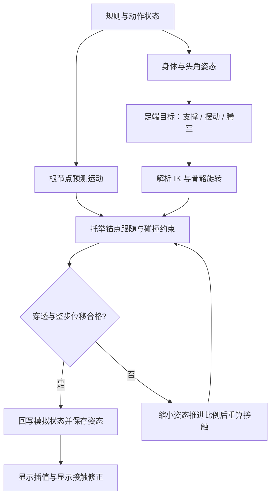

# BugDuel 关键技术说明

> 根据当前代码核对：2026-10-12。本文说明已经实现的算法、数据流、参数和限制；算法改动后应同步维护。
> 模块职责、入口、状态归属与接口总览见 [Intro.md：项目地图](Intro.md)。本文重点是 IK、程序动画、接触物理、托举反馈和运动连续性。
> 文件路径均相对于 BugDuel 项目根目录。以下简写 `Runtime/` 和 `Editor/` 分别指 `Assets/BeetleArena/Runtime/`、`Assets/BeetleArena/Editor/`。

## 阅读导航

1. [整体技术路线与坐标约定](#1-整体技术路线与坐标约定)
2. [真实模型的骨架与蒙皮生成](#2-真实模型的骨架与蒙皮生成)
3. [固定步模拟与显示帧](#3-固定步模拟与显示帧)
4. [六足步态：先决定脚去哪里](#4-六足步态先决定脚去哪里)
5. [两段式解析 IK：再求关节怎么转](#5-两段式解析-ik再求关节怎么转)
6. [非平地支持与身体姿态](#6-非平地支持与身体姿态)
7. [状态转换与攻击结算](#7-状态转换与攻击结算)
8. [碰撞代理与穿透修正](#8-碰撞代理与穿透修正)
9. [托举：接触点如何带动对手](#9-托举接触点如何带动对手)
10. [腾空计时与从慢到快的挣扎](#10-腾空计时与从慢到快的挣扎)
11. [防止顶举结束后瞬移](#11-防止顶举结束后瞬移)
12. [自由运动、落地和落台](#12-自由运动落地和落台)
13. [随机性、复现与性能](#13-随机性复现与性能)
14. [卡通渲染](#14-卡通渲染)
15. [调参、排障和验证](#15-调参排障和验证)
16. [扩展约束与维护规则](#16-扩展约束与维护规则)
17. [可插拔动作、接触响应与活体时钟](#17-可插拔动作接触响应与活体时钟)
18. [场景分组与引用安全](#18-场景分组与引用安全)

## 1. 整体技术路线与坐标约定

### 1.1 运行时由谁计算什么

当前项目组合了三类算法：

- **规则模拟**：`BeetleSimulation` 保存双方位置、速度、体力、平衡、动作、托举时序和比赛结果。
- **程序姿态**：`BeetleProceduralAnimator` 生成身体、头角和六足目标；`BeetleModelRig` 把足端目标转换为真实骨骼旋转。
- **几何接触约束**：`BeetleContactSolver` 使用 Unity 的碰撞查询检测重叠，修正根节点及必要的局部姿态；合格结果再保存为本步姿态。

根节点上的 Rigidbody 为运动学刚体，关闭内置重力。比赛中的重力、推顶、托举和位置修正由代码计算。模型上的碰撞体主要作为查询形状使用，不能把 `AddForce()` 接到当前流程中就期待它接管运动。

这套实现是面向游戏表现的运动学与动力学近似：有重力、质量相关速度变化、抓地指标、接触锚点和防穿透，但没有完整求解每个关节的刚体动力学、肌肉力矩、接触摩擦锥或六足力分配。



重试有次数上限；所有尝试都失败时保留此前姿态，持续受阻的托举会提前释放，流程不会无限循环。

### 1.2 坐标与单位

| 数据 | 所处空间 / 含义 |
| --- | --- |
| `BeetleState.Position`、`Velocity` | `Vector2`，分别对应世界 X、Z 平面 |
| `Height`、`VerticalVelocity` | 世界 Y 方向位置与速度 |
| `Heading` | 水平朝向，角度制；与地面倾斜分开保存 |
| `SurfaceNormal` | 世界空间地表法线 |
| `leg.planted`、`stepFrom`、`stepTo`、IK 输入 `target` | 世界空间足端点 |
| `leg.restAnkle` | 模型空间名义足端位置；当前真实模型中实际表示爪端接触点，并非踝骨原点 |
| `footOffsetInModel` | 绑定姿态下踝到爪端的模型空间偏移 |
| `bendInBody` | 身体局部空间中的膝弯曲提示方向 |
| 骨骼快照 | 局部位置、局部旋转、局部缩放；根节点另外处理 |

世界采用 Y 向上、甲虫模型 Z 向前。模型缩放为 `settings.visualScale * traits.size`，默认基础值为 `0.70`。IK 使用 `Abs(model.lossyScale.x)` 换算长度，因此当前绑定要求均匀缩放。

展示用毫米、克来自个体属性；运动采用归一化游戏单位。重力数值为 `9.81`，不意味着整个模型已经按现实米、千克完成标定。

## 2. 真实模型的骨架与蒙皮生成

**实现文件：** `Editor/Model/BeetleImportedModelBuilder.cs`、`Runtime/Rig/BeetleModelRig.cs`。

### 2.1 当前 FBX 的实际情况

`Assets/bug.fbx` 是由 22 个静态网格部分组成的模型，没有可直接驱动的原生骨架和动画。编辑器构建器依据当前模型的部件编号、实测关节点及方向约定，生成 `Generated/ArticulatedBeetle.prefab`。

这不是任意 FBX 的自动识别器。当前算法包含部件名称末尾编号和指定关节坐标的绑定知识，换模型时必须重新建立这些对应关系。

源模型到运行时模型的点转换为：

```text
Point(p)     = (-p.z * 5, (0.17 - p.x) * 5, (p.y - 0.43) * 5)
Direction(p) = (-p.z, -p.x, p.y)
```

点带有平移和缩放，方向不带平移。源模型的头向、背向和侧向经过该转换，成为运行时的 Z 前、Y 上、X 侧。

### 2.2 骨架层级

```text
甲虫根节点（模拟拥有世界位置）
└── FBX Model（统一模型缩放）
    └── Body（身体俯仰、侧倾和小幅姿态抬升）
        ├── Head（头角俯仰 / 偏转）
        ├── 左前腿 Hip → Knee → Ankle → Tip
        ├── 左中腿 Hip → Knee → Ankle → Tip
        ├── 左后腿 Hip → Knee → Ankle → Tip
        ├── 右前腿 Hip → Knee → Ankle → Tip
        ├── 右中腿 Hip → Knee → Ankle → Tip
        └── 右后腿 Hip → Knee → Ankle → Tip
```

六腿数组顺序固定为左前、左中、左后、右前、右中、右后。`side` 为左 `-1`、右 `+1`，`pair` 为前 `0`、中 `1`、后 `2`；索引为 `(side < 0 ? 0 : 3) + pair`。

每条腿的 `LegBinding` 至少包含：

- `hip / knee / ankle / tip`：骨骼和实际末端引用。
- `hipRest / kneeRest`：绑定旋转，求解前恢复，避免累计旋转误差。
- `upperLength / lowerLength`：由关节点位置计算的固定段长。
- `footOffsetInModel`：保留原始足节形状所需的踝到爪端偏移。
- `bendInBody / lastBend`：初始弯曲方向和上次有效弯曲方向。
- `targetError`：实际足端到经过限制后的目标的距离，供诊断使用。

腿节长度在运行时保持不变。步态通过旋转关节完成，不通过拉长腿网格追赶目标。

### 2.3 蒙皮如何得到

构建器为 11 个腿部网格生成蒙皮，另外 11 个部件保持刚性绑定。原始顶点、三角形、UV 和纹理关系通过生成的网格副本保留。

权重生成大致过程：

1. 找出顶点离 `hip→knee`、`knee→ankle`、`ankle→tip` 哪一段最近。
2. 远离关节的顶点赋给对应骨骼。
3. 接近相邻关节的顶点，根据关节附近的方向与距离，在相邻两骨骼之间平滑混合。
4. 设置 `bindposes = bone.worldToLocalMatrix * model.localToWorldMatrix`。

当前每顶点最多使用两根骨骼权重；渲染器设置 `SkinQuality.Bone2`。关节附近的权重混合控制弯折外观，IK 本身不修复错误权重。

足底补偿 `soleOffset` 来自足部网格的最低位置估算，用于弥补“骨骼端点到真实网格底面”之间的差距。缺少该补偿时，即使目标点落在地表，足部网格仍可能插入地面。

运行时不需要每帧 `BakeMesh()` 来生成碰撞网格。碰撞使用随骨骼运动的简化代理；蒙皮网格只负责显示。验证工具可以烘焙网格进行检查。

## 3. 固定步模拟与显示帧

**实现文件：** `Actors/BeetleMatchController.cs`、`Actors/BeetleActor.cs`、`Animation/BeetlePoseBuffer.cs`。

### 3.1 两个更新频率

模拟固定步长为 `BeetleSimulation.FixedStep = 0.02s`，即每秒 50 步。控制器通过 `Update()` 内的累积时间循环调用模拟，并非依赖 Unity 的 `FixedUpdate()`。

```text
dt = 暂停 ? 0 : min(unscaledDeltaTime, 0.1)
accumulator += dt

while accumulator >= 0.02:
    每只甲虫 BeforeStep()
    simulation.Step(0.02)
    accumulator -= 0.02

alpha = accumulator / 0.02
每只甲虫 Render(alpha, ...)
contacts.ProjectView(simulation, dt)
```

帧时间被限制为最多 `0.1s`。严重卡顿时不会无限追赶丢失时间；因此长时间低帧率下，模拟时间与现实经过时间可能不一致。

### 3.2 必须区分三种姿态

| 姿态 | 保存位置 | 用途 |
| --- | --- | --- |
| 模拟状态 | `BeetleState` | 规则、命中、运动、胜负 |
| 固定步已接受姿态 | `BeetleActor` + `BeetlePoseBuffer` | 下一步起点、显示插值端点 |
| 当前显示姿态 | 场景 Transform + `viewMotion` | 屏幕显示及该显示帧的防穿透 |

`BeetlePoseBuffer` 保存模型子节点的局部 TRS。根位置和根旋转由 `BeetleActor` 独立保存；根朝向同时包含水平 Heading 与地表倾斜。

`BeforeStep()` 会恢复上一固定步的完整模型姿态和根姿态，再开始本次计算。它不能只恢复骨骼而保留上一次显示帧修正过的根位置，否则显示结果就会污染下一次模拟的起点。

`Render()` 对根位置做 Lerp，对旋转做 Slerp，并插值骨骼快照。正常接触驱动路径不会在显示帧再次推进步态、动作计时或随机数。

### 3.3 一次模拟步的顺序

正式战斗阶段的主要顺序是：

1. 更新交锋阶段和已有托举反馈。
2. 更新计时、冷却、体力与 AI 动作。
3. 先计算双方的命中结果，再按选手索引应用结果。
4. 积分双方平面及竖直运动。
5. 生成程序姿态、求 IK、跟随托举锚点、求解接触。
6. 回写根位置、高度、接触等状态，保存本步骨骼姿态。
7. 检查落台并更新比赛结果。

双方命中先计算后应用，可以减少“先执行的一方改变动作，导致另一方本步无法计算命中”的顺序偏差；结果应用仍按索引执行，不能视为完整的同时刚体冲量求解。

## 4. 六足步态：先决定脚去哪里

**实现文件：** `Animation/BeetleProceduralAnimator.cs`，重点为 `Pose()`、`NominalFoot()`、`FootHeight()`、`AcceptSolvedPose()`。

IK 只回答“如何到达给定目标”。什么时候抬腿、脚放哪里、空中摆动、落地混合，都由 IK 前面的步态层决定。

### 4.1 每条腿的运行状态

| 字段 | 含义 |
| --- | --- |
| `planted` | 当前世界足端目标；支撑期保持固定，摆动期沿轨迹更新 |
| `stepFrom / stepTo` | 本次摆动的起点和终点 |
| `stepping` | 是否正在迈步 |
| `stepTime / stepDuration` | 摆动归一化进度与持续时间 |
| `lastFoot` | 上次已接受姿态中的实际足端，可能与理想目标不同 |
| `landingFrom / landingBlend` | 空中转落地时的实际起点与混合进度 |

支撑期的目标点放在世界空间。身体向前移动时，脚仍停留在原来的世界位置，IK 调整髋和膝补偿身体运动，从而形成落脚感。

如果每帧都将支撑脚目标重新绑定在身体局部位置，脚会跟着身体平移，即使 IK 数学完全正确也会明显滑步。

### 4.2 名义落脚点与迈步触发

名义点由模型空间的 `restAnkle` 转到世界空间，再通过地表采样设定足底高度。它代表当前身体位置和朝向下，这条腿适合回到的支撑位置。

正常迈步需同时满足：

- 当前没有迈步。
- `planted` 与名义点的误差超过 `0.16 * size`。
- 当前腿进入允许的步态相位窗口。
- 同时摆动的腿数尚未超过预算。

当脚过分靠近身体中线，或误差超过 `0.40 * size`，会触发紧急调整，允许跳过正常相位窗口。

起步时的目标加入 `Velocity * 0.17` 的平面预测偏移。终点在该步开始时确定，不会每帧跟随身体重新漂移。

### 4.3 慢走、快走与发力时的支撑预算

速度超过 `0.55` 且不处于承诺动作时，进入较快步态：

- 第一组三足：左前、左后、右中，相位偏移为 0。
- 第二组三足：左中、右前、右后，相位偏移为 0.5。
- 慢速使用按前中后错开的波浪相位。

普通同时迈步预算：快走最多 3 条，慢走最多 2 条；承诺动作或撑地时最多 1 条。紧急调整预算可到 3 条。

该预算约束的是“是否开启新的一步”。已经开始的摆动不会在动作切换时立刻取消，因此瞬时摆动数不一定马上降到新预算。

### 4.4 摆动轨迹

设归一化摆动进度为 `t`，平滑函数为：

```text
S(t) = 3t² - 2t³，t 限制在 [0, 1]
foot = Lerp(stepFrom, stepTo, S(t))
foot.y += sin(πt) * 0.13 * size
```

持续时间分别为：紧急 `0.12s`、快步 `0.17s`、慢步 `0.25s`。每个模拟步还对当前摆动点做地形高度检查，保证不低于足底高度加上当前抬脚弧线所要求的余量。

这里采样的是离散模拟步中的当前位置，并没有对整条曲线进行连续扫掠。很窄的障碍仍可能需要更密集采样或额外的摆动路径规划。

### 4.5 落地与异常恢复

从腾空转为落地时，记录上一已接受姿态中的实际足端 `lastFoot`，再用约 `0.18s` 过渡回支撑目标，避免直接跳回名义站姿。

接触求解结束后，`AcceptSolvedPose()` 记录实际脚位；当姿态推进被缩小时，也同步内部头、身体角度缓存。支撑点不会随根节点碰撞修正一起平移，否则会人为造成滑步。

代码还有应急重置：根位移超过 2 个世界单位，或足点严重越过身体中线、偏差超过 `1.5 * size` 时，重新建立落脚点。这些是处理瞬移和异常初始状态的兜底，不属于正常连续步态。

## 5. 两段式解析 IK：再求关节怎么转

**主实现：** `Runtime/Rig/BeetleModelRig.cs` 的 `Solve()`。

`BeetleProceduralAnimator.SolveLeg()` 检测到 `importedRig` 后，会直接调用上述实现。该方法后面的旧几何体腿算法是备用分支，修改真实模型腿部时应先确认修改的是正在使用的分支。

### 5.1 问题定义

一条腿有髋 H、膝 K、踝 A、爪端 T。两个主要可弯折长度为：

```text
L1 = |K - H|   // 上腿段
L2 = |A - K|   // 下腿段
```

程序给出爪端目标和足节朝向，先反推出踝目标，再求髋、膝旋转。第三段足节的原始形状作为固定偏移保留；这不是任意三段链的全自由度 IK。

### 5.2 第一步：限制目标活动区域

把世界目标转回模型局部空间，保证目标仍位于本腿一侧：

```text
local.x = side * max(abs(restAnkle.x) * 0.55, local.x * side)
local.z = clamp(local.z, restAnkle.z - 0.55, restAnkle.z + 0.55)
```

随后转回世界空间。这样可以减少左右腿跨过中线、前后腿互相穿越的情况，但它只是足端活动区域限制，不是完整的生物关节角限位。

接地时采样足端下方地表，将目标 Y 限制为至少：

```text
地表高度 + (soleClearance + soleOffset) * 模型缩放
```

### 5.3 第二步：足端目标转换成踝目标

足节旋转由地面法线和 Heading 构成：

```text
footFrame = FromToRotation(up, surfaceNormal) * Euler(0, Heading, 0)
ankleTarget = tipTarget - footFrame * (footOffsetInModel * scale)
```

腾空或已经落台时使用 `model.rotation` 作为足节方向参考。

必须先减去足节偏移。如果把爪端目标直接当作踝目标求解，整段足节还会从踝继续伸出去，实际脚尖就会偏离地面目标。

### 5.4 第三步：限制可达距离

令 `offset = ankleTarget - H`，方向为其单位向量 `e`，长度为 `d`。当前代码限制：

```text
dMin = abs(L1 - L2) + 0.001 * scale
dMax = (L1 + L2) * (1 - reachMargin)
d = clamp(length(offset), dMin, dMax)
ankleTarget = H + e * d
```

`reachMargin` 默认 `0.015`。不允许腿完全伸直，有助于避免膝弯曲方向在接近奇异姿态时跳变；最短距离也保留小余量。输入方向接近零时使用向下方向兜底。

超出可达范围的目标会被收回可达区域，骨骼长度不会被拉长。因此 `targetError` 大于零不一定意味着求解公式错误，也可能是目标受距离或活动区域限制。

### 5.5 第四步：确定膝盖朝哪边弯

只有 H、踝目标和两段长度，不能唯一确定膝位置：膝可以绕 H→A 轴转成一个圆。需要弯曲提示向量来选择平面。

当前实现将身体局部的 `bendInBody` 转到世界空间，再投影到垂直于 `e` 的平面：

```text
pole = Normalize(ProjectOnPlane(body.TransformDirection(bendInBody), e))
```

当提示方向与 `e` 近乎平行、投影过小时，依次尝试：

1. 上一次有效方向 `lastBend`。
2. `model.right * side`，让腿倾向身体外侧。
3. `model.forward`。

使用历史方向和左右侧信息可以降低膝盖突然翻到另一侧的风险。只对最终旋转做平滑，无法补救每帧随机选择弯曲平面的问题。

### 5.6 第五步：由余弦定理求膝位置

沿 H→A 的投影距离 `x` 和垂直高度 `h` 为：

```text
x = (L1² - L2² + d²) / (2d)
h = sqrt(max(0, L1² - x²))
Ktarget = H + e * x + pole * h
```

例如 `L1 = L2 = 1`，目标距离 `d = 1.2`，则 `x = 0.6`、`h = 0.8`。膝位于主方向前进 0.6、弯曲方向偏出 0.8 的位置，两段长度仍都是 1。

根号内使用 `max(0, ...)`，避免浮点误差产生负数和 NaN。

### 5.7 第六步：把位置解变成骨骼旋转

恢复髋、膝的绑定旋转后，依次执行：

```csharp
hip.rotation = Quaternion.FromToRotation(
    knee.position - hip.position,
    kneeTarget - hip.position) * hip.rotation;

knee.rotation = Quaternion.FromToRotation(
    ankle.position - knee.position,
    ankleTarget - knee.position) * knee.rotation;

ankle.rotation = footFrame;
```

这是省略绑定对象前缀的算法摘录。先转髋，因为髋旋转会改变膝和踝的世界位置；然后用更新后的世界位置转膝，最后设置足节朝向。

### 5.8 IK 当前没有负责的事情

- 不决定什么时候迈步，不选择攻击状态。
- 不进行全身重心与支撑多边形优化。
- 不保证所有腿段、刺和爪子之间绝不相交；碰撞代理与接触修正负责后续几何检查。
- 没有为每个真实关节配置独立的解剖角度上下限。
- 不支持未经重新标定的非均匀缩放或任意坐标轴骨架。

## 6. 非平地支持与身体姿态

**实现文件：** `Environment/BeetleArenaSurface.cs`、`Simulation/BeetleSimulation.cs`、`Actors/BeetleActor.cs`、`Rig/BeetleModelRig.cs`。

### 6.1 统一地表接口

模拟与动画都通过 `IBeetleGround.Sample(Vector2, out BeetleGroundSample)` 获得高度、法线和抓地系数，避免身体认为地面在一个位置，而脚又使用另一套高度公式。

`BeetleArenaSurface` 在登记的支撑碰撞体上向下射线采样，选取有效表面；坡度超出 `maximumSlope` 的面不当作可站立地表，默认阈值为 38 度。

`supportColliders` 与 `contactColliders` 用途不同：前者回答“哪里可以站”，后者还可包含侧壁、台外地面等实体，回答“哪里不能穿过去”。地表采样不会把甲虫自己的碰撞体误认成台面。

### 6.2 身体法线与抓地估计

`UpdateGround()` 采样根节点和六个名义足位。足位与中心高度差较大时，支撑权重降低：

```text
reach = 1 - InverseLerp(0.45 * size, 0.85 * size, abs(footHeight - centerHeight))
Footing = 六个 reach 的总和 / 6
SurfaceNormal = Normalize(中心法线 + Σ(足位法线 * reach))
```

根朝向由地面倾斜与水平朝向组合；各脚还会独立使用自己目标点处的法线。移动牵引力进一步结合 `Footing`、个体 grip、地面 grip 和坡度；较陡坡面增加移动约束及滑移效果。

这里的 `Footing` 来自**名义足位采样**，并不是从六只实际脚上的接触力反推。实际足端高度另用于托举失去支撑的计时，两个指标不能混为一谈。

### 6.3 触角避地

`AvoidFeelerGround()` 对触角上的多个采样点检查地面，尝试 0～60 度、间隔 5 度的收拢姿态，选择能减轻入地的角度。靠近时较快收起，离开时较慢放松，响应系数分别为 35 和 7。

如果收拢仍不能完全避地，还允许身体姿态在模型局部最多抬高 `0.25`，之后重新求六足 IK。该值作用于身体姿态，不直接作为模拟根节点的攻击位移。

这是几何避障近似；触角没有作为独立动力学杆件参与碰撞反力求解。

## 7. 状态转换与攻击结算

**实现文件：** `Simulation/BeetleState.cs`、`Simulation/BeetleSimulation.cs`、`Simulation/BeetleLiftResponse.cs`。

### 7.1 三层状态各管一件事

| 层级 | 状态 | 作用 |
| --- | --- | --- |
| 比赛 | `Countdown → Fighting → Resolving → Finished` | 是否允许战斗、落台结算与比赛结束 |
| 交锋节奏 | `Probing → Clash → Recovery` 循环 | 试探、强冲突、短暂恢复的行为倾向 |
| 个体动作 | 观察、接近、绕行、试探、推顶、抬举、撑地、退让、受击、腾空等 | 当下运动意图、发力窗口和程序姿态 |

交锋阶段默认时长为 7、9、3.5 秒。阶段改变行为条件与倾向，不会替代动作自身的准备、命中和收招过程。

`SetAction()` 统一设置动作与持续时间，清零 `ActionTime`，并重置 `AttackApplied`。添加动作时必须检查：AI 能否进入、何时离开、是否消耗体力、是否属于承诺动作、动画如何表现、接触模式是否需要改变。

### 7.2 AI 为什么不会每帧重新抽动作

决策综合距离、对准程度、体力、平衡、边缘风险、交锋阶段和随机选择。已有动作的时长及决策间隔限制重新选择频率；部分随机分支共用一次随机值按顺序判断，所以各条件不是相互独立的概率事件。

`Committed` 用于识别正在执行的发力动作，影响转向、步态预算和体力；被托举者主要由 `Airborne` 和托举状态接管，而不是继续执行常规地面追击。

### 7.3 一次攻击只结算一次

`ComputeHit()` 检查比赛阶段、双方状态、动作类型、朝向、距离、高度差、命中窗口和 `AttackApplied`。接触场景中的 `TouchingOpponent` 来自已完成的接触求解，所以通常反映前一固定步的接触结果。

当前抬举窗口从动作归一化进度 `pryContactStart = 0.16` 开始，其他相关攻击使用各自判定。有效攻击登记后设置 `AttackApplied`，避免同一个动作每步重复扣体力或施加冲量。

抬举还需要后续真实角部接触捕获成功。捕获失败时允许在该动作剩余窗口继续尝试，而不会自动转成隔空向上冲量。

### 7.4 发力、抓地与位移

普通攻击的效果由个体力量、剩余体力、鼓励加成、平衡、抓地和动作倍率组合。阻力中包含 `grip`、体力、`Balance`、`Footing`，撑地动作进一步增强抵抗。

普通推顶可以修改平面速度；托举则通过下一节的接触锚点与姿态变化让对方离地。单独增大 `pryImpulse` 不会直接变成更大的上抛速度，它主要影响能否克服抓地的力量判断。

长局的 `openingSeconds`、`escalationSeconds` 使位移效果逐渐增强。它们不是倒计时判胜条件，无法保证每局必定在 1～3 分钟结束。

## 8. 碰撞代理与穿透修正

**实现文件：** `Physics/BeetleContactRig.cs`、`Physics/BeetleContactSolver.cs`，代理由模型构建器生成。

### 8.1 用哪些形状代表甲虫

当前每只甲虫有 29 个碰撞代理：

- 六条腿各 3 个胶囊，共 18 个。
- 腹、胸、头的凸壳代理，共 3 个。
- 头角主干、分叉、尖端及胸角等，共 8 个胶囊。

胶囊和凸壳随相应骨骼运动。角色分类区分腿、头角、身体等；部分分类依赖生成对象名称，如左右、前中后腿和 `Thoracic horn`。修改命名时必须同步检查 `BeetleContactRig` 的分类规则。

代理不是逐三角形复制显示网格。较小的爪尖、倒刺和薄片仍可能超出代理范围，因此“代理没有穿透”与“每个可见顶点绝无交叠”不是同一个保证。

### 8.2 检测分两层

1. **包围盒筛选**：检查整只甲虫和各形状的 AABB 是否相交，排除明显无关的组合。
2. **精确代理查询**：对候选形状调用 `Physics.ComputePenetration()`，得到分离方向和穿透深度。

骨骼或根变换改变后，需要 `Physics.SyncTransforms()` 和更新形状缓存。`ContactRig.Translate()` 能同时平移缓存包围盒；骨骼旋转后则必须重新缓存。

接触查询给出的是当前形状如何脱离重叠，不自动提供合理的攻击反应、冲量、摩擦或关节动作，这些需要项目自己的求解策略。

### 8.3 按接触场景选择分离策略

| 场景 | 方法 | 核心策略 |
| --- | --- | --- |
| 普通相遇 / 推挤 | `SeparateCentered()` | 沿双方水平中心连线分离，按质量分配位移，抑制继续闭合的平面速度 |
| 低头入角 | `SeparateInsertion()` | 使用接触法线的水平分量，小步调整；攻击者承担较多退让，减少将防守者整只推走 |
| 已建立托举 | `SeparateSupported()` | 允许三维分离，使受击者在角部支撑下向上移动 |
| 与台面 / 侧壁接触 | `ResolveArena()` | 沿环境接触方向修正；台面与侧壁分别处理 |

普通分离的质量权重使较轻者承担较大位移。入角模式中攻击者通常承担约 75% 的水平修正。局部循环设有次数上限和单次位移上限，随后还需检查整步结果是否可接受。

### 8.4 为什么要交替处理甲虫与擂台

把一只甲虫从另一只甲虫中推出后，它可能进入台面；从台面推出又可能挤回对手。`Constrain()` 因此交替进行：

```text
双方分离 → A 与环境分离 → B 与环境分离 → 检查残余
```

外层最多 8 轮。最终还会测量双方以及环境的全部残余，防止最后一次环境修正重新造成虫间穿透而遗漏检查。

循环中的提前退出深度约为 `0.0005`，运动接受阈值为 `0.001` 世界单位。它们与碰撞皮肤余量、验证工具允许误差有不同用途，不能随意互相替换。

### 8.5 局部避让与地面反作用

入角、托举和收角期间，`YieldArticulatedContacts()` 会检查角对角和腿部冲突，先进行小幅头角或腿目标避让，再求整体分离。

- 头角根据接触法线方向小幅抬起，每次局部修正约 4 度。
- 腿目标向接触分离方向、身体外侧及上方少量偏移，再重新求 IK。
- 同一轮用标记避免同一头或同一腿反复接受相同局部修正。

受击者还贴近台面时，如果角部重叠要求把它向下推，继续下推会与地面约束互相抵消。当前会让攻击者适度水平退让，避免“往下推受击者—地面再顶起—再次重叠”的循环。

### 8.6 连续检测的实际边界

根 Rigidbody 设置了 `ContinuousSpeculative`，但主要位置与关节姿态仍由自定义查询求解器直接控制。这一选项不能等同于“整只甲虫的所有骨骼都经过连续扫掠检测”。

当前防护依靠固定步、姿态变化限制、代理查询和安全姿态回退；没有实现每根骨骼从上一姿态到下一姿态的完整连续凸体扫掠。

## 9. 托举：接触点如何带动对手

**实现文件：** `Physics/BeetleHornSupport.cs`、`Physics/BeetleContactSolver.cs`、`Simulation/BeetleLiftResponse.cs`、`Simulation/BeetleSimulation.cs`。

### 9.1 必须先建立几何接触

有效抬举通过 `IBeetleLiftContacts.TryBeginLift()` 请求接触层建立支撑；接触层调用 `BeetleHornSupport.TryCapture()`。

只接受攻击者头角代理与防守者身体代理的候选，排除防守者胸角。腿碰腿、角尖对角尖不会直接成为身体托举锚点。

对每对候选形状交替查询最近点，得到角点 `p` 和身体点 `q`，当前条件包括：

```text
|p - q| <= 0.085
p.y <= q.y + 0.055
(p.y + q.y) / 2 <= 受击身体代理包围盒中心高度 + 0.03
```

这些是结合当前模型调校的几何容差，用于筛选角从较低位置托住实体的情况，不是现实接触力的测量值。

### 9.2 锚点保存在各自局部空间

选定接触后取两点中点 `contact`，分别保存为：

```text
hornPoint = horn.InverseTransformPoint(contact)
receiverPoint = receiver.InverseTransformPoint(contact)
```

头角抬起后，用骨骼变换重新计算两个世界点：

```text
error = horn.TransformPoint(hornPoint) - receiver.TransformPoint(receiverPoint)
rootCorrection = ClampMagnitude(error, liftFollowSpeed * dt)
```

默认 `liftFollowSpeed = 2.8`，在 `0.02s` 中锚点跟随本身最多移动 `0.056` 世界单位。随后还必须通过碰撞与整步位移检查。

受击者没有被设置为攻击者的子节点，也不是在命中那一刻直接提高固定高度。其移动方向来自转动后的真实局部接触点差，所以头角上抬可以转化为受击身体向上的反馈。

### 9.3 抬头—承重—末段加速的时序

`ApplySupportedPry()` 在一次有效入角时选择发力系数 `Effort`，结合当次攻击力生成抬起时间、保持时间和目标抬头幅度。随机只在动作建立时抽取；不会每帧重新抽取方向或距离。

- `Effort` 的基础变化为 0.85～1.18；合格且抽中额外爆发时再乘 1.5。
- `RaiseSeconds` 在配置抬起时间的 0.7～1.1 倍之间变化。
- `HoldSeconds` 在配置保持时间的 0.35～1 倍之间变化；额外爆发将保持时间再乘 0.12，表现为直接猛撬。
- `SnapSeconds` 以 `throwSnapSeconds` 为基准，根据驱动力在 0.8～1.2 倍之间变化。
- `SweepTarget` 是相对入角时实际头部角度的抬头幅度，在 98～138 度之间变化。

抬头进度由两段曲线组成：前段 SmoothStep 完成总幅度的 56%，承重阶段保持，最后 44% 使用 `snap²` 加速完成。攻击者动画从进入动作时实际 `liftingHeadStart` 开始，以指数平滑接近该目标；碰撞仍可限制实际推进。

六足仍按前、中、后逐步松开。受击者身体俯仰由原有托举反馈驱动，离地挣扎继续使用真实足部失去支撑的计时。

### 9.4 参考了什么杠杆原理

实现参考了角作为输出力臂、头部作为输入杠杆系统的研究，以及入角后克服对手抓地、将其撬离支撑面的行为描述。[Weber 等，2023，角长与抬举力量](https://doi.org/10.1016/j.cub.2023.08.066)、[McCullough，2014，甲虫武器的力学限制](https://pmc.ncbi.nlm.nih.gov/articles/PMC4046419/)

代码使用以下关系：

```text
输入力矩 τ = 肌肉输入力 × 输入力臂
接触输出力 Fout = max(0, τ / 接触输出力臂 - 抓地阻力近似)
有效功 W += Fout × 输出力臂 × 实际抬头角增量 × 接触质量
有效冲量 J += Fout × dt × 接触质量（仅实际抬头时累计）
能量速度上限 vW = sqrt(2 × W × 效率 / 对手质量)
冲量速度尺度 vJ = J / 对手质量
```

这是归一化游戏模型；具体力、效率、角度范围与反抛门槛由项目调校，不是论文给出的生物测量值。论文支持杠杆与抓地关系，不能据此声称当前每次身后反抛的角度、概率都经过实验验证。

### 9.5 实际接触如何转成测量样本

新增 `Runtime/Simulation/BeetleThrowMechanics.cs`，接触采样入口为 `BeetleHornSupport.Measure()`。它只在 `ContactSolver.Solve()` 完成全部约束和回退、保存已接受姿态后执行。

1. 从攻击者头骨的局部 X 角读取相邻已接受姿态的抬头增量，消除绕角表示跳变，只累计正向抬头。
2. 从头部枢轴指向实际角接触锚点得到 `radial`；投影到垂直转轴的平面，长度作为输出力臂。
3. `Cross(-headPivot.right, radial)` 给出扬角时的切向方向，保存在 `ReleaseTangent`。
4. 两个锚点误差小于 0.10 时按充分接触计算，0.10～0.45 之间降低接触质量，超过范围不累计有效功和冲量。
5. 输入力矩结合个体力量、剩余体力、鼓励、攻击者抓地和平衡；受击者尚未脱足时扣除抓地阻力近似。

`ContactSeconds` 记录加权接触时长，`LostContactSeconds` 记录连续失去有效接触的时间。静止保持可以增加接触时长，但没有抬头角增量就不会增加功或冲量，不能站着等待无限蓄力。功受 `throwWorkLimit` 限制。

没有场景接触求解器的纯数据测试使用理想杆角度近似。真实模型路径始终使用最终接受的实际骨骼测量；渲染插值、碰撞失败候选均不计入。

### 9.6 出手时机与连续程度

满足末段加速时序且实际累计抬头达到目标的一定比例时出手。连续滑脱、持续受阻、动作超时或攻击者状态中断也会结束支撑。

成功撬投要求有效接触至少 0.08 秒、功至少 0.5、实际抬头至少 12 度，并且已经脱足或根节点确实离开台面超过 0.12。未建立有效托举的失败入角只能撤角，不能隔空发射。

成功出手没有轻放分支。`ThrowOpponent()` 调用 `BeetleThrowMechanics.Release()`，只赋予速度，不瞬移根位置：

```text
speed = clamp(min(vW, vJ + 0.4 × vW), throwMinimumSpeed, throwMaximumSpeed)
```

最低速度是避免成功动作退化成轻放的表现下限，最高速度限制极端输入；两者都是游戏调校。方向取接触切线对应的仰角及有限侧向分量。

普通能量下，允许仰角上限随单位质量的有效功从 38 度增至 82 度，因此不同接触过程会产生不同高度和距离。身后反抛同时要求：

- `HeadSweep >= throwOverheadSweep`，默认 82 度。
- `Work / mass >= throwOverheadWork`，默认 32。
- `PeakAngularSpeed >= throwOverheadAngularSpeed`，默认 2.5 弧度/秒。

达到门槛才保留切线中的向后分量，允许仰角上限根据出手速度在 100～118 度之间连续变化，为越过攻击者留出高度。门槛并不保证必然反抛：实际接触切线仍需指向后上方。所有碰撞保持开启。

当前划分为 **6 档**，速度单位为游戏世界单位/秒。档位根据计算完成的实际出手速度与方向判定，阈值不等距：

| 档 | 枚举 | 名称 | 默认出手速度条件 | 方向 / 表现 |
| --- | --- | --- | --- | --- |
| 1 | `ShortPry` | 近身短撬 | `< 3.15`（默认下限 2.2） | 向前，仍有向上速度，不能轻放 |
| 2 | `QuickPry` | 快速前抛 | `3.15 ≤ v < 4.35` | 向前，短至中等弧线 |
| 3 | `ArcThrow` | 中弧抛 | `4.35 ≤ v < 5.65` | 向前，中等抛掷 |
| 4 | `HighArc` | 高弧强抛 | `v ≥ 5.65` | 向前，允许高能量；未通过反抛门槛仍停留此类 |
| 5 | `Overhead` | 后扬抛 | `v < 7.1` 且实际向后 | 必须先通过实际转角、做功和角速度门槛 |
| 6 | `PowerOverhead` | 强力越顶反抛 | `v ≥ 7.1` 且实际向后 | 同样要求有效反抛条件，强回抛轨迹 |

前四档的轨迹仍按原来的连续比功仰角上限计算。后两档允许仰角上限随速度连续从 100° 增至 118°；跨过 7.1 阈值时不会突然替换速度、角度或骨骼姿态。具体是否落到身后还取决于释放位置、碰撞与落地高度。

`throwQuickSpeed / throwArcSpeed / throwHighArcSpeed / throwPowerOverheadSpeed` 是 Inspector 中的四个分档阈值；`Validate()` 保持它们递增并位于速度范围内。只调阈值会改变分类和反馈，出手速度仍由接触做功与冲量计算。`Classify()` 负责分类，`TierNumber()` 映射 1～6，`Description()` 提供事件反馈。

为保持已有枚举数值不变，三个新类型追加在枚举末尾；不要直接把枚举整数当显示档位。`LaunchVelocity / LaunchElevation` 保存连续出手结果，同一档内部也存在不同的距离和角度。

### 9.7 额外爆发与兼容参数

`tossChance` 默认 0.08，现在只控制合格入角中的额外爆发，`BurstEffort` 保存该选择。设为 0 后，普通成功顶举仍会抛出。`Throws` 统计全部撬投，`Tosses` 统计额外爆发的猛挑。

旧的固定水平冲量 `tossHorizontalImpulse` 和固定上抛速度 `tossVerticalSpeed` 已移除；调整强度应使用力矩、效率、速度上限及反抛门槛参数。释放后仍由重力、环境接触及落台规则决定结果。

### 9.8 当前约束的限制

角部锚点仍是限速的几何跟随约束，没有完整求解单向压力、摩擦锥或接触点沿壳面的迁移。功/冲量积分用于连续控制游戏出手，不是全身关节刚体动力学求解。

普通抛投的仰角范围与最低速度带有表现约束；完整连续骨骼扫掠、精确弹性储能和接触滑脱力矩仍未实现。进一步扩展时必须保留固定步采样、有效接触门槛以及显示帧不回写状态的边界。

## 10. 腾空计时与从慢到快的挣扎

**实现文件：** `BeetleContactSolver.UpdateFootSupport()`、`BeetleProceduralAnimator.UpdateStruggle()` 和 `Pose()` 的腾空分支。

### 10.1 何时开始计算 0.7 秒

`Lift.Time` 表示托举状态经过多久；`Lift.UnsupportedTime` 表示实际失去足部支撑后的累计时间。挣扎使用后者。

接触求解完成后，检查六个实际 `tip.position`。扣除足底补偿后，足端高于地表约 `0.045` 世界单位才算离开；全部脚都没有足够近的地表支撑时，将 `GripReleased` 锁存为真并开始累计。

锁存后，空中挣扎偶尔擦过地表不会立即把计时清零。正常落回擂台会重置。落台时 `Lift.UnsupportedTime` 可以被接触层清理，但 `Fall.UnsupportedSeconds` 接续离地时长，动画不会因判负而停腿。某脚下方采样不到有效地表，也不会被当作有支撑。

动画读取上次已完成接触求解的时间，因此可能有一个固定步的响应延迟，这比用尚未通过碰撞检查的候选脚位推进时钟更稳定。

### 10.2 振幅和频率分别控制

令：

```text
t = max(0, UnsupportedTime - liftStruggleDelay)
T = max(0.1, struggleRampSeconds)
u = clamp01(t / T)
S(u) = 3u² - 2u³
f0 = struggleStartHz
df = struggleMaxHz - f0
```

当前默认值为延迟 `0.7s`，频率从 `0.65Hz` 升至 `3.2Hz`，升速时间 `1.1s`。振幅权重另外用约 `0.35s` 淡入：

```text
频率 = f0 + df * S(u)
振幅权重 = S(clamp01(t / 0.35))
```

`t = 0` 时对外诊断频率与挣扎权重为零；实际开始挣扎后采用上述升速曲线。频率控制“多快”，振幅控制“多大”，不能只提高振幅来表现越来越急促。

### 10.3 为什么相位要积分

如果写成 `sin(2π * frequency(t) * t)`，相位导数还会包含 `t * frequency'(t)`，实际摆动速度会偏离设定频率，调节频率时也容易出现突兀变化。

当前实现对频率曲线解析积分，先计算累计周期：

```text
cycles = f0 * t + df * (T * (u³ - 0.5u⁴) + max(0, t - T))
phase = 2π * cycles
```

当 `t >= T` 时，继续以最大频率累计相位；曲线在升速结束处连续。相位直接由模拟状态计算，显示帧不会额外累加。

### 10.4 六条腿如何错开

每条腿使用不同相位：

```text
cycle = phase + pair * 2.2 + side * 1.1
amplitude = 0.36 * StruggleWeight
```

目标由收腿偏移和三个方向的正弦 / 余弦摆动构成，纵向还使用不同频率倍率，再经身体变换转为世界目标，最后仍走同一套真实模型 IK。

这样可以保留真实腿长和弯曲方向，同时避免六条腿完全同步摆动。该动作不额外施加踢腿冲量；它目前是反馈动画，碰撞代理仍参与防穿透。

## 11. 防止顶举结束后瞬移

**实现文件：** `Physics/BeetleContactMotion.cs`、`Physics/BeetleContactSolver.cs`、`Actors/BeetleActor.cs`、`Animation/BeetleProceduralAnimator.cs`。

### 11.1 产生突变的常见来源

- 从托举切换到收角时，头部从硬编码角度开始，导致角代理突然深入对手。
- 一次局部碰撞修正很小，但多轮迭代的总位移很大。
- 显示修正后的根位置被错误地当成下一模拟步起点。
- 固定步两端都无穿透，插值中间的长角却扫入另一只甲虫。
- 为避免穿透直接回退到某个固定步端点，造成显示位置来回跳。

### 11.2 收角从实际姿态开始

进入 `Lifting` 时记录实际头角和偏转；进入 `ReleaseLift` 或 `Toss` 时记录实际头部与身体俯仰，再从这些角度混合到收角目标。

这使被碰撞修正、受阻或提前打断的动作也能从当前可见姿态继续，而不是假定上一动作总能完整达到设计终点。

### 11.3 对整步位移设预算

`BeetleContactMotion` 保存起始与候选根及骨骼姿态，供尝试不同推进比例。每只甲虫的根位移预算为：

```text
physicalSpeed = length(Vector3(vx, Airborne ? vy : 0, vz))
budget = max(contactMotionSpeed, physicalSpeed + 0.5) * dt
```

默认 `contactMotionSpeed = 4`。低速状态每个固定步的预算通常为 `0.08` 世界单位；高速挑飞根据物理速度放宽，避免把合法腾空运动强行限制成慢动作。

这是本步起点到最终根位置的总距离预算，不只是某一次 `Translate()` 的长度上限。

### 11.4 缩小姿态推进，再重新求碰撞

处理顺序为：

1. 保存此前已接受姿态和当前平面速度。
2. 生成本步候选姿态，执行局部避让、锚点跟随和整体约束。
3. 如果残余深度大于 `0.001`，或根位移超预算，则尝试 `1/2、1/4……1/128` 的姿态推进。
4. 每次重试都重新同步碰撞、执行必要局部避让并约束，检查最终结果。
5. 接受第一个符合条件的结果；全部失败则恢复此前姿态与保存的平面速度。

不能先完成大幅推出，再单纯截断最终位置：被截断的位置可能仍在另一只甲虫内部。当前方法缩小造成冲突的姿态变化，并重新证明候选结果满足检查。

局部头角避让在重试中仍会重新执行，避免把必要的让角也随着推进比例缩得过小，导致所有重试都被同一处角角接触阻塞。

该回退只针对本次姿态候选及相关速度，不回滚整场模拟的所有计时和随机状态。持续受阻通过 `BlockedTime` 与释放逻辑消解。

### 11.5 显示插值也要检查

`ProjectView()` 在骨骼插值之后再次求接触。它保存上一张已接受显示姿态，朝本帧目标尝试推进；如果修正超预算或仍有穿透，就从上一显示姿态缩小推进比例重试，最坏保留上一显示姿态。

这一阶段不会把显示根位置、显示速度或显示计时写回模拟。下一模拟步先恢复固定步姿态，从而避免渲染帧率改变战斗状态。

安全姿态回退可能表现为短暂减速或停顿；它解决的是“大幅位置跳变与残余穿透”的冲突，不能保证任何形状组合都能持续顺畅推进。观察到长期停顿时应检查接触几何和状态退出，而不是无限加大推出距离。

## 12. 自由运动、落地和落台

**实现文件：** `Simulation/BeetleSimulation.cs` 的运动积分与结果检查。

被角支撑期间，场景中的高度主要由支撑锚点和碰撞约束产生；解除支撑后才进入普通自由竖直运动：

```text
vy -= gravity * dt
height += vy * dt
平面速度 *= exp(-0.18 * dt)
position += 平面速度 * dt
```

这是先更新速度再更新高度的离散积分。落地需要有效地表、下降中、上一高度与下一高度跨过地表等条件；落地后贴回地表，清除腾空速度及失去支撑的时钟，进入受击恢复。

失去脚下支撑不会立刻判负。落台判断还要求根节点相对最后支撑高度下降超过 `fallDepth`，默认 `0.75`，以避免短暂腾空或擦边被直接判负。

第一只落台后比赛进入 `Resolving`，默认等待 `doubleFallWindow = 1.2s`。双方都落台可判平局，否则窗口结束后判另一方胜利。

空中动画、接地状态和比赛落台结果属于不同层次。添加动作时不要让动画自行修改 `HasFallen` 或宣布胜负。

### 12.1 落败仍然是活体动作：跌落、寻触、缓冲、撑起

**实现文件：** `Simulation/BeetleFallResponse.cs`、`Simulation/BeetleSimulation.cs`、`Physics/BeetleContactSolver.cs`、`Animation/BeetleProceduralAnimator.cs`、`Actors/BeetleActor.cs`。

旧实现把 `Defeated` 的目标侧倾固定为左右 72 度，同时用 `!HasFallen` 禁止挣扎。结果是甲虫一判负就换成固定侧躺姿势。另一个问题是比赛结束后 `Elapsed` 停止；继续使用这个时钟的触角动作也会冻结。

当前将比赛结果与身体反馈分开：`HasFallen` 仍不可逆、不能重新参赛；`Fall` 继续按固定步推进。既有碰撞体和接触回退保持启用。

| 阶段 | 触发与动作 | 运动权限 |
| --- | --- | --- |
| 失去擂台支撑 | `Fall.Begin()` 记录初始前向/侧向速度及已有离地时长；动画保留进入时实际身体俯仰和侧倾 | 不提前判负；回到擂台有效支撑面时可 `Reset()` |
| 空中寻触 | 前约 `fallReachSeconds=0.18s` 伸腿找支撑，随后前、中、后足左右错相伸屈；较长离地接续原有慢到快挣扎 | 重力与惯性由模拟负责；摆腿仅生成姿态，不在空中凭空推动质心 |
| 判负之后 | 保留上述动作，不切固定侧躺；身体倾转依据进入姿态、初始速度和绕行偏好平滑变化 | 结果保持；没有随机再抽一个落败姿势 |
| 台外触地 | 最终接受姿态经 `HasForestFloorContact()` 确认地面，保存冲击速度；短时身体下压，足端分批寻触 | 下落速度归零，滑动阻尼增强，不立刻清空平面速度 |
| 重新撑起 | 约 0.12s 缓冲后，在 `fallRecoverySeconds=1.35s` 内平滑摆正并降低摆腿，恢复六足支撑，随后由静置模块轮流换足，头和触角保持微动 | 仍然是落败选手；不再追击、攻击或接受鼓励 |

这些时间、角度与阻尼是游戏调节值，没有宣称为独角仙实验测量常数。现有实现覆盖本项目跌落产生的中等倾斜姿态，不是任意腹朝天初始姿态的完整翻正动力学。

### 12.2 落地必须来自接触，计时不依赖显示帧

`BeetleFallResponse` 保存 `Active / OnFloor / Time / UnsupportedSeconds / GroundSeconds / ImpactSpeed / ForwardSpeed / SideSpeed`。`Simulation.Integrate()` 启动、推进和重置它；场景模式只有最终接触结果调用 `SetFloorContact()`。纯数据测试没有碰撞体，才用根高度到达 `groundHeight` 的备用判定。

台外森林地面目前是高度为 `groundHeight` 的厚 BoxCollider。求解器筛选顶部高度匹配的环境碰撞体，在最终姿态上将甲虫部件向下探测 0.035 世界单位，要求 `ComputePenetration` 返回朝上的接触法线。它不会把擂台侧壁或比赛结束标记当成落地。若未来台外地形也改为起伏曲面，必须替换这个平地接触筛选接口，不能继续按统一高度判断。

空中平面阻尼为 0.18，触地后使用 `fallSlideDamping=5.5`，仍按 `exp(-damping*dt)` 衰减。碰撞求解器始终管理防穿透和整步位移预算。身体姿态从实际进入角度接续；脚端目标限制每步速度；地面支撑目标在约 0.24s 内混入，避免切状态时瞬间展开六足。旧坡面根倾角随 `Fall.Time` 指数释放，防止森林平地上的身体持续倾斜。

`Finished` 分支继续积分落败甲虫并调用接触求解器，因此 `Fall.Time` 继续前进，即使比赛 `Elapsed` 已经停止。落败寻触与恢复读取这个独立时钟；通用动画和模块使用每个固定步都推进的 `MotionTime`，让胜者也保持活动。`Render()` 仍只读取快照；不会推进落地计时、挣扎时钟或修改胜负。新一局创建全新状态并重置动画缓存。

### 12.3 可复用的研究依据及适用范围

1. **Sasaki & Nonaka (2016)**，*The Reciprocity of Environment and Action in Self-Righting Beetles: The Textures of the Ground and an Object, and the Claws*，Ecological Psychology 28(2), 78–107。[论文 DOI / 出版社摘要](https://doi.org/10.1080/10407413.2016.1163983)。摘要描述甲虫翻正与地面纹理、可抓持物体及物体间隙的关系。本次借鉴“先寻触，再借接触撑起”的组织方式；只核对到公开摘要，未据此推断具体关节角、耗时或肌肉力量。
2. **Zeng et al. (2017)**，*Biomechanics of aerial righting in wingless nymphal stick insects*。[开放全文](https://pmc.ncbi.nlm.nih.gov/articles/PMC5206595/)，[DOI](https://doi.org/10.1098/rsfs.2016.0075)。论文观察到足端失去接触后的伸腿寻触，以及重新定向和稳定阶段的左右不对称腿部运动；全文附补充视频 S1–S3，适合后续逐帧研究。这里仅借鉴寻触和错相摆腿结构。研究对象是竹节虫若虫，不能把其空中翻正成功率、约 0.3 秒量级时序或空气动力矩直接套给独角仙。

**证据与实现的界线：** 甲虫资料支持环境接触对翻正的重要性；竹节虫资料是跨物种动作参考。当前身体摆正是接触约束下的程序姿态，未求解空气动力学、真实六足摩擦或肌肉力矩，也不保证甲虫在空中总能足朝下。后续若扩展翻滚到腹朝天、翼辅助恢复或粗糙地面翻正，需增加相应接触模型并另查物种资料。

### 12.4 本次验证入口

菜单 `Tools/Beetle Arena/Validate Fall Recovery` 对应 `Editor/Validation/BeetleFallValidation.cs`。检查两种擂台 × 四类离台速度/方向（含紧贴台边下落），并各跑无显示与每步三次插值显示的版本；检查脚端活动、接地、结束后时钟、根位移预算、角度连续性、防穿透及最终撑起。另检查纯数据台外落地和双落台平局。报告和近景截图保存在 `Artifacts/FallRecovery/`。测试结果只覆盖这些受控场景，不是所有落败轨迹的证明。

## 13. 随机性、复现与性能

### 13.1 同一个种子能保证什么

固定种子控制初始个体和后续随机决策的起点。要复现同一条模拟轨迹，还需一致的配置、模型与碰撞形状、擂台、代码版本、调用次序，以及发生在相同模拟步的玩家鼓励输入。

`initialSeed = 0` 表示控制器选取新种子。固定非零种子有助于回归测试，但不能单靠种子替代录像或完整回放记录。

当前没有跨平台逐位确定性保证：浮点运算和 Unity / PhysX 场景查询可能因运行环境而异。纯数据路径和场景接触路径也不能混用后期待结果完全相同。

### 13.2 已有的性能措施

- 先做整虫和形状 AABB 筛选，再调用穿透查询。
- 缓存骨骼、碰撞形状和姿态数组，重复使用。
- 运行时不依赖每帧 `BakeMesh()` 更新碰撞体。
- 所有分离循环和姿态重试都有有限次数。
- 游戏规则固定步推进，显示阶段只插值和修正显示接触。

两只甲虫各 29 个形状，未经筛选的虫间候选上限是 `29 × 29 = 841` 对；多轮约束、重试、环境接触和显示修正可能重复查询。因此最坏成本不能只按“每帧两个碰撞体”估算。

文档没有给出未经测量的帧率保证。性能应使用实际对局的 Profiler 数据评估，重点观察密集角力、托举受阻和显示修正频繁的阶段。

若未来增加大量甲虫，可考虑空间分区、接触对缓存、低优先级腿部代理降频或远处角色简化。这些是扩展方向，当前实现并未全部具备。

## 14. 卡通渲染

**实现文件：** `Assets/BeetleArena/Shaders/BeetleToon.shader`，配置入口为 `Editor/Setup/BeetleArenaToonSetup.cs`。

着色器包含分层明暗、颜色高光、轮廓边缘光和外描边：

- 主光照按法线与光方向夹角分成阴影、中间调和亮面，并用平滑过渡减少硬阈值闪烁。
- 高光根据视线、光方向及表面法线形成，可独立调整颜色与强度。
- 边缘光根据视线与法线夹角突出轮廓。
- 外描边通过背面扩张绘制，按屏幕尺度调整偏移；不是屏幕后处理的深度边缘检测。
- 阴影、深度及法线相关 Pass 配合 URP 渲染。

程序动画通过材质属性块设置队伍颜色，避免为每次颜色变化复制材质。描边扩大的是渲染轮廓，不会扩大物理代理；近距离观察时应区分描边覆盖与真实网格穿透。

## 15. 调参、排障和验证

### 15.1 参数在哪里改

比赛配置资产为 `Assets/BeetleArena/Generated/MatchSettings.asset`，类型定义在 `Runtime/Configuration/BeetleMatchSettings.cs`。真实模型绑定参数保存在生成预制体的 Rig 组件及构建器中。

下表列出代码初始化默认值；已有资产可覆盖默认值，调试时应以当前场景引用资产和预制体序列化值为准。

| 参数 / 位置 | 默认值 | 主要影响与注意事项 |
| --- | --- | --- |
| `visualScale` | 0.70 | 模型、脚位和代理世界尺寸；改变后检查攻击距离及全部几何容差 |
| `minimumSize / maximumSize` | 0.96 / 1.04 | 个体尺寸范围 |
| `maximumSizeDifference` | 0.08 | 较大 / 较小 - 1 的配对差异上限 |
| Rig `reachMargin` | 0.015 | 防止完全伸直；过大将缩小足端可达范围 |
| Rig `soleClearance` | 0.025 | 足底安全间隙，还会叠加每腿 `soleOffset` |
| Rig `headMotionScale` | 0.48 | 通用头部姿态到真实模型的角度映射；特殊托举分支另有目标 |
| `liftRaiseSeconds / liftHoldSeconds` | 0.65 / 0.9 秒 | 时长基准；每次顶举按发力节奏缩放，随后还有加速扬角阶段 |
| `liftedBodyPitch` | 42 度 | 受击身体抬起倾角 |
| `liftFollowSpeed` | 2.8 单位/秒 | 锚点追随速度，过大增加接触修正压力 |
| `contactMotionSpeed` | 4 单位/秒 | 低速情况下整步根位移预算；高速运动另按物理速度放宽 |
| `liftBlockedReleaseSeconds` | 0.16 秒 | 托举推进持续受阻后的退出时间 |
| `liftStruggleDelay` | 0.7 秒 | 实际失去支撑多久后挣扎 |
| `struggleStartHz / struggleMaxHz` | 0.65 / 3.2 | 挣扎主相位升速范围 |
| `struggleRampSeconds` | 1.1 秒 | 达到最大挣扎频率所需时间 |
| `tossChance` | 0.08 | 每次合格入角抽一次额外爆发；设 0 不关闭普通撬投 |
| `throwMuscleForce / throwInputArm` | 34 / 0.42 | 肌肉输入力基准与输入力臂，乘积形成力矩 |
| `throwEfficiency / throwWorkLimit` | 0.68 / 65 | 转换效率与功的上限 |
| `throwMinimumSpeed / throwMaximumSpeed` | 2.2 / 8 | 成功撬投速度的表现范围 |
| `throwQuickSpeed / throwArcSpeed / throwHighArcSpeed` | 3.15 / 4.35 / 5.65 | 向前四档的不等距速度分界 |
| `throwPowerOverheadSpeed` | 7.1 | 第五 / 第六档反抛速度分界；仍需满足反抛条件 |
| `throwSnapSeconds` | 0.22 秒 | 末段加速扬角时间基准 |
| `throwOverheadSweep` | 82 度 | 反抛要求的实际抬头幅度 |
| `throwOverheadWork` | 32 | 反抛要求的单位质量有效功 |
| `throwOverheadAngularSpeed` | 2.5 弧度/秒 | 反抛要求的峰值角速度 |
| `fallDepth` | 0.75 | 低于最后支撑面多少才判落台 |

摆动弧高、步态阈值、活动区域、锚点几何容差及部分分离阈值目前仍是代码常量，并非所有技术参数都已暴露到 Inspector。

### 15.2 现象与优先排查位置

| 现象 | 优先观察 | 常见原因 / 检查方向 |
| --- | --- | --- |
| 脚滑动 | `planted`、根修正、`lastFoot` | 世界支撑点被随身体更新，或显示与模拟姿态混用 |
| 膝盖突然反折 | `bendInBody`、`lastBend`、可达距离 | 弯曲方向退化、绑定方向错误、腿接近完全伸直 |
| 脚目标在地上但网格入地 | `soleOffset`、`tip`、`footOffsetInModel` | 把踝当爪端、足底补偿或蒙皮错误 |
| 坡面身体抖动 | 地表法线、支撑采样、环境残余 | 不连续地表、活动区域超限、重复推出或缓存未更新 |
| 上挑只向后推 | `LiftContact`、状态是否进入 `Lifting`、代理角色 | 角未捕获身体下缘、仍走普通分离、角角卡住 |
| 抬起后不挣扎 | `UnsupportedTime`、`GripReleased`、六足高度 | 实际仍有支撑、未超过延迟或腾空状态已结束 |
| 收角时整只闪现 | `AcceptedMotionFraction`、根预算、释放起始角 | 使用硬编码姿态、遗漏整步预算或显示根恢复 |
| 双方长时间僵住 | `BlockedTime`、反复失败的接触对 | 代理过厚、地面与角约束冲突、局部避让不足 |
| 固定步正常但显示穿透 | `ProjectView()`、`viewMotion` | 骨骼插值中间姿态冲突，显示修正未运行或用了错误起点 |
| 帧率下降 | 查询次数、重试比例、密集接触时段 | 反复约束/重试成本，而不一定是 IK 三角函数成本 |

`MaximumResidual` 可能包含被拒绝候选的最大穿透；它不等于当前最终显示姿态的残余。诊断最终结果应查看 `MeasurePenetration()`，并结合 `LastWorstContact`、`LiftAnchorError`、`LimitedMotionSteps` 和 `AcceptedMotionFraction`。

### 15.3 已有验证工具覆盖什么

| 文件（均在 `Editor/Validation/`） | 主要用途 |
| --- | --- |
| `BeetleArenaValidation.cs` | 纯数据规则、配对、种子和比赛推进 |
| `BeetleArenaCollisionValidation.cs` | 冲突动作与接触相关检查 |
| `BeetleArenaTerrainValidation.cs` | 擂台切换与地表支持 |
| `BeetleImportedValidation.cs` | 导入模型、生成绑定与资源检查 |
| `BeetleMotionValidation.cs` | 运动连续性与相关姿态检查 |
| `BeetleLiftValidation.cs` | 受控托举、离地、腿部反馈及挑飞 |
| `BeetleModuleValidation.cs` | 模块插拔与中断、实际部件接触、赛后持续运动、自然交锋和显示隔离 |
| `BeetleFallValidation.cs` | 真实模型落败跌落、触地撑起、双落台及显示帧独立性 |
| `BeetleThrowValidation.cs` | 杠杆参数趋势、六档边界及真实模型覆盖、第六档实际越过攻击者、接触与显示隔离 |
| `BeetleLiftContinuityValidation.cs` | 挣扎升速、渲染独立性、自然对局托举与连续性 |

连续性验证包含固定步之间插入不同显示次数的对比，以及多种种子、两种擂台中的根位移与穿透检查。自然对局可能没有发生托举，所以自然对局通过不能代替受控托举用例。

建议按改动范围选择验证：

- 修改模型绑定 / IK：检查六足实际端点、膝方向、坡面站姿、落地以及受控托举。
- 修改接触 / 收角：检查根位移预算、最终残余、锚点误差、受阻退出及多显示帧下的连续性。
- 修改状态 / 随机行为：运行纯数据规则和种子验证，再检查场景自然对局。
- 修改外观：检查渲染结果，先排除描边导致的重叠错觉。

验证报告和截图输出在根目录 `Artifacts/` 下的对应子目录。本文是代码说明，不把某一次历史测试通过当作未来所有改动的保证。

## 16. 扩展约束与维护规则

### 16.1 替换另一个真实模型时

1. 确认模型轴向、单位、根缩放和绑定姿态。
2. 有原生骨架时显式绑定六条腿与头部，避免再按当前静态 FBX 的编号生成一套错误骨架。
3. 重新测量腿长、踝到爪端偏移、弯曲方向与足底补偿。
4. 重新创建身体、头角、腿部代理并检查角色分类。
5. 将名义足位更新到配置的 `supportFootOffsets`，确保模拟支撑估计与模型一致。
6. 先验证站立和单腿 IK，再验证步态、坡面、角部捕获、托举和释放。

保留当前代码的骨架名字或字段数量，并不能保证另一模型正确工作；几何与绑定空间必须一致。

### 16.2 添加新的程序动作时

新增可选动作优先实现 `BeetleMotionModule` 并通过配置列表装配，详见第 17 节和 [MotionModules.md](MotionModules.md)。不要继续往核心状态机添加具体模块类型分支。

按“进入条件 → 状态数据 → 姿态曲线 → 命中窗口 → 接触模式 → 打断 / 退出 → 连续性验证”的顺序实现。所有需要混合的动作应记录实际进入姿态，避免假设前一动作必定完整结束。

如果新动作改变脚部接触，应明确它使用世界支撑点、摆动目标还是空中目标；如果改变根运动，应由模拟或接触层负责，不能在显示动画中偷偷移动根节点。

### 16.3 文档同步检查

- 新增、移动、删除文件或改变接口：更新 [Intro.md](Intro.md)。
- 改变 IK 公式、步态门槛、坐标约定、碰撞策略：更新本文对应章节。
- 改变托举计时、挣扎曲线或姿态回退：同步检查时钟归属及显示帧独立性说明。
- 修改参数默认值：区分代码初始化值、已有资产值和模型绑定值。
- 新增优化或测试：明确已经实现的范围，不把计划写成现有能力。
- 每次功能改动同时在 [CHANGELOG.md](CHANGELOG.md) 追加带时区的时间戳、原因、文件范围和验证结果，保留历史记录。

核心维护边界是：**模拟管理规则和世界运动，程序动画生成候选姿态，接触层决定可接受的几何结果，显示层消费快照。** 新功能应明确自己在哪一层读写数据，再加入流程。


## 17. 可插拔动作、接触响应与活体时钟

### 17.1 目录与职责

`Runtime/Motion/Core` 定义 `BeetleMotionModule`、只读值结构 `BeetleMotionContext`、意图结构 `BeetleMotionSample`、每只甲虫独立的 `BeetleMotionRuntime`、可选物理接口 `IBeetleMotionContacts`。`Runtime/Motion/Modules` 中每个动作独立一份 C# 文件和一份 ScriptableObject 配置资产。

注册入口只有 `MatchSettings.motionModules`。核心不引用 `DrivingPushMotion` 等具体类型；增加类型与资产不需要增加核心 switch。现有试探、托举、撬飞等旧状态机仍然保留；本次新增的五种动作全部走模块接口，没有宣称整个旧状态机已完成插件重构。

### 17.2 固定步时序与数据所有权

1. `Step(dt)` 增加 `MotionTime`，给两个宿主刷新值快照并推进活动动作时间；无效、禁用、删除或超时模块退出。
2. AI 到正常决策点时，用本局随机源的一次抽样决定是否尝试模块。默认 `moduleActionChance=0.42` 是决策点尝试概率，不是每帧概率，也不是命中概率。
3. 只对通过 `CanStart()` 且冷却结束的 Combat 模块按 `weight` 加权选择；无合格者继续原状态机。动作总时长在进入时快照，冷却按进入时间加本次时长和冷却时长计算。
4. `Sample()` 的局部速度、体力消耗由模拟处理；姿态由 Animator 消费。`SampleLeg()` 提供模型局部足端偏移。
5. 原有接触求解接受身体/角/腿姿态后，模拟查询 `IBeetleMotionContacts`；合格接触最多结算一次模块响应。
6. 状态切换到非 Module（受击、被举、结束等）立即 `Cancel()`；不能让旧动作继续占用腿。正常超时/禁用后的孤立 Module 状态转换为短暂 Brace。

共享资产只能保存参数和无状态函数。`Active/Elapsed/readyAt/hitUsed/Starts/Hits` 全部属于每只虫自己的宿主。上下文没有 State、Transform、随机源、求解器引用；模块返回意图，宿主负责实际改动。这个边界是接口设计和编码约定，无法阻止违规自定义模块主动寻找全局对象。

`MotionTime` 与 `Elapsed` 分开：前者在每次固定步推进，后者比赛结束后停止。胜者、败者支撑微动仍能继续；暂停时两者都不前进。落败寻触/落地恢复依然读取 `Fall.Time/GroundSeconds`。显示插值和碰撞姿态重试不抽随机数、不推进模块计时、不结算第二次攻击。

### 17.3 接触与冲量

入口条件允许在接近范围内做动作，不要求决策瞬间已经 Touching，否则自然对局很难选中。**产生响应时仍必须有真实部件接触。** 角部动作检查头角代理，前足动作只检查当前选择的前足，并排除“角碰到角”被错误视为前足命中。

`HasMotionContact()` 先做扩展 0.05 的包围盒筛选，再让查询代理朝目标最近点探进 0.02，使用 `ComputePenetration` 确认接触邻域。这个小容差用于接触求解留下的分离皮肤，不把整个攻击距离当作命中范围；它是游戏尺度参数。

当前驱动力与抵抗近似如下：

```text
drive = strength × staminaFactor × footingFactor × balanceFactor × cheerFactor
resistance = grip × staminaFactor × footingFactor × balanceFactor
response = min(clamp(moduleImpulse, 0, 1.5) × drive / max(0.5, resistance), 1.8)
defenderVelocity += localDirectionInWorld × response / defenderMass
attackerVelocity -= localDirectionInWorld × response × 0.13 / attackerMass
```

这些是受力反馈的游戏近似，并非肌肉力测量或严格动量守恒模型；0.13 表示攻击方支撑下的小幅反作用表现。模块不修改根位置，不产生新的传送。位移仍交下一固定步积分及原有整步预算/接触约束。虚晃同时使用 `AppliesContactResponse=false` 和 `Contact=None`，即使几何靠近也不触发模块攻击冲量；被动防穿透仍然生效。

### 17.4 IK 控制权与平滑退出

Combat 模块对自己声明控制的腿优先；未被占用的腿可以由第一个符合条件的 SupportOverlay 模块控制。身体姿态允许叠加，脚端不把多个模块偏移相加。列表中重复引用同一资产只处理一次；列表顺序会影响脚端覆盖优先级。

宿主将足端偏移转换到模型/世界空间，约束到地表以上，并以 `(3 × size + speed) × dt` 限制趋近距离，再送入原有 IK 和接触求解。所有新增腿动作沿用真实模型骨长、弯曲方向和实际脚端反馈。

当某条腿失去模块控制权，记录 `lastFoot`，在 0.18 秒内使用平滑曲线接回当前基础目标。地面接名义足点，台外地面接森林支撑点；空中被打断时接当前空中腿姿态，不能硬接地面点。头/身体仍使用现有角度平滑器。姿态重试沿用原有缓存与最终姿态接收流程。

静置模块每 0.72 秒轮到一条腿，前 0.42 秒抬足再放回；六足按左前、右中、左后、右前、左中、右后顺序交替。败者触地超过 1.8 秒后以 0.5 秒权重渐入，避免与撑起抢动作。这是支撑调整的动画近似，不是逐足静力平衡求解。

### 17.5 动作资料与适用边界

| 动作 | 依据 | 当前程序化实现与限制 |
| --- | --- | --- |
| 蹬足推顶 `DrivingPushMotion` | McCullough & Zinna 的 Trypoxylus 交锋观察 [1] | 压低身体、后足向后蹬、头角前推；角部确认后推动。幅度/曲线是调节值。 |
| 侧向角力 `HornBindMotion` | 同文描述角交叉后侧向施力 [1] | 身体轻滚转、偏头与侧向移动，角部接触后施加侧向响应。没有锁死两只虫的根节点。 |
| 前足探抵/扒拉 `ForelegGrappleMotion` | Eberhard 对 Golofa porteri 的电影观察、图 1a–c [2] | 单侧前足向前探抵再后撤扒拉，后/中足维持支撑。是跨物种改编，不能称作本项目物种已确认的拳击行为。 |
| 探角虚晃 `HornFeintMotion` | 头角试探、接触后评估/退出的背景 [1][3] | 短促压头前探，再收角并在支撑足够时退步。是用户要求的表现性“虚晃”；没有文献证明甲虫有意识欺骗。 |
| 静置换足 `SupportAdjustmentMotion` | 支撑调整动画近似，结合第 12 节接触恢复资料 | 重心小幅换侧、轮流抬足；没有把设定频率解释为物种实测值。 |

**[1] McCullough & Zinna (2013).** *Sensilla Density Corresponds to the Regions of the Horn Most Frequently Used During Combat in the Giant Rhinoceros Beetle Trypoxylus dichotomus*. Annals of the Entomological Society of America 106(4):518–523，DOI 10.1603/AN12155。[作者提供的完整 PDF](https://wordpress.clarku.edu/mcculloughlab/wp-content/uploads/sites/739/2023/09/McCullough-and-Zinna-2013-sensilla-density.pdf)。作者观察了两百余次交锋，记录撬举、向前推和角交叉后侧推；适合核对角部接触区域与动作类别。本文不提供本游戏的冲量数值。

**[2] Eberhard.** *Fighting behavior of male Golofa porteri beetles (Scarabeidae: Dynastinae)*. Psyche 84:292–298（1977 卷，1978 年稿件/出版记录）。[Smithsonian 原文 PDF](https://repository.si.edu/bitstreams/a06da26f-32ea-4bd7-b73a-b72a12d0d6f9/download)。前足沿对手身体伸展、向后下方扒拉以削弱抓持，中后足支撑，随后角部撬举。图 1 连续动作示意特别适合后续实现与对照。研究对象为 Golofa，形态和前足比例与 Trypoxylus 不同。

**[3] (2024).** *Rhinoceros beetle (Trypoxylus dichotomus) cuticular hydrocarbons contain information about body size and sex*. [PLOS ONE 全文](https://journals.plos.org/plosone/article?id=10.1371%2Fjournal.pone.0299796)。对接触评估、体型信息及交锋退出背景有参考价值；并非有意欺骗或假攻击的直接实验证据。

### 17.6 配置与验证

具体启停/扩展步骤见 [MotionModules.md](MotionModules.md)。`Tools > Beetle Arena > Validate Motion Modules` 检查新类型注册、空/重复引用、独立实例、禁用/移除/状态中断、真实接触、一次命中锁、显示不改模块状态、赛后持续活动和两种擂台自然对局。报告位于 `Artifacts/ModularActions/Validation.txt`。

相同种子还要求相同模块列表顺序、权重、参数和输入时序；增删模块会改变后续动作序列。不能把相同种子解释为修改配置后仍逐帧一致，当前也没有跨平台 PhysX 位级确定性保证。

### 17.7 虚晃垫步与顶角冲击节奏（2026-10-12 调整）

此前三个动作主要使用慢速、近似对称的曲线，虚晃也没有独立脚端意图。当前把虚晃、侧顶与前推的姿态节奏分别放在自己的模块中；不修改宿主接口、原有 IK、碰撞容差或位移预算。

- **HornFeintMotion**：动作前 27% 快速前探，保持到 37%，76% 前完成主要收角，后段小幅回弹。前足一只在 0–36% 探步，另一只在 40–83% 收回换位，避免同时抬起双前足；后足贴地向后撑。仍然不结算攻击冲量。
- **HornBindMotion**：前 16% 压住支撑，16–33% 快速侧顶，41% 后逐渐卸力。中后足向后并向发力反侧撑，配合更明显的身体滚转与偏头；真实接触响应增强。
- **DrivingPushMotion**：前 30% 发力，保持到 43%，随后卸力。后足向后蹬压增大，身体前压、角部前推与根移动意图同步；接触窗口从 22% 开始。

| 动作资产字段 | 默认值 | 单位与意义 |
| --- | --- | --- |
| Feint `headDip` | 43 | 输入头部俯仰角度；真实模型仍经过 0.48 标定缩放和角度平滑，不等于实际头骨转 43° |
| Feint `footLift / footReach` | 0.19 / 0.30 | 模型局部足端抬高/前探偏移，再经过模型缩放、速度限制、IK 与碰撞 |
| Bind `headDrive / contactImpulse / braceTravel` | 29 / 1.10 / 0.20 | 头部输入角、基础接触响应、支撑足后蹬偏移 |
| Push `headDrive / contactImpulse / hindLegDrive` | 33 / 1.28 / 0.24 | 头部输入角、基础接触响应、后足蹬压偏移 |

以上参数已暴露在对应动作资产 Inspector。真实接触仍为响应前提，受力上限仍由宿主控制；没有通过直接改根坐标制造冲击。时序与幅度是表现调节，沿用第 17.5 节的动作依据，未将这些数值声称为文献测量值。

模块验证可以确认脚端活动、头部幅度、接触与连续性，无法判断“够不够有冲击力”。视觉力度和节奏由用户在 Unity 中亲自验收；后续按反馈调整对应资产或模块曲线。

## 18. 场景分组与引用安全

`BeetleSceneHierarchy.Organize(match)` 根据显式组件引用和已知装饰名称建立六个根组，木桩装饰另分四组。通过 Unity Editor API 和 Undo 变更父节点，保留世界矩阵；不手改场景 YAML、不删除部件、不重建真实模型。

整理前记录场景所有原有 Transform 的 `localToWorldMatrix` 与 `activeSelf`，整理后逐一核对（矩阵分量容差 0.0001）。现有同名分组必须保持启用、零位置、单位旋转/缩放，避免静默重置用户变换。重复运行复用已有分组；模型骨骼与 UI 内部结构不分组，不破坏局部动画路径。当前碰撞器、Actor、HUD、镜头和擂台依赖显式序列化引用，换父节点不会换对象实例。

以前有六个验证入口只查根 GameObject 的控制器，已统一使用 `BeetleSceneHierarchy.FindMatch(scene)`，它递归搜索且限定在目标 Scene，包含禁用节点，要求恰好一个控制器。不能使用全局 FindFirstObject 代替，否则 Additive 验证可能找到用户正式场景的对象。

构建器与地形安装器保存前调用统一整理逻辑。场景分组是编辑器维护功能，不参与 AI、物理或渲染更新；不要移动/缩放这些父节点来调整某一只虫子的大小。实际层级见项目地图，整理结果摘要位于 `Artifacts/SceneHierarchy/Hierarchy.txt`。
